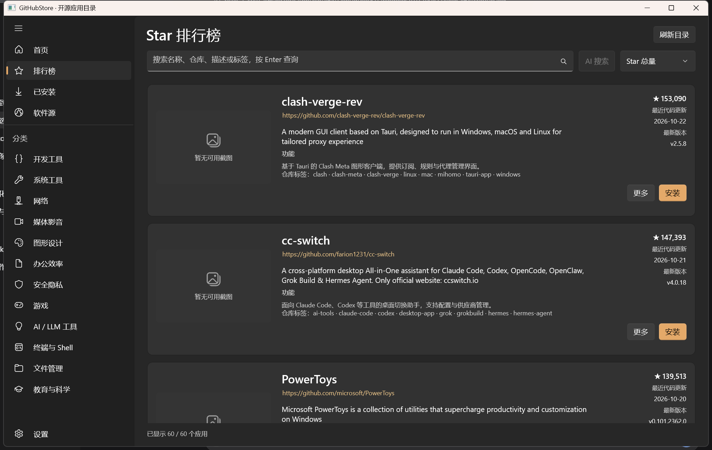
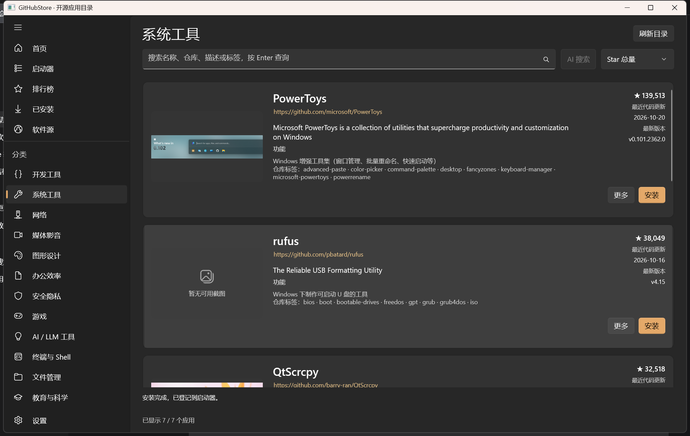
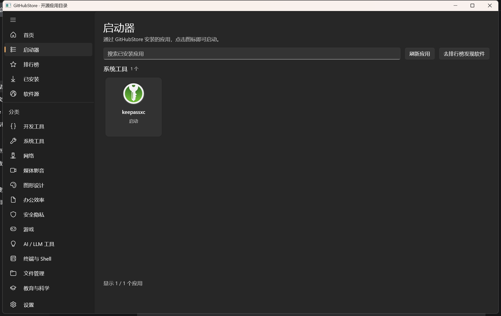

# GitHubStore

Windows GitHub 软件目录与管理客户端，使用 **C# / .NET 8 + WinUI 3**。当前处于开发阶段：已支持软件目录同步、README AI 摘要、资产下载、首次安装和按分类启动已安装应用；升级与回滚尚未实现。

> 文档核对日期：2026-10-22。功能状态以当前源码的实际调用链和验证结果为准；“有接口、有服务或构建通过”不等于“用户已能使用”。

## 应用截图

### Star 排行榜

浏览软件卡片，查看仓库介绍、Star 数、最近更新时间与最新版本，并按名称、仓库或标签搜索。



### 按分类浏览软件

从侧栏进入系统工具等分类，查看软件功能与截图，选择需要的应用进行安装。



### 应用启动器

通过 GitHubStore 安装并登记的应用会显示在启动器中，可按分类查看、搜索并点击图标启动。



截图为开发阶段的实际界面，软件版本、Star 数与目录内容以运行时为准。

## 当前能做什么

- 浏览真实 GitHub 仓库元数据与 Release，按分类、名称或 Star 浏览、搜索；随包提供 70 款经核验的 Windows 软件，离线即可浏览。
- **单页软件卡片**：在列表中直接查看软件名、仓库地址、介绍、功能、实际截图、Star 数、最近代码更新时间和最新版本；点击卡片打开中文 README 弹窗，可切换原文、取消和重新生成译文。截图缺失时明确显示占位，下载、安装及 AI 工具收纳在“更多”中。
- 每款软件显示**推荐来源**与**核验范围**；来源只说明“被推荐过”，不代表安全认证。入库与被拒原因见 [软件库与来源核验](docs/CURATION.md)。
- 在“软件源”中预览并添加公开 GitHub 仓库，保存本地缓存；支持刷新、重复检测和从目录移除。
- **同步软件目录库**：在设置中保存 HTTPS JSON 直链，点击“立即同步”，或启用启动后台同步。下载并校验后原子更新本地目录；保留手动仓库、删除选择及已安装记录。可将独立的 [目录文件](catalog/catalog.json) 上传到仓库托管，使用方式见 [目录库说明](catalog/README.md)。
- 在设置的 **AI 接口**中保存 OpenAI 兼容接口地址、模型和 API 密钥；在软件详情点击 **生成 README 摘要**，支持取消和重新生成。密钥用 Windows 当前用户 DPAPI 保护；浏览目录不会自动调用模型。
- README 原文、AI 摘要和发行说明分别显示，均有 Markdown 渲染与预算；摘要按 README 内容、接口、模型、语言缓存，可离线恢复。
- **AI 软件助手**：显式触发用途搜索、所选安装包解释、发行说明解读、结构化安装失败分析，以及已安装软件问答、对比和卸载影响说明；共用设置中的 AI 接口，支持取消与旧结果隔离。搜索结果只接受真实目录条目。卸载/升级说明不执行对应操作。[AI 使用说明](docs/AI.md)。
- **默认选包策略**：先匹配 Windows 与系统架构，再优先选择绿色版压缩包（显式 `portable`/`standalone` 标记，或与同版本 EXE/MSI 同名的 ZIP/7z，如 `KeePassXC-2.8.0-x64.zip`），其次便携 EXE、普通 EXE，最后 MSI；排除源码、调试符号、校验文件和更新补丁。以“Setup/Install”命名的压缩包属于安装器打包，不作为绿色版。详情中自动推荐并选中，可手动换包。下载失败不会自动换成其他安装包执行。
- **下载缓存**：点击卡片的“更多”，选择安装包后点击“下载所选包（不安装）”，带进度与取消；下载完成只落盘，绝不执行安装包。下载与安装共用同一份持久缓存，安装包在安装后仍会保留；再次下载或安装前会先校验缓存，命中后无需联网重下。设置页“目录设置”显示缓存占用，并可用“清空全部下载缓存”手动删除本程序的全部下载缓存（含未完成的下载），不影响已安装程序。
- **安装所选包**：详情中确认目标目录后，ZIP 安全解压、便携 EXE 复制安装，普通 EXE/MSI 打开安装向导；校验目标目录内的程序入口后才登记到首页。默认安装到 `C:\githubapps\<软件名>`，支持进度、取消及明确失败提示。[安装说明与限制](docs/INSTALLATION.md)。
- **下载组件统一管理**：aria2 随程序内嵌、首次使用离线准备；winget 自动定位 Windows App Installer；Xget 为内置网络加速接线。设置中不再填写 exe 路径或 Xget 地址。
- **首页趋势发现**：程序默认进入“首页”，左右两栏分别展示 [Trendshift](https://trendshift.io/) 每日榜与 [Star History](https://www.star-history.com/) Weekly。每日榜显示排名、趋势评分、当日新增与累计 Star、语言和仓库描述；每周榜显示当周新增 Star。两栏各自加载和失败，显示来源统计周期、缓存/过期状态与来源链接；联网失败时回退到带原始日期的已核实快照并明确标注为缓存，不会把旧数据或累计 Star 当作实时新增量。
- **启动器“我的应用”**：在左侧导航“启动器”中按分类分组显示已登记安装应用的图标网格，支持搜索、刷新与点击启动；分类来自本地目录，已下架或未知的应用归入“其他”，不按目录名猜测。未安装时显示空状态引导，点击“去排行榜发现软件”进入榜单。列表只读取本程序的成功安装登记，不含系统其他软件。
- **已安装页与卸载**：只展示通过本程序安装并成功登记的应用。安装器应用按名称与实际安装目录匹配 Windows 已登记的卸载程序；点击卸载并确认后打开该卸载程序，MSI 由 Windows Installer 处理，机器级安装可能请求管理员授权。旧 MSI 记录缺少产品码时也能匹配系统入口。取消授权或卸载失败保留安装记录；无法唯一匹配时不执行任意命令。本程序自行解包的绿色/便携应用仍可移除受管目录。
- 切换浅色、深色、系统主题以及中文、English、系统语言，并保存偏好。代理密码使用当前 Windows 用户 DPAPI 保护，不以明文写入设置文件。
- 在“软件源”查看 8 个内置 winget 精选条目；精选明确标注为静态清单。

**尚不能宣称完成：** 7z 自动安装、EXE/MSI 逐款真实兼容性验收、winget 下载与安装、P2P、aria2 公网下载与代理完整验收、Xget 真实网络加速、升级/回滚/目录迁移。系统缺少或禁止 Windows App Installer 时，winget 会如实报告不可用。工具来源与许可证见 [第三方声明](src/GitHubStore.App/Assets/Tools/THIRD-PARTY-NOTICES.md)。

## 文档入口

| 文档 | 用途 |
|---|---|
| [架构与功能现状](docs/ARCHITECTURE.md) | 项目分层、实际调用链、功能完成度、持久化边界 |
| [开发计划与优化建议](docs/ROADMAP.md) | 尚未完成的功能、验收边界与后续优先级 |
| [AI 使用说明](docs/AI.md) | 搜索、选包解释、失败诊断、已安装问答及模型接入 |
| [开发与验证](DEVELOPMENT.md) | 环境、构建、测试、启动命令和本轮验证记录 |
| [Windows 安装包](packaging/README.md) | EXE 打包、默认安装目录、运行库与卸载行为 |
| [GitHub 上传与发布](docs/PUBLISHING.md) | 首次提交、远端绑定、自动验证和 Releases 附件 |
| [软件库清单](docs/LIBRARY.md) | 当前全部入库软件的分类、名称与作用 |
| [软件库与来源核验](docs/CURATION.md) | 入库软件、来源、拒绝原因与平台限制 |
| [历史设计归档](docs/archive/README.md) | 原 00–10 设计稿，仅供背景与方案参考 |

新功能状态只维护在“架构与功能现状”；计划只维护在“开发计划与优化建议”。历史设计不作为当前实现证明。

## 下载安装

在 [GitHub Releases](https://github.com/SRW-OG/githubstore/releases/latest) 下载 Windows x64 安装程序及 SHA-256 校验文件。安装包内置 .NET 8 和 Windows App SDK，支持 Windows 10 2004 及以上系统，按当前用户安装，无需管理员权限。当前安装包未配置代码签名。

## 快速开始

环境：Windows、.NET SDK **8.0.425**（见 [global.json](global.json)）；首次还原需要 NuGet。普通开发构建随包分发 Windows App SDK 1.6 运行时，仍依赖系统 .NET 8 Runtime；EXE 安装包同时内置 .NET 运行库。

```powershell
# 在仓库根目录执行。重新构建前先关闭正在运行的应用。
pwsh -File scripts\verify.ps1 -InProcess

# 发布到正常用户应用目录并启动 x64 Debug 应用
pwsh -File scripts\run-desktop.ps1 -Configuration Debug
```

可从 [GitHubStore.sln](GitHubStore.sln) 打开解决方案。常规环境也可以使用 `dotnet test`；同进程测试入口用于此前 VSTest 宿主受限的环境。

## 目录

```text
src/
  GitHubStore.App/             WinUI 视图、ViewModel、组合根，以及当前多数基础设施实现
  GitHubStore.Core/            领域模型、服务接口、GitHub 目录服务、纯逻辑
  GitHubStore.Platform.Win32/  DPI、窗口操作、运行环境信息、DPAPI 凭据保护
 tests/GitHubStore.Core.Tests/ xUnit、分层检查、源码链接的 ViewModel 与纯逻辑测试
scripts/                      构建验证、窗口截图、UI 自动化辅助
docs/                         当前架构与计划；archive/ 保存历史设计
```

默认数据目录为 `%LOCALAPPDATA%\GitHubStore`，可用 `GITHUBSTORE_DATA_DIR` 覆盖。数据文件、缓存与卸载启动日志的具体含义见 [架构与功能现状](docs/ARCHITECTURE.md#数据与日志)。
