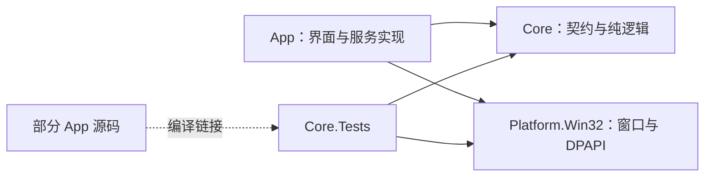

# 架构与功能现状

[项目说明](../README.md) · [安装与缓存](INSTALLATION.md) · [AI 使用](AI.md) · [待办](ROADMAP.md) · [开发与验证](../DEVELOPMENT.md)

## 1. 框架与依赖

应用使用 .NET 8、WinUI 3、MVVM Toolkit 和轻量 DI，运行在单个进程中。安装器、winget 和 aria2 按需启动，没有常驻后台服务或 IPC。

| 项目 | 当前职责 |
|---|---|
| App | 页面、ViewModel、组合根、设置与本地化；下载、安装、注册表卸载、进程、AI、趋势源和 Markdown 渲染实现 |
| Core | 不可变领域模型与服务契约、GitHub 目录、选包规则、命令行拆分等纯逻辑 |
| Platform.Win32 | 运行环境、DPI、窗口操作与 CurrentUser DPAPI 凭据保护 |
| Core.Tests | 引用 Core、Platform.Win32，并链接部分 App 服务、ViewModel 和纯规则源码进行测试 |



Core 不引用 App 或 Platform.Win32；Platform.Win32 当前也不引用 Core。注册表和进程代码仍在 App。

应用为 unpackaged：`WindowsAppSDKSelfContained=true`，随应用携带 Windows App SDK；`SelfContained=false`，仍需机器上的 .NET 8 运行时。项目配置包含 x64、ARM64，实际设备验收范围见 [开发与验证](../DEVELOPMENT.md)。

## 2. 功能完成度

| 能力 | 当前范围 |
|---|---|
| 软件目录 | 内置离线快照、分类、排序、分页与普通字符串搜索；支持手动添加公开 GitHub 仓库、刷新和 HTTPS JSON 目录同步 |
| 软件卡片 | 展示仓库事实与按需加载的实际图片；点击打开中文 README，下载、安装与 AI 助手在详情中操作 |
| 趋势首页 | Trendshift 每日榜和 Star History 每周新增 Star 独立获取；失败显示带原统计日期的缓存或随包快照 |
| 下载与安装 | HTTP、内嵌 aria2、可选 Xget 与代理；持久安装包缓存；ZIP、便携 EXE 与交互式 EXE/MSI 首次安装 |
| 启动器与已安装 | 只读本商店成功安装回执；支持搜索、刷新和启动，安装成功后登记；不展示系统全部软件，不创建桌面 `.lnk` |
| 卸载 | 自行解包的安装按受管目录移除；第三方安装匹配并调用 Windows 注册卸载入口 |
| AI | 中文 README、摘要、用途搜索、选包/版本解释、失败诊断、已安装问答和趋势点评；需用户配置模型 |
| winget | 自动定位 Windows App Installer，保留静态精选来源；尚无 winget 下载或安装流程 |
| 未实现 | 自动升级、回滚、安装目录迁移、安全 7z 自动解压、P2P；后续事项见 [路线图](ROADMAP.md) |

界面存在调用路径不代表每个第三方安装包、网络服务或设备均已验收。

## 3. 当前调用链

### GitHub 元数据与下载

```text
启动 → 设置初始化 → 内置库 + 用户缓存 → 分类 / 目录列表
软件源 → 仓库预览 → 选分类 → 添加 → 原子写缓存
刷新 → GitHub 仓库与 latest release → 成功后更新缓存
详情 → 选资产 → 持有缓存租约 → 校验复用或下载 → 仅下载 / 安装
```

[GitHubCatalogService](../src/GitHubStore.Core/Catalog/GitHubCatalogService.cs) 串行化目录写入，列表读取不可变快照。来源身份是 `SourceInstanceId + PackageId`，仓库键忽略大小写。刷新失败保留旧数据，重启恢复的缓存标为 Stale。

默认选包按架构匹配后排序：绿色压缩包、便携 EXE、EXE、MSI；用户可以改选。推荐规则不等于安装兼容性或发布者可信证明。

### 内置软件库与推荐来源

[内置库](../src/GitHubStore.Core/Catalog/CuratedCatalog.seed.json) 嵌入 Core，由 [加载器](../src/GitHubStore.Core/Catalog/CuratedCatalogLoader.cs) 离线解析。用户缓存和分类优先，内置库补缺；删除内置条目写入 tombstone，显式重新添加才清除。缓存 schema 2 兼容 schema 1，初始化不重写缓存。

每条记录的 `Curation` 保存推荐来源与核验范围。推荐只证明来源提到过该软件；知乎搜索索引摘要、平台正文或视频简介按实际取得方式区分。软件清单见 [软件库](LIBRARY.md)，原始证据和许可限制见 [来源核验](CURATION.md)。

### 远端软件目录库

[同步服务](../src/GitHubStore.Core/Catalog/GitHubCatalogService.LibrarySync.cs) 使用设置中的 `CatalogLibraryUrl`；默认地址为空。支持手动同步和本地展示后的启动后台同步。仅接受 HTTPS JSON，限 30 秒、8 MiB，完整解析校验后才原子更新目录，失败或取消保留旧目录。

远端集合替换已同步/内置集合，手动仓库优先，删除记录保留；安装登记不参与合并。当前每次下载全文件，没有 ETag。格式和维护见 [目录库说明](../catalog/README.md)。

### README 与 AI 摘要

卡片打开中文 README 弹窗后，[ChineseReadmeService](../src/GitHubStore.App/Services/Ai/ChineseReadmeService.cs) 先恢复译文缓存，缺失时获取原文并按段翻译；无配置则显示原文。摘要是独立操作，由 [ReadmeSummaryService](../src/GitHubStore.App/Services/Ai/ReadmeSummaryService.cs) 读取 README 后生成。

正文、翻译和摘要各有缓存身份与预算；模型调用共用 [OpenAiClient](../src/GitHubStore.App/Services/Ai/IAiClient.cs)，使用配置快照、取消、超时与稳定错误码。任务、发送数据和隐私边界见 [AI 使用说明](AI.md)。

### AI 软件助手

[助手服务](../src/GitHubStore.App/Services/Ai/IAiAssistantService.cs) 整理目录、发行资产、版本资料和成功安装登记。用途搜索遍历当前本地目录分页，并验证模型返回的软件 ID；已安装问答按实际 AppId 关联目录。

失败诊断使用安装服务返回的结构化 `InstallDiagnostic`，只保留本次运行的失败事实，不持久保存安装历史。ViewModel 负责取消和旧结果隔离；AI 解释不改变安装、卸载或路径校验规则。

### 趋势首页

[DiscoveryFeedService](../src/GitHubStore.App/Services/Discovery/DiscoveryFeedService.cs) 分别抓取两个来源，[解析器](../src/GitHubStore.App/Services/Discovery/DiscoveryFeedParser.cs) 校验仓库、来源主机、排名与统计区间，不执行源站脚本。累计 Star 不替代新增量，仓库介绍不替代评价。

成功结果写入 `discovery-cache`；失败保留最近可用数据，首次运行可使用带原始统计日期的随包快照，均明确标注缓存/过期。只有点击“AI 点评”才调用模型，榜单加载本身不调用模型。

### 应用启动器

[ManagedAppLauncher](../src/GitHubStore.App/Services/Launcher/ManagedAppLauncher.cs) 读写 `managed-apps.json`，只接受 `Origin.Store`、`State.Done` 且具有真实来源绑定的回执。分类取自目录，缺失时归“其他”。

启动时按安装 ID 重读登记，校验安装根一级子目录内的 EXE、祖先重解析点及文件存在性，再以 `UseShellExecute=false` 启动；图标由 Windows 缩略图 API 读取。清单原子写入，读取失败不以空清单覆盖原文件。

### 下载引擎选择

```text
操作开始 → 设置快照 → PackageCacheService.AcquireAsync
  → 以完整来源 URL 的 SHA-256 定位缓存槽
  → 重新校验大小、上游摘要 / 本地摘要回执
  ├─ 有效：复用文件
  └─ 无效或缺失：保留旧完整文件 → 下载 → 校验 → 写回执
      ├─ HTTP：.part + .part.json、If-Range、范围/长度校验
      ├─ aria2：独立暂存产物 → 校验 → 原子发布
      └─ Xget：仅 GitHub HTTPS /gh/ 路由，失败原址重试一次
```

[PackageCacheService](../src/GitHubStore.App/Services/Download/PackageCacheService.cs) 管理带 `.cache-owner` 标记的 `packages-v1` 命名空间。仅下载与安装共用同一持久路径；租约覆盖下载和安装器使用期间，清理遇到占用会返回忙。无过期或容量自动淘汰，只有设置中的手动清空会删除完整缓存包。具体操作见 [安装与缓存](INSTALLATION.md#下载缓存)。

### 统一工具管理

[ManagedToolManager](../src/GitHubStore.App/Services/Tools/ManagedToolManager.cs) 从内嵌官方 ZIP 离线准备 aria2，核对 ZIP 与指定 EXE 摘要后发布到数据根 `tools/aria2/<版本>/<架构>/`，每次使用前复核。ARM64 当前使用 x86 兼容包。

winget 从当前用户注册的 Windows App Installer 定位，必要时用 WindowsApps 绝对别名；Xget 是网络 provider，无本地程序。旧手动路径/实例字段仅保留数据兼容。组件许可见 [第三方声明](../src/GitHubStore.App/Assets/Tools/THIRD-PARTY-NOTICES.md)。

### 库存与卸载

[ManagedInstalledProgramService](../src/GitHubStore.App/Services/Inventory/ManagedInstalledProgramService.cs) 仍只展示商店成功安装回执；Windows 注册表用于匹配这些回执的卸载入口，不用于扩展为系统软件列表。

[ManagedAppRemovalService](../src/GitHubStore.App/Services/Inventory/ManagedAppRemovalService.cs) 处理本程序自行解包的安装：按安装 ID 重读所有权，严格校验安装根直接子目录并拒绝重解析点，先撤登记再删该目录；部分失败报告残留。

[RegisteredUninstallService](../src/GitHubStore.App/Services/Inventory/RegisteredUninstallService.cs) 从 HKLM/HKCU 的 32/64 位卸载注册项中，按精确安装目录和归一化名称唯一匹配。MSI 用系统 `msiexec /x <注册产品码> /norestart`，保留交互界面；旧 MSI 回执缺产品码时仍可通过注册项匹配。EXE 仅运行经过校验的注册卸载命令。机器级应用请求 UAC；取消或失败保留登记，确认注册项消失后才撤登记。

## 数据与日志

默认数据根为 `%LOCALAPPDATA%\GitHubStore`，可由 `GITHUBSTORE_DATA_DIR` 覆盖。下载缓存根默认是该数据根下的 `cache`，安装根默认是 `C:\githubapps`；三者职责不同。

| 位置 | 含义 |
|---|---|
| 数据根 `settings.json` | 分区保存的设置；代理密码与 AI 密钥经 CurrentUser DPAPI 保护 |
| 数据根 `github-catalog.json` | 目录元数据、手动仓库与删除记录，schema 2 |
| 数据根 `managed-apps.json` | 成功安装回执、目录、入口与来源摘要；不是安全签名 |
| 数据根 `ai-cache/` | README、翻译与摘要缓存，不含密钥 |
| 数据根 `discovery-cache/` | 趋势源最近可用结果与原统计日期 |
| 数据根 `tools/aria2/` | 已校验的内嵌组件，与下载缓存设置分开 |
| 缓存根 `packages-v1/<完整URL的SHA256>/<文件名>` | 完整安装包、本地摘要回执、保留的无效旧包及未完成传输文件 |
| 数据根 `logs/operations.jsonl` | 历史卸载路径的操作记录，不是完整安装历史或库存重建来源 |
| EXE 同级 `startup.log`、用户本地目录 `logs/crash.log` | 启动诊断与异常兜底文本，没有 crash dump |
| `artifacts/` | 本地验证产物，不是正式发布文件 |

## 4. 验证边界

构建、自动测试与真实安装/卸载的具体版本、结果和证据统一记录于 [开发与验证](../DEVELOPMENT.md)，本页不重复测试数量。软件库核验只覆盖所列元数据与来源范围，不等于逐款安装或安全审计。

当前安装只支持首次安装，不覆盖已有目标；外部安装器可忽略预填目录或提前返回，取消等待也不等于终止或回滚。安装成功必须核验目标入口，登记失败保留文件并提示残留。目录迁移、逐款安装器兼容性及各网络服务和架构的验收仍见 [待办](ROADMAP.md)。
