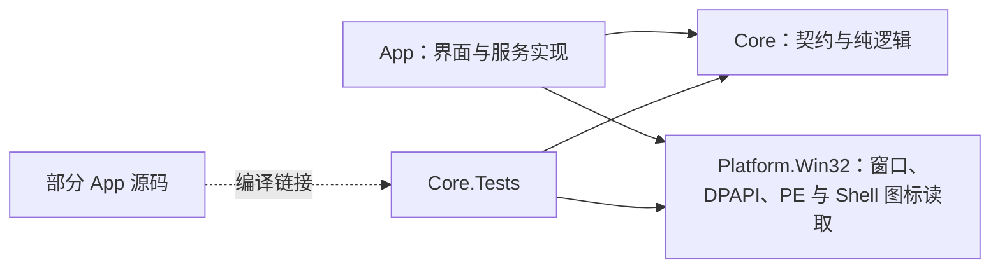

# 架构与功能现状

[项目说明](../README.md) · [启动器使用](LAUNCHER.md) · [安装与缓存](INSTALLATION.md) · [AI 使用](AI.md) · [待办](ROADMAP.md) · [开发与验证](../DEVELOPMENT.md)

核对日期：2026-11-02；本文描述当前工作区实现。公开发布、本地安装包与最新源码的差异见 [产物状态](CHANGELOG.md#当前产物与验证边界)。

## 1. 框架与依赖

应用使用 .NET 8、WinUI 3、MVVM Toolkit 和轻量 DI，运行在单个进程中。安装器、winget 和 aria2 按需启动，没有常驻后台服务或 IPC。

| 项目 | 当前职责 |
|---|---|
| App | 页面、ViewModel、组合根、设置与本地化；下载、安装、注册表卸载、进程、AI、趋势源和 Markdown 渲染实现 |
| Core | 不可变领域模型与服务契约、GitHub 目录、选包规则、命令行拆分等纯逻辑 |
| Platform.Win32 | 运行环境、DPI、窗口操作、CurrentUser DPAPI 凭据保护、只读 PE 图标提取与 Windows Shell 图标读取 |
| Core.Tests | 引用 Core、Platform.Win32，并链接部分 App 服务、ViewModel 和纯规则源码进行测试 |



Core 不引用 App 或 Platform.Win32；Platform.Win32 当前也不引用 Core。注册表和进程代码仍在 App。

应用为 unpackaged：`WindowsAppSDKSelfContained=true`，随应用携带 Windows App SDK；`SelfContained=false`，仍需机器上的 .NET 8 运行时。项目配置包含 x64、ARM64，实际设备验收范围见 [开发与验证](../DEVELOPMENT.md)。

## 2. 功能完成度

| 能力 | 当前范围 |
|---|---|
| 软件目录 | 随包 81 个条目；分类、排序与字符串搜索；排行榜/分类每页 10 条、排行榜在前 60 名快照内分页；支持手动添加公开 GitHub 仓库、刷新和 HTTPS JSON 目录同步 |
| 导航与设置 | 设置固定在侧栏底部并与分类分隔；设置内容区最大宽度 900 DIP、水平居中；原生标题栏跟随实际深浅主题，高对比度回退系统配色 |
| 软件卡片 | 展示仓库事实与按需加载的实际图片；点击打开中文 README，下载、安装与 AI 助手在详情中操作 |
| 趋势首页 | Trendshift 每日榜和 Star History 每周新增 Star 独立获取；失败显示带原统计日期的缓存或随包快照 |
| 下载与安装 | HTTP、内嵌 aria2、可选 Xget 与代理；持久安装包缓存；ZIP、便携 EXE 与交互式 EXE/MSI 首次安装 |
| 启动器与已安装 | 已安装页仍只展示本商店成功安装回执；启动器合并受管入口与用户添加的本地 EXE/`.lnk`，支持分类、搜索、成功启动计数排序、刷新、启动与路径/参数属性；不扫描系统全部软件，不创建桌面 `.lnk` |
| 卸载 | 自行解包的安装按受管目录移除；第三方安装匹配并调用 Windows 注册卸载入口 |
| AI | 中文 README、摘要、用途搜索、选包/版本解释、失败诊断、已安装问答和趋势点评；需用户配置模型 |
| winget | 自动定位 Windows App Installer；静态精选、实时搜索、精确 ID 详情和独立交互式安装，不纳入商店受管安装登记 |
| 升级与回退 | 已安装单列列表按行显示当前/最新版本及卸载、更新、回退；支持绿色/便携安装更新及从来源重装更旧版本，不长期保留本地上一版目录；不覆盖普通 EXE/MSI 安装器应用升级 |
| 未实现 | 安装目录迁移、安全 7z 自动解压、后台静默更新、P2P；后续事项见 [路线图](ROADMAP.md) |

界面存在调用路径不代表每个第三方安装包、网络服务或设备均已验收。

## 3. 当前调用链

### GitHub 元数据与下载

```text
启动 → 设置初始化 → 内置库 + 用户缓存 → 分类 / 目录列表
软件源 → 仓库预览 → 选分类 → 添加 → 原子写缓存
刷新 → GitHub 仓库与 latest release → 成功后更新缓存
详情 → 选资产 → 持有缓存租约 → 校验复用或下载 → 仅下载 / 安装
```

[GitHubCatalogService](../src/GitHubStore.Core/Catalog/GitHubCatalogService.cs) 串行化目录写入，列表读取不可变快照。来源身份是 `SourceInstanceId + PackageId`，仓库键忽略大小写。刷新失败保留旧数据，重启恢复的缓存标为 Stale。

[添加仓库对话框](../src/GitHubStore.App/Views/AddRepositoryDialog.xaml) 使用整行强调色“获取预览”按钮；先预览，再展示发行包、分类和规则确认，不把此仓库添加流程与本地启动器“手动添加”混为一谈。[CatalogViewModel](../src/GitHubStore.App/ViewModels/CatalogViewModel.cs) 在排行榜/分类中使用 `PageSize=10`，支持上一页、下一页与页码；切换页面、分类、搜索条件或排序会重置页码。分类按 offset/limit 查询，普通目录列表保留加载更多，趋势首页的来源榜单不受此分页控制。

默认选包按架构匹配后排序：绿色压缩包、便携 EXE、EXE、MSI；用户可以改选。推荐规则不等于安装兼容性或发布者可信证明。

### 内置软件库与推荐来源

[内置库](../src/GitHubStore.Core/Catalog/CuratedCatalog.seed.json) 嵌入 Core，由 [加载器](../src/GitHubStore.Core/Catalog/CuratedCatalogLoader.cs) 离线解析。用户缓存和分类优先，内置库补缺；删除内置条目写入 tombstone，显式重新添加才清除。缓存 schema 2 兼容 schema 1，初始化不重写缓存。

每条记录的 `Curation` 保存推荐来源与核验范围。推荐只证明来源提到过该软件；知乎搜索索引摘要、平台正文或视频简介按实际取得方式区分。软件清单见 [软件库](LIBRARY.md)，原始证据和许可限制见 [来源核验](CURATION.md)。

### 远端软件目录库

[同步服务](../src/GitHubStore.Core/Catalog/GitHubCatalogService.LibrarySync.cs) 使用设置中的 `CatalogLibraryUrl`；[默认设置](../src/GitHubStore.App/Services/Preferences/AppPreferences.cs) 指向本仓库 `catalog/catalog.json` 的 HTTPS Raw 地址，并默认开启启动后台同步。支持手动同步和本地展示后的后台同步；用户明确清空并保存地址后停止同步，不把主动退出恢复成默认地址。仅接受 HTTPS JSON，限 30 秒、8 MiB，完整解析校验后才原子更新目录，失败或取消保留旧目录。

远端集合替换已同步/内置集合，删除记录保留；安装登记不参与合并。手动条目分两种处理：远端库未收录时整条保留；远端库已收录同一仓库时合并为一条并以远端条目为准（仓库元数据、策展说明、分类归属与策略都取远端，首次合并保留用户的描述覆盖与多分类选择；之后再次同步采用远端内容），手动标记随即取消，同步结果用 `MergedManualCount` 报告合并数量。当前每次下载全文件，没有 ETag。格式和维护见 [目录库说明](../catalog/README.md)。

### README 与 AI 摘要

卡片打开中文 README 弹窗后，[ChineseReadmeService](../src/GitHubStore.App/Services/Ai/ChineseReadmeService.cs) 先恢复译文缓存，缺失时获取原文并按段翻译；无配置则显示原文。摘要是独立操作，由 [ReadmeSummaryService](../src/GitHubStore.App/Services/Ai/ReadmeSummaryService.cs) 读取 README 后生成。

正文、翻译和摘要各有缓存身份与预算；模型调用共用 [OpenAiClient](../src/GitHubStore.App/Services/Ai/IAiClient.cs)，使用配置快照、取消、超时与稳定错误码。任务、发送数据和隐私边界见 [AI 使用说明](AI.md)。

### AI 软件助手

[助手服务](../src/GitHubStore.App/Services/Ai/IAiAssistantService.cs) 整理目录、发行资产、版本资料和成功安装登记。用途搜索遍历当前本地目录分页，并验证模型返回的软件 ID；已安装问答按实际 AppId 关联目录。

失败诊断使用安装服务返回的结构化 `InstallDiagnostic`，只保留本次运行的失败事实，不持久保存安装历史。ViewModel 负责取消和旧结果隔离；AI 解释不改变安装、卸载或路径校验规则。

### 趋势首页

[DiscoveryFeedService](../src/GitHubStore.App/Services/Discovery/DiscoveryFeedService.cs) 分别抓取两个来源，[解析器](../src/GitHubStore.App/Services/Discovery/DiscoveryFeedParser.cs) 校验仓库、来源主机、排名与统计区间，不执行源站脚本。累计 Star 不替代新增量，仓库介绍不替代评价。

成功结果写入 `discovery-cache`；失败保留最近可用数据，首次运行可使用带原始统计日期的随包快照，均明确标注缓存/过期。只有点击“AI 点评”才调用模型，榜单加载本身不调用模型。

### 应用启动器

[ManagedAppLauncher](../src/GitHubStore.App/Services/Launcher/ManagedAppLauncher.cs) 读写 `managed-apps.json`，只接受 `Origin.Store`、`State.Done` 且具有真实来源绑定的安装回执；安装成功后登记并通知启动器刷新。[IManualAppLauncher](../src/GitHubStore.Core/Abstractions/ManualLauncherContracts.cs) / [ManualAppLauncher](../src/GitHubStore.App/Services/Launcher/ManualAppLauncher.cs) 独立读写 `manual-launcher.json`，仅登记用户选择的本地 EXE 或 `.lnk`。手动入口不成为安装回执、不授权更新或卸载；“移除”只撤入口，保留程序文件。两类入口均按保存的 ID 重读目标后启动，不使用界面快照中的任意路径。

受管入口启动前校验安装根一级子目录内的 EXE、祖先重解析点及文件存在性；默认以 `UseShellExecute=false` 启动，工作目录为 EXE 所在目录。默认启动链观察 4 秒：观察期内非零退出返回失败；零退出允许单实例转交；仍存活则报告已启动。这只覆盖短期异常退出，不证明应用已完成初始化或之后持续运行。手动入口拒绝 UNC、非本地绝对路径、重解析点与不支持的文件类型，启动时检查可用性，通过 ShellExecute 启动；旧 `.lnk` 可继续交由 Shell 使用其目标与工作目录。带参数、自定义工作目录或提权的受管入口仍按回执固定目标，但改用 `UseShellExecute=true` 的选项启动链；提权使用 `runas`，UAC 取消返回取消结果。手动及受管选项启动链成功不等于通过受管默认启动链的 4 秒观察。参数直接交给目标程序，不经过 `cmd`。界面在启动期间阻止重叠点击。

[LauncherProgramResolver](../src/GitHubStore.App/Services/Launcher/LauncherProgramResolver.cs) 把添加或重新选择的 EXE/`.lnk` 转为程序路径与参数：EXE 原样返回，快捷方式通过独立 STA 线程上的 `IShellLinkW.GetPath` / `GetArguments` 读取，不执行快捷方式，也不调用可能搜索目标或弹窗的 `Resolve`。嵌套快捷方式最多读取 8 层，拒绝循环、失效或不安全目标；参数按内层到外层顺序合并。新增手动项以及简化属性保存调用 `AddProgramAsync` / `UpdateProgramAsync`，将路径和参数在同一份 `manual-launcher.json` 中原子保存，写入失败保留原路径和原参数。重复目标路径忽略大小写，添加时保留既有配置，编辑时拒绝与其他入口重复。

手动记录的 `Arguments` 可为 null：旧记录缺省或 null 时才从 `launcher-customizations.json` 的旧参数取值；显式空字符串表示清空参数，重载后也不会恢复旧值。旧 `.lnk` 进入属性框时先解析，保存后转换为目标 EXE 路径与合并参数，保留入口 ID、名称、分类、添加时间和计数。取消属性编辑不会迁移记录。清单采用串行读改写与临时文件原子替换，损坏或不可读清单不会被空清单覆盖。手动清单与自定义清单均使用 schema 1、各限 1 MiB；手动入口最多 512 条，自定义配置最多 4096 条，参数最多 8192 字符。

[LauncherCustomizationStore](../src/GitHubStore.App/Services/Launcher/LauncherCustomizationStore.cs) 将成功启动计数、受管入口的显示/分类覆盖及兼容启动选项保存在 `launcher-customizations.json`，不改安装回执或程序文件。[LauncherViewModel](../src/GitHubStore.App/ViewModels/LauncherViewModel.cs) 以 `(IsManual, EntryId)` 即“来源 + ID”隔离自定义配置、计数和热键，手动与受管同 ID 不串数据。只有服务返回 `Started=true` 才累计计数，失败与取消不累计；计数保存失败会提示，刷新中的旧快照不会覆盖刚完成的计数。分类优先依目录顺序展示，受管分类来自目录并兼容旧覆盖，手动分类来自添加时的记录，缺失归“其他”；组内按成功启动次数降序，再按名称、来源与 ID 稳定排序。搜索同时匹配名称与受管包 ID / 手动路径。

[当前界面](../src/GitHubStore.App/Views/LauncherView.xaml) 使用 128×128 DIP 方卡，显示图标和名称；Store 入口使用主题默认配色，手动入口用青色区分，旧自定义颜色仍优先生效。点击方卡或右键“启动”均走同一启动链；右键“属性”当前只展示程序路径与参数，手动路径可编辑或重新浏览 EXE/`.lnk`，受管路径只读，参数可编辑。添加入口仍可选择名称、分类并确认解析后的路径和参数，支持文件选择与拖放。名称、分类、自定义图标、颜色、工作目录、提权、热键和备注不再作为属性框中的可编辑字段，已有配置继续兼容保留；图标/颜色继续显示，工作目录、提权和参数继续参与启动，备注仍保存在兼容数据中。

[LauncherHotkeyRegistry](../src/GitHubStore.App/Services/Launcher/LauncherHotkeyRegistry.cs) 继续为旧热键配置注册主窗口 `WM_HOTKEY`，使用 `MOD_NOREPEAT`，按来源 + ID 触发同一启动链。冲突或原生注册失败保留原绑定；条目移除、窗口解绑或进程结束时释放注册，不作为常驻后台服务。

[ExecutableIconReader](../src/GitHubStore.Platform.Win32/Shell/ExecutableIconReader.cs) 使用 `PEReader` 只读本机文件的 `RT_GROUP_ICON`（14）与 `RT_ICON`（3），支持数字/字符串资源名和语言变体；优先 `IDI_ICON1`、`MAINICON`、`APPICON`，再按尺寸、色深、载荷长度选最佳图像，重建单帧 ICO。读取有文件大小、资源大小、帧数和目录条目预算，不加载目标程序集或执行目标程序。[ShellIconReader](../src/GitHubStore.Platform.Win32/Shell/ShellIconReader.cs) 在最多两个并发 STA 工作线程上使用 `IShellItemImageFactory` 读取 Shell 图标（含快捷方式图标位置），使用 `ICONONLY` 避免缩略图处理器，转换为带 alpha 的 BMP 并释放原生位图/COM 资源，不启动或编辑目标。[图标控件](../src/GitHubStore.App/Views/LauncherAppIcon.cs) 先尝试旧自定义图标，EXE 再尝试 PE 内嵌图标，然后依次退回 Shell 图标、Windows 缩略图和本地通用字形；`.lnk` 跳过 PE 提取。控件卸载或目标变化后丢弃旧异步结果。

实际 DevToys EXE 与 DLL 都含原生品牌图标，KeePassXC EXE 的 `IDI_ICON1` 是应用图标、`IDI_KDBX` 是文档图标，已验证真实文件提取。2026-10-25 14:25（Asia/Shanghai），用户真实使用后确认 0.1.14 本轮验收通过，DevToys WebView2 `0x800700AA` 启动崩溃问题已解决，启动器图标显示不再列为待验收。该状态来自用户确认；本次文档更新没有新增代理实机复现、根因结论或修复补丁，也不将图标提取改动认定为崩溃根因修复。

### winget 独立查询与安装

[软件源页面](../src/GitHubStore.App/Views/SourcesView.xaml) 顶部保留 GitHub 仓库添加区，下方是 winget 搜索框及左侧结果、右侧详情。静态精选明确标注为内置条目；选中条目后按精确包 ID 查询实时详情，切换选择时隔离旧请求结果。缺失的说明、许可、发布者或链接不会用猜测值补齐。

[WingetService](../src/GitHubStore.App/Services/Winget/WingetService.cs) 通过统一工具管理器定位 CLI，各参数单独传入进程。详情命令为 `winget show --id <ID> --exact --source winget --accept-source-agreements --disable-interactivity --locale en-US`，限时 30 秒。[详情解析器](../src/GitHubStore.App/Services/Winget/WingetDetailsParser.cs) 要求输出标题中的包 ID 与请求匹配，兼容英文、中文字段及多行描述/发行说明，在安装器区段前停止；`--locale en-US` 选择清单内容语言，不保证 CLI 字段标签变成英文。

用户点击“通过 winget 安装”后执行 `winget install --id <ID> --exact --source winget --accept-source-agreements --accept-package-agreements --interactive --disable-interactivity`。包 ID 先校验；同一应用进程内只允许一个后台安装请求，并发请求直接返回忙。保留原生安装向导，可能请求 UAC；不指定 `--location`、`--scope`、`--force` 或 `--silent`，不强制使用商店安装根，也不写 `managed-apps.json` 或商店安装流水，不复用 `packages-v1` 安装包缓存。

安装进程限时 30 分钟；调用方取消会传播取消异常，[进程执行器](../src/GitHubStore.App/Services/Processes/ProcessRunner.cs) 在取消或超时时尝试终止其拥有的进程树。提权或脱离进程树的安装器可能继续，取消不保证回滚。仅进程正常退出且原始退出码为 `0`、`3010`、`1641` 时报告成功，后两者标记需要重启；其他非零 winget 状态不猜测映射为成功，不自动重启系统。界面提供不定进度状态和完成后的输出，输出清除 ANSI 控制序列并截取最多 8,000 字符；它不是实时日志或百分比进度。

### 下载引擎选择

```text
操作开始 → 设置快照 → PackageCacheService.AcquireAsync
  → 以完整来源 URL 的 SHA-256 定位缓存槽
  → 重新校验大小、上游摘要 / 本地摘要回执
  ├─ 有效：复用文件
  └─ 无效或缺失：保留旧完整文件 → 下载 → 校验 → 写回执
      ├─ HTTP：.part + .part.json、If-Range、范围/长度校验
      ├─ aria2：独立暂存产物 → 校验 → 原子发布
      └─ Xget：仅 GitHub HTTPS /gh/ 路由，失败原址重试一次
```

[PackageCacheService](../src/GitHubStore.App/Services/Download/PackageCacheService.cs) 管理带 `.cache-owner` 标记的 `packages-v1` 命名空间。仅下载与安装共用同一持久路径；租约覆盖下载和安装器使用期间，清理遇到占用会返回忙。无过期或容量自动淘汰，只有设置中的手动清空会删除完整缓存包。具体操作见 [安装与缓存](INSTALLATION.md#下载缓存)。

### 统一工具管理

[ManagedToolManager](../src/GitHubStore.App/Services/Tools/ManagedToolManager.cs) 从内嵌官方 ZIP 离线准备 aria2，核对 ZIP 与指定 EXE 摘要后发布到数据根 `tools/aria2/<版本>/<架构>/`，每次使用前复核。ARM64 当前使用 x86 兼容包。

winget 从当前用户注册的 Windows App Installer 定位，必要时用 WindowsApps 绝对别名；Xget 是网络 provider，无本地程序。旧手动路径/实例字段仅保留数据兼容。组件许可见 [第三方声明](../src/GitHubStore.App/Assets/Tools/THIRD-PARTY-NOTICES.md)。

### 绿色/便携更新与回退

[PortableUpgradeService](../src/GitHubStore.App/Services/Installation/PortableUpgradeService.cs) 只处理本商店自行解包、来源绑定完整的安装，按安装 ID 重读回执后，从对应软件源的真实 release 按发布通道、架构与选包策略查询候选。更新复用持久下载缓存并独立校验资产，解包到同级暂存目录、校验入口，写入恢复 journal 后再切换目录并保留原 InstallId 更新回执。切换中的旧目录仅用于失败或中断恢复；提交成功后清理旧目录，不长期保留一份旧版本备份。未完成操作在启动恢复流程中按 journal 处理；清理失败如实报告可能残留。

用户显式“回退”会从来源中查询比当前版本更旧的最近可用 release，优先复用缓存，否则重新下载，再用同一目录替换流程安装旧版。它不依赖本地备份；来源不可读、没有更旧版本或缺少受支持资产时明确失败。EXE/MSI 外部安装器、`PreservePaths` 保留式更新、目录迁移仍不在此流程支持范围内。

### 库存与卸载

[ManagedInstalledProgramService](../src/GitHubStore.App/Services/Inventory/ManagedInstalledProgramService.cs) 仍只展示商店成功安装回执；Windows 注册表用于匹配这些回执的卸载入口，不用于扩展为系统软件列表。

[ManagedAppRemovalService](../src/GitHubStore.App/Services/Inventory/ManagedAppRemovalService.cs) 处理本程序自行解包的安装：按安装 ID 重读所有权，严格校验安装根直接子目录并拒绝重解析点，先撤登记再删该目录；部分失败报告残留。

[RegisteredUninstallService](../src/GitHubStore.App/Services/Inventory/RegisteredUninstallService.cs) 从 HKLM/HKCU 的 32/64 位卸载注册项中，按精确安装目录和归一化名称唯一匹配。MSI 用系统 `msiexec /x <注册产品码> /norestart`，保留交互界面；旧 MSI 回执缺产品码时仍可通过注册项匹配。EXE 仅运行经过校验的注册卸载命令。机器级应用请求 UAC；取消或失败保留登记，确认注册项消失后才撤登记。

## 数据与日志

默认数据根为 `%LOCALAPPDATA%\GitHubStore`，可由 `GITHUBSTORE_DATA_DIR` 覆盖。下载缓存根默认是该数据根下的 `cache`，安装根默认是 `C:\githubapps`；三者职责不同。

| 位置 | 含义 |
|---|---|
| 数据根 `settings.json` | 分区保存的设置；代理密码与 AI 密钥经 CurrentUser DPAPI 保护 |
| 数据根 `github-catalog.json` | 目录元数据、手动仓库与删除记录，schema 2 |
| 数据根 `managed-apps.json` | 商店成功安装回执、目录、受管入口与来源摘要；不是安全签名，手动入口不写入这里 |
| 数据根 `manual-launcher.json` | 手动启动项的 ID、名称、路径、分类、添加时间与 nullable 参数；路径 + 参数同次原子保存，不授予安装所有权 |
| 数据根 `launcher-customizations.json` | 按来源 + ID 隔离的成功启动计数、受管显示覆盖及旧图标/颜色/启动选项；不修改安装回执 |
| 数据根 `ai-cache/` | README、翻译与摘要缓存，不含密钥 |
| 数据根 `discovery-cache/` | 趋势源最近可用结果与原统计日期 |
| 数据根 `tools/aria2/` | 已校验的内嵌组件，与下载缓存设置分开 |
| 缓存根 `packages-v1/<完整URL的SHA256>/<文件名>` | 完整安装包、本地摘要回执、保留的无效旧包及未完成传输文件 |
| 数据根 `logs/operations.jsonl` | 历史卸载路径的操作记录，不是完整安装历史或库存重建来源 |
| EXE 同级 `startup.log`、用户本地目录 `logs/crash.log` | 启动诊断与异常兜底文本，没有 crash dump |
| `artifacts/` | 本地验证产物，不是正式发布文件 |

## 4. 验证边界

构建、自动测试与真实安装/卸载的具体版本、结果和证据统一记录于 [开发与验证](../DEVELOPMENT.md)。软件库核验只覆盖所列元数据与来源范围，不等于逐款安装或安全审计。

GitHub 包的首次安装不覆盖已有目标；受支持绿色/便携安装已接通显式升级和上一版本回退，使用暂存、目录切换、回执更新与恢复日志，具体支持边界见 [安装说明](INSTALLATION.md#升级与回退绿色便携安装) 和 [优化实施记录](OPTIMIZATION-PROGRESS.md)。该能力不等于所有已安装应用均可自动更新：外部 EXE/MSI 升级、声明 PreservePaths 的保留式升级、目录迁移等仍有限制。外部安装器可忽略预填目录或提前返回，取消等待不等于回滚；GitHub 安装成功仍须核验目标入口，登记失败保留文件并提示残留。

截至 2026-11-02，本次交付版本 v0.1.22 已完成 Release x64 测试项目构建（0 警告、0 错误）、1,908 项完整回归（0 失败、0 跳过），以及客户端自包含 `dotnet publish` / Inno Setup 打包；测试报告为 [release-0.1.22-Release-x64.json](../artifacts/test-results/release-0.1.22-Release-x64.json)。同日 Debug x64 App 与测试项目也均为 0 警告、0 错误、1,908 项测试通过，覆盖真实 Windows 快捷方式中文路径/引号参数/native 读取、路径与参数同清单原子写失败、旧参数清空及重载等。本次文档更新引用已有证据，没有重跑构建或测试。

v0.1.22 自包含发布输出使用隔离数据目录实际启动，PID `18876`、窗口标题“GitHubStore · 开源应用目录”、句柄 `395604`、`Responding=true`，请求正常关闭后退出码 0；证据为 [release-0.1.22-smoke.json](../artifacts/test-results/release-0.1.22-smoke.json)。同日早期开发程序 Build ID `EDD3170783B7ED66`、PID `20024` 也已响应并于 09:44（Asia/Shanghai）正常退出；当时 UI Automation 未读到内部控件，因此本次仍不宣称属性点击验收通过，发布输出启动也不等于安装器安装/卸载全流程验收。安装包大小、摘要与历史版本差异见 [开发与验证](../DEVELOPMENT.md)；本节不提前宣称远端 CI 或正式 Release 成功。

历史 0.1.14 综合验证为 1,750 项测试通过，并从实际 DevToys/KeePassXC 文件提取核对图标。2026-10-25 14:25（Asia/Shanghai），用户确认该轮真实使用验收通过、DevToys 启动崩溃问题已解决；此前的“图标显示待验收、启动故障待调查”状态已关闭。此项依据为用户确认，没有新增代理复现或根因分析。该确认不代表 winget 的超时、UAC 拒绝、取消、全部安装器及跨设备矩阵均已实测，扩展场景仍按 [路线图](ROADMAP.md) 补充。
