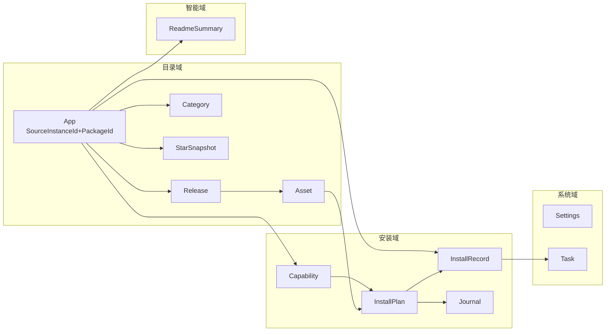
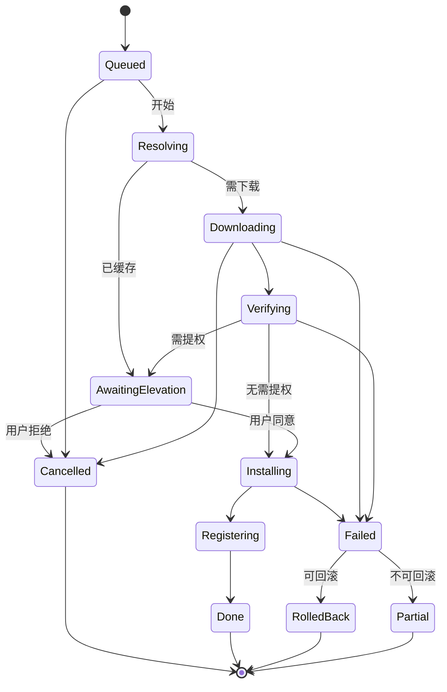

# 01 · 领域模型与数据契约

> 状态：草案 v0.3（设计阶段，未开发）
> **v0.3 变更（2026-10-18）**：架构改为**单一 C# 进程**。本文 §3 的全部类型由 Go 结构体改写为 **C# record / enum**；§4 的服务接口由「Go 接口 + IPC 方法表」改为**同进程 C# 接口**；§8 的事件由「跨 IPC 事件」改为 **C# event / IProgress**；§10 删除协议版本与版本偏斜条款。
> **v0.2 变更**：UI 技术栈定为 WinUI 3；新增 §3.7 校验与信任（发布者变更检测）。
> 本文是**全项目的契约中心**：C# 类型、SQLite schema、模块间接口都在这里定。其它文档引用本文的类型名，不得另起一套。

---

## 本章结论（TL;DR）

1. **一个聚合根 `App`，一条生命周期链 `App → Release → Asset → InstallPlan → InstallRecord`**。所有功能都挂在这条链上，避免出现「商店条目」和「已安装条目」两套互不相识的模型。
2. **`AppId` 使用 `SourceInstanceId + PackageId` 复合身份**，不按显示名、源声明 ID 或 GitHub `owner/repo` 自动合并。GitHub 仓库地址只用于重复提示；原因是自定义源并不共享同一信任域。
3. **「能不能装到哪」是数据不是判断**：`Capability` 由探测得出并持久化，UI 只读它，安装器只信它。这是 FR-4.5 的实现基础。
4. **`Origin` 与 `Fingerprint` 是更新/卸载功能的开关**：只有 `Origin.Store` 才允许商店更新与卸载（FR-5.3）。指纹用于在注册表/文件系统被外部改动后仍能认出「这是我装的」。
5. **`VerifyPolicy` 是校验的唯一裁决**：哈希优先于签名；发布者变更硬失败；产品中**不存在**「忽略校验」开关。UI 只按策略渲染。
6. **数据库是缓存 + 状态机日志，不是真源**：删库能重建目录（联网或内置快照），但**不能重建 `install_records`**——所以 `install_records`、`journal`、`publisher_history` 必须单独备份/导出。
7. **v0.3 的契约设计有两条新原则**：① 类型用 `record` + `init` 表达**不可变性**（`InstallPlan` 尤其重要，它不该在执行期被改）；② 枚举用 `enum` 而非字符串常量（编译器能检查 `switch` 完备性），但落库格式仍固定为 snake_case 字符串以保证**数据可读与向后兼容**。

---

## 1. 领域全景



**读法**：目录域是「GitHub 镜像」，安装域是「本机事实」，两者通过 `App` 关联。`Task`（下载/安装/更新任务）是横切关注点，任何长任务都必须是一个 `Task`，以便统一进度、取消与恢复。

---

## 2. 标识与规范形式

| 类型 | 定义 | 规范形式 | 说明 |
|---|---|---|---|
| `AppId` | 商店应用标识 | `SourceInstanceId + PackageId` | 只在客户端内全局唯一；仓库 URL 不是身份 |
| `ReleaseKey` | 源内版本标识 | `channel + ":" + version` 或源显式稳定键 | 在一个 `PackageId` 内唯一，不依赖 GitHub 数字 ID |
| `InstallerId` | 源内安装器标识 | 源提供的受限字符串 | 在一个 release 内唯一；GitHub asset id 只作上游元数据 |
| `InstallID` | 一次安装实例 | ULID（26 字符，字典序可排序） | 同一 App 可有多次安装（多用户/多路径），故不与 AppId 合一 |
| `TaskID` | 任务标识 | ULID | |
| `SummaryKey` | 摘要缓存键 | `sha256(AppId \| ReleaseKey \| readmeSha \| promptVer \| model)` | 见 docs/05 §12 |
| `WingetID` | winget 包标识 | 原样字符串（如 `Microsoft.PowerToys`） | 大小写敏感，比较时忽略大小写 |

> **结论**：`InstallID` 与 `AppId` 分离是刻意的——用户可能把同一个软件装两份（便携 + 安装版），合并会导致卸载时删错。

---

## 3. 核心 C# 类型

> 以下为**设计稿**，字段名即契约。全部为 C# 类型（v0.3 起项目为单一 C# 栈，docs/02 ADR-011）。
> 约定：类型放在 `GitHubStore.Core/Abstractions`；可变性优先用 `record`（值语义、不可变）；集合用 `IReadOnlyList<T>`；时间用 `DateTimeOffset`（UTC）。

### 3.1 目录域

```csharp
namespace GitHubStore.Core.Abstractions;

public readonly record struct SourceInstanceId(Guid Value);
public readonly record struct PackageId(string Value);

/// <summary>全局应用身份；PackageId 只在一个订阅源内唯一。</summary>
public readonly record struct AppId(SourceInstanceId SourceId, PackageId PackageId)
{
    public override string ToString() => $"{SourceId.Value:N}:{PackageId.Value}";
}

public enum SourceTrust { Official, Verified, Unsigned, Invalid }
public enum SourceState { Active, Disabled, Refreshing, Stale, Error, Removed }

public sealed record CatalogSource
{
    public required SourceInstanceId InstanceId { get; init; } // 客户端生成，不接受源覆盖
    public required Uri EntryUrl { get; init; }                 // HTTPS source.json
    public required string DeclaredId { get; init; }            // 仅展示/诊断
    public required string Name { get; init; }
    public SourceTrust Trust { get; init; }
    public SourceState State { get; init; }
    public long ActiveRevision { get; init; }
    public long HighestSeenRevision { get; init; }
    public string? SigningKeyId { get; init; }
    public string? SigningKeyFingerprint { get; init; }
    public DateTimeOffset? LastSuccessAt { get; init; }
    public string? LastError { get; init; }
}

public sealed record App
{
    public required AppId Id { get; init; }
    public required long SourceRevision { get; init; }
    public required string DisplayName { get; init; }
    public required string Owner { get; init; }
    public required string Repo { get; init; }
    public string? Description { get; init; }
    public string? Homepage { get; init; }
    /// <summary>SPDX 表达式，未知为 "NOASSERTION"</summary>
    public string License { get; init; } = "NOASSERTION";
    public string? Language { get; init; }
    public IReadOnlyList<string> Topics { get; init; } = [];
    public int Stars { get; init; }
    public int Forks { get; init; }
    public int OpenIssues { get; init; }
    public bool Archived { get; init; }
    public bool IsTemplate { get; init; }
    public string DefaultBranch { get; init; } = "main";
    public DateTimeOffset PushedAt { get; init; }
    public DateTimeOffset CreatedAt { get; init; }
    public IReadOnlyList<CategoryId> Categories { get; init; } = [];   // 主分类在前
    public CategoryId PrimaryCategory { get; init; }
    /// <summary>是否有 Windows 可安装资产或 winget 包</summary>
    public bool WindowsReady { get; init; }
    public ExcludeReason Excluded { get; init; } = ExcludeReason.None;
    public DateTimeOffset FetchedAt { get; init; }
    /// <summary>派生字段，不落库</summary>
    public bool Stale { get; init; }
}

public enum ExcludeReason
{
    None,
    NoWindowsAsset,   // "no_windows_asset"
    Archived,
    NotAnApp,
    ManualBlacklist,
}

public readonly record struct CategoryId(string Value);

public sealed record Category
{
    public required CategoryId Id { get; init; }
    public required string Name { get; init; }      // 中文名
    public required string NameEn { get; init; }
    public string? Icon { get; init; }              // 内嵌 SVG 资源名
    public CategoryId? ParentId { get; init; }
    public int Order { get; init; }
}

public sealed record Release
{
    public required string Key { get; init; }       // 源内稳定 ReleaseKey
    public required AppId AppId { get; init; }
    public required string TagName { get; init; }
    public string? Name { get; init; }
    public string? Body { get; init; }              // release notes，截断存储
    public bool Prerelease { get; init; }
    public bool Draft { get; init; }
    public DateTimeOffset PublishedAt { get; init; }
    public IReadOnlyList<Asset> Assets { get; init; } = [];
}

public sealed record Asset
{
    public required string InstallerId { get; init; }
    public required string ReleaseKey { get; init; }
    public required string Name { get; init; }
    public long Size { get; init; }
    public string? ContentType { get; init; }
    public required string DownloadUrl { get; init; }   // browser_download_url
    public string? ApiUrl { get; init; }
    /// <summary>形如 "sha256:..."，GitHub 可能为空</summary>
    public string? Digest { get; init; }
    public int DownloadCount { get; init; }
    // 派生字段（探测得出并落库，见 docs/06 §2）
    public AssetKind Kind { get; init; }
    public Arch Arch { get; init; }
    public InstallerKind Installer { get; init; }
}

public enum AssetKind
{
    Unknown, InstallerMsi, InstallerExe, ArchiveZip, Archive7z,
    PortableExe, Checksum, Signature, SourceArchive,
}

public enum Arch { Unknown, Amd64, Arm64, X86 }

public enum InstallerKind
{
    Unknown, Msi, Nsis, Inno, Squirrel, Burn, Msix, Zip, Portable, Winget,
}
```

**读法**：`Asset` 的 `Kind/Arch/Installer` 是**派生字段**，由资产名 + PE 头探测得出（算法见 docs/06 §2）。它们落库，因为探测需要下载字节，不能在渲染列表时做。

### 3.2 能力与安装计划

```csharp
/// <summary>「这个包能怎么装」的事实，由探测得出，UI 只读。</summary>
public sealed record Capability
{
    public required AppId AppId { get; init; }
    public required string ReleaseKey { get; init; }
    public required string InstallerId { get; init; }
    public Channel Channel { get; init; }
    public InstallerKind Installer { get; init; }
    public bool SupportsDefault { get; init; }      // 总能装到「默认位置」
    public bool SupportsCustom { get; init; }       // 能否自定义目录
    public bool SupportsGreen { get; init; }        // 能否绿色安装
    /// <summary>不支持自定义时的原因码，见 §3.6；null = 无限制</summary>
    public ReasonCode? CustomPathReason { get; init; }
    public bool RequiresElevation { get; init; }
    public Scope Scope { get; init; }
    public IReadOnlyList<string> SilentArgs { get; init; } = [];
    /// <summary>如 "/D=%PATH%"、"INSTALLDIR=\"%PATH%\""</summary>
    public string? PathArgTemplate { get; init; }
    public long EstSize { get; init; }              // 预估安装后占用，未知为 0
    public DateTimeOffset ProbedAt { get; init; }
    public Confidence Confidence { get; init; }
}

public enum Channel { Http, Winget }
public enum Scope { User, Machine, Both }
public enum Confidence { Low, High }               // High = 已知安装器类型
public enum Strategy { Default, Custom, Green }

public sealed record SourceBinding
{
    public required SourceInstanceId SourceId { get; init; }
    public required Uri SourceEntryUrl { get; init; }
    public required long SourceRevision { get; init; }
    public required PackageId PackageId { get; init; }
    public required string InstallerId { get; init; }
    public Uri? ArtifactUrl { get; init; }             // HTTP channel 必填
    public string? ArtifactSha256 { get; init; }       // HTTP channel 必填
    public string? WingetPackageId { get; init; }      // Winget channel 必填
    public string? WingetVersion { get; init; }        // Winget channel 必填
}
// SourceBinding 与 InstallPlan.Channel 共同校验互斥字段；两类都永久保留原来源和 installerId。

public sealed record InstallPlan
{
    public required string PlanId { get; init; }
    public required AppId AppId { get; init; }
    public required SourceBinding Source { get; init; }
    public required string ReleaseKey { get; init; }
    public required string InstallerId { get; init; }
    public Channel Channel { get; init; }
    public Strategy Strategy { get; init; }
    /// <summary>空 = 使用安装器默认</summary>
    public string? TargetDir { get; init; }
    public Scope Scope { get; init; }
    public bool Elevate { get; init; }
    public IReadOnlyList<InstallStep> Steps { get; init; } = [];
    public long EstBytes { get; init; }
    public DateTimeOffset CreatedAt { get; init; }
}

public sealed record InstallStep
{
    public int Index { get; init; }
    public StepKind Kind { get; init; }             // Download|Verify|Run|Extract|Shortcut|Register
    public string? Command { get; init; }
    public IReadOnlyList<string> Args { get; init; } = [];
    public string? WorkDir { get; init; }
    public TimeSpan Timeout { get; init; }
    public bool Optional { get; init; }
}

public enum StepKind { Download, Verify, Run, Extract, Shortcut, Register }
```

**读法**：`InstallPlan` 是**不可变的执行计划**（`record` + `init` 从语言层面保证），先生成、再展示给用户确认、再执行。执行器不允许在执行期临时改计划——这是「安装前就知道会发生什么」（FR-4.5）的技术保障。`InstallStep.Command` 只能由客户端内置的类型化安装适配器生成，软件源 JSON 不得直接赋值；参数必须经 `ArgumentList` 逐项传递，不经 shell。

### 3.3 已安装事实

```csharp
public enum Origin { Store, External }

public sealed record InstallRecord
{
    public required string InstallId { get; init; }   // ULID
    public required AppId AppId { get; init; }
    public required SourceBinding Source { get; init; }
    public required string ReleaseKey { get; init; }
    public Origin Origin { get; init; }
    public Channel Channel { get; init; }
    public Strategy Strategy { get; init; }
    public InstallerKind Installer { get; init; }
    public required Version Version { get; init; }     // 见 §3.4
    /// <summary>原始字符串，如 "1.2.3-beta.1"</summary>
    public string? DisplayVersion { get; init; }
    public string? TargetDir { get; init; }
    public string? ExePath { get; init; }
    public string? UninstallString { get; init; }
    public string? QuietUninstallString { get; init; }
    /// <summary>完整注册表路径，用于精确卸载</summary>
    public string? RegistryKey { get; init; }
    /// <summary>MSI ProductCode（GUID）</summary>
    public string? ProductCode { get; init; }
    public string? MsixPackageFamilyName { get; init; }
    public string? WingetId { get; init; }
    public Fingerprint Fingerprint { get; init; } = new();
    public TrustLevel TrustLevel { get; init; }
    public IReadOnlyList<string> Shortcuts { get; init; } = [];
    public DateTimeOffset InstalledAt { get; init; }
    public DateTimeOffset UpdatedAt { get; init; }
    public InstallState State { get; init; }
}

/// <summary>用于「外部改动后仍能认出这是我装的」</summary>
public sealed record Fingerprint
{
    public string? AssetSha256 { get; init; }
    public string? Publisher { get; init; }         // 签名主体
    public string? ProductName { get; init; }
    public AppId? AppId { get; init; }
    /// <summary>绿色安装写入 .githubstore.json 的 UUID</summary>
    public string? Marker { get; init; }
}

public enum InstallState
{
    Queued, Resolving, Downloading, Verifying, AwaitingElevation,
    Installing, Registering, Done, Failed, Cancelled, RolledBack,
    /// <summary>不可回滚的半装状态，需人工介入</summary>
    Partial,
}
```

### 3.4 版本与比较

```csharp
public sealed record Version
{
    public required string Raw { get; init; }
    public VersionScheme Scheme { get; init; }
    public IReadOnlyList<long> Parts { get; init; } = [];   // 归一化数值段
    public string? Pre { get; init; }                        // 预发布标识
}

public enum VersionScheme
{
    Semver,
    Quad,      // 四段数字
    Date,      // 20240115
    Opaque,    // 无法解析，只能相等比较
}

/// <summary>版本比较结果；Comparable=false 表示方案不同无法判定</summary>
public readonly record struct VersionCompare(int Result, bool Comparable);
```

**比较规则**（实现为 `VersionComparer.Compare(a, b)`）：

1. 去除前缀 `v`/`V`、去除 `+build` 元数据；
2. 若两侧均为可解析数字序列，逐段数值比较，缺段补 0；
3. 预发布标识（`-alpha` < `-beta` < `-rc` < 正式）按 SemVer 规则排序；
4. 方案不同（如一侧 `Date` 一侧 `Semver`）→ `Comparable=false`，UI 显示「版本未知，可查看更新」而非「有更新」；
5. `Opaque` 只在字符串不等时提示「版本可能已变化」，不判定为更新。

> **结论**：**宁可漏报更新，不可误报更新**。误报会让用户点「更新」却发现什么都没发生，信任一次性消耗。

### 3.5 摘要

```csharp
public sealed record ReadmeSummary
{
    public required string Key { get; init; }        // SummaryKey，见 §2
    public required AppId AppId { get; init; }
    public required string ReleaseTag { get; init; }
    public required string ReadmeSha { get; init; }
    public required string PromptVer { get; init; }
    public required string Model { get; init; }
    public string? Provider { get; init; }
    /// <summary>≤180 字</summary>
    public required string OneLiner { get; init; }
    public string? WhatItDoes { get; init; }
    public string? WhoFor { get; init; }
    public IReadOnlyList<string> KeyFeatures { get; init; } = [];
    public string? InstallHint { get; init; }
    public IReadOnlyList<string> Requirements { get; init; } = [];
    public IReadOnlyList<string> Caveats { get; init; } = [];
    public CategoryId? CategorySuggestion { get; init; }
    public string? SafetyNote { get; init; }
    public SummaryConfidence Confidence { get; init; }
    /// <summary>启发式模板降级（无 AI / 离线）</summary>
    public bool Degraded { get; init; }
    public DateTimeOffset CreatedAt { get; init; }
    public DateTimeOffset ExpiresAt { get; init; }
    public int InputTokens { get; init; }
    public int OutputTokens { get; init; }
}

public enum SummaryConfidence { Low, Medium, High }
```

### 3.6 原因码（枚举，UI 直接映射文案）

```csharp
/// <summary>
/// 稳定性契约：这些值会落库并跨版本比较，禁止重命名。
/// UI 文案表见 docs/04 §9；新增值必须同时更新 docs/04。
/// </summary>
public enum ReasonCode
{
    InstallerIgnoresLocation,   // "installer_ignores_location" — Squirrel/MSIX 等
    ManifestNoSwitches,         // "manifest_no_switches"
    PortableAlready,            // "portable_already"
    ScopeUserOnly,              // "scope_user_only"
    NeedsElevation,             // "needs_elevation"
    PathNotWritable,            // "path_not_writable"
    PathOnSystemDriveWarn,      // "path_on_system_drive_warn"
    PathNetworkUnsupported,     // "path_network_unsupported"
    PathTooLong,                // "path_too_long"
    PathInUse,                  // "path_in_use"
    DiskInsufficient,           // "disk_insufficient"
    SignatureInvalid,           // "signature_invalid"
    WingetUnavailable,          // "winget_unavailable"
    NoWindowsAsset,             // "no_windows_asset"
}

public static class ReasonCodeExtensions
{
    /// <summary>稳定的线格式/落库格式（snake_case）。UI 不得依赖此字符串，只依赖枚举。</summary>
    public static string ToWire(this ReasonCode r) => r switch
    {
        ReasonCode.InstallerIgnoresLocation => "installer_ignores_location",
        ReasonCode.ManifestNoSwitches       => "manifest_no_switches",
        ReasonCode.PortableAlready          => "portable_already",
        ReasonCode.ScopeUserOnly            => "scope_user_only",
        ReasonCode.NeedsElevation           => "needs_elevation",
        ReasonCode.PathNotWritable          => "path_not_writable",
        ReasonCode.PathOnSystemDriveWarn    => "path_on_system_drive_warn",
        ReasonCode.PathNetworkUnsupported   => "path_network_unsupported",
        ReasonCode.PathTooLong              => "path_too_long",
        ReasonCode.PathInUse                => "path_in_use",
        ReasonCode.DiskInsufficient         => "disk_insufficient",
        ReasonCode.SignatureInvalid         => "signature_invalid",
        ReasonCode.WingetUnavailable        => "winget_unavailable",
        ReasonCode.NoWindowsAsset           => "no_windows_asset",
        _ => throw new ArgumentOutOfRangeException(nameof(r)),
    };
}
```

**读法**：原因码是**UI 与业务层唯一的文案契约**。UI 不得自己拼接「因为安装器不支持」这类字符串，一律查表（docs/04 §9）。
**v0.3 说明**：v0.2 用 `ReasonCode string` 常量，v0.3 改为 `enum` —— 枚举能让编译器检查 `switch` 完备性，而字符串常量不行。落库/日志仍用 `ToWire()` 的 snake_case，保证与历史数据兼容。

### 3.7 校验与信任（供应链投毒检测）

```csharp
/// <summary>记录某应用历史上出现过的签名主体，用于「发布者变更」检测。</summary>
public sealed record PublisherHistory
{
    public required AppId AppId { get; init; }
    /// <summary>Authenticode 签名主体（证书 Subject DN 或规范化名称）</summary>
    public required string Subject { get; init; }
    /// <summary>证书指纹（SHA256），用于精确比对</summary>
    public string Thumbprint { get; init; } = "";
    public DateTimeOffset FirstSeenAt { get; init; }
    public DateTimeOffset LastSeenAt { get; init; }
    public int SeenCount { get; init; } = 1;
    public bool Revoked { get; init; }
    /// <summary>
    /// 表示该主体变更已被运营白名单审核通过（docs/06 §3.2、docs/07 PC-1）。
    /// 注意：只豁免「主体一致性」一项，哈希与签名有效性永不豁免。
    /// </summary>
    public bool ApprovedByWhitelist { get; init; }
    public string? WhitelistReason { get; init; }   // 可展示给用户
    public DateTimeOffset? ReviewedAt { get; init; }
}

/// <summary>安装记录的信任等级，UI 用于渲染不同的警示强度。</summary>
public enum TrustLevel
{
    /// <summary>哈希匹配 + 有效签名 + 主体一致</summary>
    Verified,
    /// <summary>主体变更但已白名单审核</summary>
    Whitelisted,
    /// <summary>哈希匹配但无签名（用户已二次确认）</summary>
    Unsigned,
    /// <summary>上游未提供哈希且无签名（用户已二次确认）</summary>
    Unverified,
}

/// <summary>校验链的最终判定，UI 只读。</summary>
public sealed record VerifyResult
{
    public bool HashOk { get; init; }
    /// <summary>上游是否提供了哈希</summary>
    public bool HashProvided { get; init; }
    public SignatureState SignatureState { get; init; }
    public string? Publisher { get; init; }
    /// <summary>与历史主体不一致 → true（硬失败）</summary>
    public bool PublisherChanged { get; init; }
    public VerifyPolicy Policy { get; init; }
    public string? Detail { get; init; }
    // 允许 hash 不匹配但 Upstream 未提供的区分
    // HashProvided=false && HashOk=false 不等于校验失败，见下表
}

public enum SignatureState
{
    Unknown,               // 未检查
    Valid,                 // 有效且未吊销
    ValidNoChain,          // 有效但链不完整（少见）
    None,                  // 无签名
    Invalid,               // 签名无效
    Revoked,               // 已吊销
    TrustedButUntrustedRoot, // 链到不受信根
}

/// <summary>
/// 校验策略：产品中不存在「跳过校验」分支。
/// 注意：枚举成员刻意不叫 Allow —— docs/08 §9 R2 门禁会断言这一点，
/// 避免有人后来加一个「允许」语义的值。
/// </summary>
public enum VerifyPolicy
{
    Proceed,        // 直接安装
    WarnConfirm,    // 标红 + 强制二次确认
    HardFail,       // 硬失败，无任何继续入口
}
```

**判定矩阵**（与 docs/07 的控制项必须完全一致，任一侧改动需同步）：

| 哈希 | 签名状态 | 发布者 | 策略 |
|---|---|---|---|
| ✅ 匹配 | `Valid` | 与历史一致或无历史 | `Proceed` |
| ✅ 匹配 | `Valid` | **与历史不一致** | `HardFail`（提示「发布者变更」） |
| ✅ 匹配 | `None` | — | `WarnConfirm`（标红 + 强制二次确认） |
| ✅ 匹配 | `Invalid` / `Revoked` | — | `HardFail` |
| ❌ 不匹配 | 任意 | 任意 | `HardFail` |
| — 未提供 | `None` | — | `WarnConfirm` |

> **结论**：`VerifyPolicy` 是**业务层的唯一裁决**，UI 只负责按策略渲染。产品中**不存在**「忽略校验继续安装」的开关——`HardFail` 时 UI 不渲染任何继续按钮（见 docs/07 红线）。
>
> **v0.3 命名说明**：v0.2 的 `PolicyAllow / PolicyWarnConfirm / PolicyHardFail` 在 v0.3 简化为 `VerifyPolicy.Proceed / WarnConfirm / HardFail`。删掉 `Allow` 这个词是刻意的——「允许」听起来像权限，而这里表达的是「流程可以继续」。docs/08 §9 的 R2 门禁会断言 `VerifyPolicy` 中不存在名字含 `Allow`/`Skip`/`Ignore`/`Force` 的成员。

---

## 4. 服务接口（层边界）

> 这些接口是 docs/02 中 M-1..M-14 模块的对外契约，由 DI 注入到 ViewModel。
> **v0.3 变更**：v0.2 中这些是 Go 接口、经 IPC 暴露给 C# UI；v0.3 是**同进程 C# 接口**，直接调用，无序列化、无协议版本。

```csharp
namespace GitHubStore.Core.Abstractions;

// ── M-1 目录 ────────────────────────────────────────────────
public interface ICatalogService
{
    event EventHandler<CatalogUpdatedEventArgs>? CatalogUpdated;
    Task<IReadOnlyList<Category>> ListCategoriesAsync(CancellationToken ct = default);
    Task<CatalogPage> BrowseAsync(CatalogQuery query, CancellationToken ct = default);
    Task<IReadOnlyList<App>> RankAsync(BoardKind board, int limit, CancellationToken ct = default);
    Task<AppDetail> GetAppAsync(AppId id, CancellationToken ct = default);
    Task RefreshAsync(RefreshScope scope, IProgress<RefreshProgress>? progress = null, CancellationToken ct = default);
}

public enum SortKey { Stars, Trending, Updated, Name }
public enum BoardKind { Stars, Trending, New }

public sealed record CatalogQuery
{
    public CategoryId? Category { get; init; }
    public SortKey Sort { get; init; } = SortKey.Stars;
    public int Offset { get; init; }
    public int Limit { get; init; } = 60;
    public bool IncludeArchived { get; init; }
}

public sealed record CatalogPage
{
    public IReadOnlyList<App> Items { get; init; } = [];
    public int Total { get; init; }
    public bool HasMore { get; init; }
}

// 初始框架补充：原设计已引用的刷新与 README 元数据契约。
// 当前仅支持完整刷新；增量刷新后续按源协议扩展。
public enum RefreshScope { All }
public sealed record RefreshProgress
{
    public int Done { get; init; }
    public int Total { get; init; }
    public string? Message { get; init; }
}
public sealed record ReadmeMeta
{
    public string? Sha { get; init; }
    public string? Path { get; init; }
    public string? HtmlUrl { get; init; }
    public DateTimeOffset? FetchedAt { get; init; }
}
public sealed class CatalogUpdatedEventArgs : EventArgs
{
    public required int Count { get; init; }
    public required DateTimeOffset At { get; init; }
}

public sealed record AppDetail
{
    public required App App { get; init; }
    public IReadOnlyList<Release> Releases { get; init; } = [];
    public Capability? Capability { get; init; }         // null = 未探测
    public ReadmeSummary? Summary { get; init; }
    public InstallRecord? Install { get; init; }         // null = 未安装
    public ReadmeMeta ReadmeMeta { get; init; } = new();
    public IReadOnlyList<string> Screenshots { get; init; } = [];
}

// 以下 DTO 只负责反序列化不可信输入；验证通过后才能转换为 App/Release/SourceBinding。
public sealed record SourcePointerDto(
    int SchemaVersion, string Id, string Name, long Revision,
    DateTimeOffset UpdatedAt, SnapshotRefDto Index, SigningDto? Signing);
public sealed record SnapshotRefDto(Uri Url, string Sha256, long Size);
public sealed record SigningDto(string Algorithm, string KeyId, string PublicKey);

public enum ManifestInstallerType { Msi, Inno, Nsis, Msix, ZipPortable, Winget }
public sealed record ManifestInstallerDto(
    string InstallerId, string Architecture, ManifestInstallerType Type,
    Uri? Url, string? Sha256, long? Size,
    string? WingetPackageId, string? WingetVersion,
    Scope Scope, IReadOnlyList<Strategy> Strategies, IReadOnlyList<string> SilentArgs);
// Schema 按 Type 做互斥校验：HTTP 类型要求 Url/Sha256/Size；Winget 要求 WingetPackageId/WingetVersion。

// ── M-15 软件源同步（协议见 docs/10）─────────────────────────
public interface ICatalogSourceService
{
    Task<IReadOnlyList<CatalogSource>> ListAsync(CancellationToken ct = default);
    Task<SourcePreview> PreviewAsync(Uri sourceJsonUrl, CancellationToken ct = default);
    Task<CatalogSource> AddAsync(Uri sourceJsonUrl, SourceTrustDecision trust,
        CancellationToken ct = default);
    Task SetEnabledAsync(SourceInstanceId id, bool enabled, CancellationToken ct = default);
    Task<SourceRefreshResult> RefreshAsync(SourceInstanceId id,
        IProgress<RefreshProgress>? progress = null, CancellationToken ct = default);
    Task RemoveAsync(SourceInstanceId id, CancellationToken ct = default);
}

public sealed record SourcePreview(
    string Name, string DeclaredId, Uri EntryUrl, SourceTrust Trust,
    string? KeyFingerprint, int AppCount, long Revision);
public sealed record SourceTrustDecision(bool AcceptUnsigned, string? AcceptedKeyFingerprint);
public sealed record SourceRefreshResult(
    SourceInstanceId SourceId, long PreviousRevision, long ActiveRevision,
    bool Changed, bool UsedCachedSnapshot, string? Error);

// ── M-2 搜索 ────────────────────────────────────────────────
public interface ISearchService
{
    Task<SearchResult> SearchAsync(string query, SearchOptions options, CancellationToken ct = default);
}

public sealed record SearchOptions
{
    public CategoryId? Category { get; init; }
    public string? Language { get; init; }
    public int MinStars { get; init; }
    public bool IncludeRemote { get; init; }
    public int Limit { get; init; } = 50;
}

public sealed record SearchResult
{
    public IReadOnlyList<App> Items { get; init; } = [];
    public int Total { get; init; }
    public string Source { get; init; } = "local";   // local | github | hybrid
    public TimeSpan Took { get; init; }
    public string? RemoteError { get; init; }
}

// ── M-6 安装 ────────────────────────────────────────────────
public interface IInstallService
{
    Task<Capability> ProbeAsync(AppId appId, FetchOptions options, CancellationToken ct = default);
    /// <summary>生成并持久化待确认计划；不下载、不启动进程、不弹窗。</summary>
    Task<InstallPlan> PlanAsync(PlanRequest request, CancellationToken ct = default);
    /// <summary>执行前会用 planId 复校 Capability 与校验结果，防止调用方绕过。</summary>
    Task<InstallRecord> ExecuteAsync(string planId, IProgress<InstallProgress>? progress, CancellationToken ct = default);
    Task CancelAsync(string taskId);
}

public sealed record PlanRequest
{
    public required AppId AppId { get; init; }
    public required string ReleaseKey { get; init; }
    public required string InstallerId { get; init; }
    public Channel Channel { get; init; }
    public Strategy Strategy { get; init; }
    public string? TargetDir { get; init; }
    public Scope Scope { get; init; }
}

public sealed record InstallProgress
{
    public required string TaskId { get; init; }
    public required InstallState Phase { get; init; }
    public long Done { get; init; }
    public long Total { get; init; }
    public string? Message { get; init; }
}

// ── M-7 已安装 ──────────────────────────────────────────────
public interface IInventoryService
{
    Task<IReadOnlyList<InstalledItem>> ListAsync(CancellationToken ct = default);
    Task RescanAsync(bool force, IProgress<InstallProgress>? progress = null, CancellationToken ct = default);
    Task<IReadOnlyList<UpdateInfo>> CheckUpdatesAsync(IReadOnlyList<AppId> ids, CancellationToken ct = default);
    Task<InstallRecord> UpdateAsync(string installId, IProgress<InstallProgress>? progress = null, CancellationToken ct = default);
    Task UninstallAsync(string installId, UninstallOptions options, CancellationToken ct = default);
}

public enum UpdateState { UpToDate, Available, Unknown, Unavailable }

public sealed record UpdateInfo
{
    public required string InstallId { get; init; }
    public required AppId AppId { get; init; }
    public required Version CurrentVersion { get; init; }
    public Version? LatestVersion { get; init; }
    public UpdateState State { get; init; }
    public bool Comparable { get; init; }
    public string? ReleaseKey { get; init; }
    public string? Notes { get; init; }
    public long SizeBytes { get; init; }
    public DateTimeOffset CheckedAt { get; init; }
}

// ── M-8 摘要 ────────────────────────────────────────────────
public interface ISummaryService
{
    /// <summary>缓存优先</summary>
    Task<ReadmeSummary?> GetAsync(AppId appId, CancellationToken ct = default);
    /// <summary>
    /// 生成摘要；流式增量通过 progress 回调（IProgress 自动 marshal 回 UI 线程）。
    /// v0.3 用 IProgress 替代 v0.2 的 summary.delta 事件 —— 同进程下不需要事件总线。
    /// </summary>
    Task<ReadmeSummary> GenerateAsync(AppId appId,
        IProgress<SummaryChunk>? progress = null, CancellationToken ct = default);
}

public sealed record SummaryChunk
{
    public required AppId AppId { get; init; }
    public required int Seq { get; init; }
    public required string Text { get; init; }
}
```

**读法**：
- `PlanAsync` 不下载、不启动安装器、不弹窗，但会在同一 SQLite 事务中写入一份 `AwaitingConfirmation` 的不可变计划及来源绑定。对同一请求反复调用可产生新计划；未执行草稿在 24 小时后清理。这样 UI 可安全预览，同时 `ExecuteAsync(planId)` 有可信的持久化输入。
- `ExecuteAsync` 只接受 `planId` 而不是整个 `InstallPlan`（v0.3 收紧）——服务层从 journal 按 `planId` 查出计划并**复校** Capability、活动源身份与校验结果，防止某个 ViewModel 构造一个校验已失败或已换源的 plan 直接执行。这是 docs/07 D-13 在单进程下的落地形式。
- 所有方法都接受 `CancellationToken`，且全部 `async`——这是 docs/02 §4.2 线程纪律的前提。

---

## 5. SQLite 数据契约

### 5.1 通用约定

- 引擎：SQLite，`journal_mode=WAL`、`synchronous=NORMAL`、`foreign_keys=ON`、`busy_timeout=5000`。
- 迁移：`schema_migrations(version INTEGER PRIMARY KEY, applied_at TEXT)`，单向升级，禁止降级（降级即提示「数据库版本过新」）。
- 时间统一存 `INTEGER`（Unix 毫秒，UTC）；对外转 `DateTimeOffset`。
- 布尔存 `INTEGER` 0/1。
- 所有文本字段 UTF-8；`TEXT` 长度上限在应用层校验。

### 5.2 表清单

```sql
-- 软件源域（docs/10）
CREATE TABLE catalog_sources (
  instance_id TEXT PRIMARY KEY,             -- 客户端生成的 UUID
  entry_url TEXT NOT NULL UNIQUE,
  declared_id TEXT NOT NULL, name TEXT NOT NULL,
  trust INTEGER NOT NULL, state INTEGER NOT NULL,
  is_enabled INTEGER NOT NULL DEFAULT 1,
  removed_at INTEGER NOT NULL DEFAULT 0,
  active_revision INTEGER NOT NULL DEFAULT 0,
  highest_seen_revision INTEGER NOT NULL DEFAULT 0,
  signing_key_id TEXT NOT NULL DEFAULT '',
  signing_key_fingerprint TEXT NOT NULL DEFAULT '',
  etag TEXT NOT NULL DEFAULT '', last_modified TEXT NOT NULL DEFAULT '',
  last_success_at INTEGER NOT NULL DEFAULT 0,
  last_error TEXT NOT NULL DEFAULT ''
);

CREATE TABLE catalog_snapshots (
  source_instance_id TEXT NOT NULL REFERENCES catalog_sources(instance_id),
  revision INTEGER NOT NULL, index_sha256 TEXT NOT NULL,
  state TEXT NOT NULL,                         -- staging | active | retired
  imported_at INTEGER NOT NULL,
  PRIMARY KEY (source_instance_id, revision)
) WITHOUT ROWID;

-- 目录域
CREATE TABLE apps (
  id            TEXT PRIMARY KEY,          -- AppId 的复合序列化值
  source_instance_id TEXT NOT NULL REFERENCES catalog_sources(instance_id),
  package_id    TEXT NOT NULL,
  source_revision INTEGER NOT NULL,
  display_name  TEXT NOT NULL,
  owner         TEXT NOT NULL,
  repo          TEXT NOT NULL,
  description   TEXT NOT NULL DEFAULT '',
  homepage      TEXT NOT NULL DEFAULT '',
  license       TEXT NOT NULL DEFAULT 'NOASSERTION',
  language      TEXT NOT NULL DEFAULT '',
  stars         INTEGER NOT NULL DEFAULT 0,
  forks         INTEGER NOT NULL DEFAULT 0,
  open_issues   INTEGER NOT NULL DEFAULT 0,
  archived      INTEGER NOT NULL DEFAULT 0,
  default_branch TEXT NOT NULL DEFAULT 'main',
  pushed_at     INTEGER NOT NULL DEFAULT 0,
  created_at    INTEGER NOT NULL DEFAULT 0,
  primary_category TEXT NOT NULL DEFAULT '',
  windows_ready INTEGER NOT NULL DEFAULT 0,
  exclude_reason TEXT NOT NULL DEFAULT '',
  fetched_at    INTEGER NOT NULL DEFAULT 0
);
CREATE UNIQUE INDEX idx_apps_source_package ON apps(source_instance_id, package_id);
CREATE INDEX idx_apps_cat_stars ON apps(primary_category, stars DESC);
CREATE INDEX idx_apps_stars     ON apps(stars DESC);
CREATE INDEX idx_apps_pushed    ON apps(pushed_at DESC);

CREATE TABLE app_topics (
  app_id TEXT NOT NULL REFERENCES apps(id) ON DELETE CASCADE,
  topic  TEXT NOT NULL,
  PRIMARY KEY (app_id, topic)
) WITHOUT ROWID;

CREATE TABLE app_categories (
  app_id TEXT NOT NULL REFERENCES apps(id) ON DELETE CASCADE,
  category_id TEXT NOT NULL REFERENCES categories(id),
  weight REAL NOT NULL DEFAULT 1.0,
  PRIMARY KEY (app_id, category_id)
) WITHOUT ROWID;
CREATE INDEX idx_appcat_cat ON app_categories(category_id);

CREATE TABLE categories (
  id TEXT PRIMARY KEY, name TEXT NOT NULL, name_en TEXT NOT NULL DEFAULT '',
  parent_id TEXT NOT NULL DEFAULT '', icon TEXT NOT NULL DEFAULT '',
  ord INTEGER NOT NULL DEFAULT 0
);

CREATE TABLE releases (
  id TEXT PRIMARY KEY,                 -- AppId + ReleaseKey 的复合序列化值
  app_id TEXT NOT NULL REFERENCES apps(id) ON DELETE CASCADE,
  release_key TEXT NOT NULL, tag_name TEXT NOT NULL,
  name TEXT NOT NULL DEFAULT '', body TEXT NOT NULL DEFAULT '',
  prerelease INTEGER NOT NULL DEFAULT 0, draft INTEGER NOT NULL DEFAULT 0,
  published_at INTEGER NOT NULL DEFAULT 0,
  UNIQUE (app_id, release_key)
);
CREATE INDEX idx_rel_app ON releases(app_id, published_at DESC);

CREATE TABLE assets (
  id TEXT PRIMARY KEY,                 -- release id + InstallerId 的复合序列化值
  release_id TEXT NOT NULL REFERENCES releases(id) ON DELETE CASCADE,
  installer_id TEXT NOT NULL, app_id TEXT NOT NULL,
  name TEXT NOT NULL, size INTEGER NOT NULL DEFAULT 0,
  content_type TEXT NOT NULL DEFAULT '', download_url TEXT NOT NULL,
  digest TEXT NOT NULL DEFAULT '', kind INTEGER NOT NULL DEFAULT 0,
  arch INTEGER NOT NULL DEFAULT 0, installer TEXT NOT NULL DEFAULT 'unknown',
  download_count INTEGER NOT NULL DEFAULT 0,
  UNIQUE (release_id, installer_id)
);
CREATE INDEX idx_asset_rel ON assets(release_id);

CREATE TABLE star_snapshots (
  app_id TEXT NOT NULL, day INTEGER NOT NULL, stars INTEGER NOT NULL,
  PRIMARY KEY (app_id, day)
) WITHOUT ROWID;

CREATE TABLE capabilities (
  app_id TEXT NOT NULL, release_key TEXT NOT NULL, installer_id TEXT NOT NULL,
  channel INTEGER NOT NULL, installer TEXT NOT NULL,
  supports_default INTEGER NOT NULL, supports_custom INTEGER NOT NULL,
  supports_green INTEGER NOT NULL, custom_path_reason TEXT NOT NULL DEFAULT '',
  requires_elevation INTEGER NOT NULL, scope INTEGER NOT NULL,
  silent_args TEXT NOT NULL DEFAULT '[]', path_arg_template TEXT NOT NULL DEFAULT '',
  est_size INTEGER NOT NULL DEFAULT 0, confidence INTEGER NOT NULL DEFAULT 0,
  probed_at INTEGER NOT NULL DEFAULT 0,
  PRIMARY KEY (app_id, release_key, installer_id, channel)
) WITHOUT ROWID;

-- 安装域（最不能丢的表）
CREATE TABLE install_records (
  install_id TEXT PRIMARY KEY, app_id TEXT NOT NULL,
  source_instance_id TEXT NOT NULL, source_entry_url TEXT NOT NULL,
  source_revision INTEGER NOT NULL, package_id TEXT NOT NULL,
  release_key TEXT NOT NULL DEFAULT '', installer_id TEXT NOT NULL DEFAULT '',
  asset_url TEXT NOT NULL DEFAULT '', artifact_sha256 TEXT NOT NULL DEFAULT '',
  trust_level INTEGER NOT NULL,
  origin INTEGER NOT NULL, channel INTEGER NOT NULL, strategy INTEGER NOT NULL,
  installer TEXT NOT NULL, version_raw TEXT NOT NULL, version_scheme INTEGER NOT NULL,
  display_version TEXT NOT NULL DEFAULT '', target_dir TEXT NOT NULL DEFAULT '',
  exe_path TEXT NOT NULL DEFAULT '', uninstall_string TEXT NOT NULL DEFAULT '',
  quiet_uninstall_string TEXT NOT NULL DEFAULT '', registry_key TEXT NOT NULL DEFAULT '',
  product_code TEXT NOT NULL DEFAULT '', msix_pfn TEXT NOT NULL DEFAULT '',
  winget_id TEXT NOT NULL DEFAULT '', winget_version TEXT NOT NULL DEFAULT '',
  fingerprint TEXT NOT NULL DEFAULT '{}',
  shortcuts TEXT NOT NULL DEFAULT '[]', installed_at INTEGER NOT NULL,
  updated_at INTEGER NOT NULL, state INTEGER NOT NULL
);
CREATE INDEX idx_inst_app ON install_records(app_id);

CREATE TABLE journal (
  seq INTEGER PRIMARY KEY AUTOINCREMENT, install_id TEXT NOT NULL,
  ts INTEGER NOT NULL, phase TEXT NOT NULL, payload TEXT NOT NULL DEFAULT '{}',
  kind TEXT NOT NULL DEFAULT 'phase'  -- phase | confirmation | whitelist_hit（v0.2 新增）
);
CREATE INDEX idx_journal_inst ON journal(install_id, seq);

-- 智能域
CREATE TABLE summaries (
  key TEXT PRIMARY KEY, app_id TEXT NOT NULL, release_key TEXT NOT NULL DEFAULT '',
  readme_sha TEXT NOT NULL DEFAULT '', prompt_ver TEXT NOT NULL DEFAULT '',
  model TEXT NOT NULL DEFAULT '', provider TEXT NOT NULL DEFAULT '',
  payload TEXT NOT NULL, degraded INTEGER NOT NULL DEFAULT 0,
  created_at INTEGER NOT NULL, expires_at INTEGER NOT NULL,
  input_tokens INTEGER NOT NULL DEFAULT 0, output_tokens INTEGER NOT NULL DEFAULT 0
);
CREATE INDEX idx_sum_app ON summaries(app_id, created_at DESC);

-- 系统域
CREATE TABLE settings (k TEXT PRIMARY KEY, v TEXT NOT NULL) WITHOUT ROWID;
CREATE TABLE tasks (
  task_id TEXT PRIMARY KEY, kind TEXT NOT NULL, app_id TEXT NOT NULL DEFAULT '',
  install_id TEXT NOT NULL DEFAULT '', state INTEGER NOT NULL,
  bytes_total INTEGER NOT NULL DEFAULT 0, bytes_done INTEGER NOT NULL DEFAULT 0,
  message TEXT NOT NULL DEFAULT '', created_at INTEGER NOT NULL, updated_at INTEGER NOT NULL
);
CREATE TABLE kv_meta (k TEXT PRIMARY KEY, v TEXT NOT NULL) WITHOUT ROWID;

-- 发布者历史（v0.2 新增，供应链投毒检测）
CREATE TABLE publisher_history (
  app_id      TEXT NOT NULL,
  subject     TEXT NOT NULL,
  thumbprint  TEXT NOT NULL DEFAULT '',
  first_seen  INTEGER NOT NULL,
  last_seen   INTEGER NOT NULL,
  seen_count  INTEGER NOT NULL DEFAULT 1,
  revoked     INTEGER NOT NULL DEFAULT 0,
  approved_by_whitelist INTEGER NOT NULL DEFAULT 0,
  whitelist_reason      TEXT NOT NULL DEFAULT '',
  reviewed_at           INTEGER NOT NULL DEFAULT 0,
  PRIMARY KEY (app_id, subject, thumbprint)
) WITHOUT ROWID;
CREATE INDEX idx_pubhist_app ON publisher_history(app_id, last_seen DESC);

-- 源内 PackageId 重定向；禁止借重定向跨 SourceInstanceId 合并
CREATE TABLE app_id_redirects (
  source_instance_id TEXT NOT NULL REFERENCES catalog_sources(instance_id),
  old_package_id TEXT NOT NULL,
  new_package_id TEXT NOT NULL,
  detected_at INTEGER NOT NULL,
  source TEXT NOT NULL DEFAULT 'manifest', -- manifest | api | manual
  PRIMARY KEY (source_instance_id, old_package_id)
) WITHOUT ROWID;
CREATE INDEX idx_redirect_new ON app_id_redirects(source_instance_id, new_package_id);
```

**快照导入不直接逐行修改活动表。** 下载和 Schema/摘要验证先在缓存暂存目录完成；解析结果写入临时 SQLite 表。全部成功后，在一个写事务中删除该 `SourceInstanceId` 的旧目录行、从临时表批量插入新行、同步更新 FTS，并最后更新 `catalog_sources.active_revision` 与 `catalog_snapshots.state`。提交前读者始终看到旧 revision；任一步失败则回滚。旧快照文件按缓存策略保留，用户请求回滚时重新走同一验证/导入流程，不能只改 revision 数字。

### 5.3 全文检索

```sql
-- 主索引：名称/描述/topics/owner
CREATE VIRTUAL TABLE apps_fts USING fts5(
  app_id UNINDEXED, name, desc, topics, owner,
  tokenize = "unicode61 remove_diacritics 2"
);

-- 中文子串索引：trigram
CREATE VIRTUAL TABLE apps_fts_tri USING fts5(
  app_id UNINDEXED, text, tokenize = 'trigram'
);

-- 拼音别名（全拼 + 首字母），由应用层生成后写入
CREATE TABLE app_aliases (
  app_id TEXT NOT NULL, alias TEXT NOT NULL, kind TEXT NOT NULL,
  PRIMARY KEY (app_id, alias, kind)
) WITHOUT ROWID;
CREATE INDEX idx_alias ON app_aliases(alias);
```

> **待验证（TBD-01-1）**：`Microsoft.Data.Sqlite` 内置的 SQLite 是否编译了 FTS5 与 `trigram` 分词器。若不可用，回退方案为「应用层切词 + 普通表倒排」（见 docs/05 ADR-003）。
>
> **待验证（TBD-01-2）**：`trigram` 分词器对 2 字中文查询（如「截图」）是否可命中；若不可，需在 `app_aliases` 中额外写入 2-gram 别名。

---

## 6. 文件系统契约

```
%LOCALAPPDATA%\GitHubStore\           # 数据根（可迁移，见设置）
├── data\
│   ├── store.db  store.db-wal  store.db-shm
│   └── seed\seed-v1.json.gz           # 内置种子目录快照（内嵌资源，首启导入）
├── cache\
│   ├── http\                          # 条件请求缓存（ETag/Last-Modified）
│   ├── catalogs\<sourceInstanceId>\   # source.json 与不可变快照；staging/active 分离
│   ├── readme\                        # README 原文（按 sha 命名）
│   └── icons\                         # 图标缓存（按 AppId 哈希 + 尺寸）
├── downloads\                         # 下载暂存，完成后可清理
├── installs\                          # 绿色安装默认根（可改）
│   └── <source-short>\<package-slug>\
│       ├── .githubstore.json          # 绿色安装清单（含 SourceBinding + Marker）
│       └── <程序文件>
├── logs\
│   ├── app-YYYYMMDD.log               # 按日滚动，保留 7 天，单文件 ≤5MB
│   └── install-<installID>.log        # 安装器输出
└── run\
    └── instance.lock                  # 单实例互斥
```

绿色安装清单 `.githubstore.json`：

```json
{
  "schema": 1,
  "marker": "01JABCDEF...",
  "sourceInstanceId": "7f1c0f6c-1a1f-4a37-9b0f-2f2c8b1a9d33",
  "packageId": "example.app",
  "sourceRevision": 184,
  "releaseKey": "stable:1.2.3",
  "version": "1.2.3",
  "installId": "01J...",
  "installedAt": "2026-10-18T10:00:00Z",
  "source": {
    "channel": "http",
    "installerId": "win-x64-exe",
    "assetUrl": "https://example.invalid/Foo-1.2.3-setup.exe",
    "sha256": "..."
  },
  "shortcuts": ["%APPDATA%\\Microsoft\\Windows\\Start Menu\\Programs\\Foo.lnk"]
}
```

> **结论**：绿色安装的「卸载」完全依赖这个清单。若用户手删了清单但留了目录，商店无法认领——此时降级为「检测到疑似残留目录」并提示，绝不自动删除（见 docs/06 §8）。

---

## 7. 状态机（安装）



**不变量**（必须由实现保证，并写进单测）：

1. `Downloading` 之后进入 `Failed` 时必须保留 `.part` 文件与已校验分片，以支持续传。
2. `Installing` 阶段**不可直接取消**（安装器进程可能已写注册表）；取消请求标记为 `cancel-requested`，安装器返回后按结果决定 → `Done` 或 `RolledBack`。
3. 任一状态迁移必须先写 `journal` 再执行动作（write-ahead），保证崩溃后能判断「做到哪一步」。
4. `Partial` 状态必须能被 UI 高亮，并提供「打开目录 / 强制卸载 / 标记为已解决」三个出口。

---

## 8. 事件（C# 事件，进程内）

> **v0.3 变更**：v0.2 的「跨 IPC 事件」全部作废。单进程下用 **C# `event`**，或对流式数据直接用 `IProgress<T>`。
> **不再需要**：协议版本、序号跳号检测、重连重放、节流以节省管道带宽。**仍然需要**：节流（因为 UI 线程每帧预算有限）、退订（否则内存泄漏）。

| 事件 | 载荷 | 订阅者 | 节流 |
|---|---|---|---|
| `ICatalogService.CatalogUpdated` | `CatalogUpdatedEventArgs { int Count, DateTimeOffset At }` | 列表刷新 | 无 |
| `IInstallService.ProgressChanged` | `InstallProgress` | 进度条、托盘徽标 | **≤20 次/秒**（同阶段只留最新值；阶段切换立即 flush） |
| `IInstallService.TaskFinished` | `TaskFinishedEventArgs { string TaskId, bool Ok, AppError? Error }` | 通知、更新中心 | 无 |
| `IInventoryService.InstallCompleted` | `{ string InstallId, AppId AppId }` | 库存刷新、推荐去重 | 无 |
| `IInventoryService.UpdateFound` | `{ int Count }` | 托盘徽标 | 无 |
| `ISettingsService.SettingsChanged` | `{ IReadOnlyList<string> Keys }` | 各处生效 | 无 |

**流式摘要不用事件**：`ISummaryService.GenerateAsync(..., IProgress<SummaryChunk> progress, ...)`。理由：流式数据有明确的「一次调用、多个增量、一个结束」结构，`IProgress<T>` 天然表达这个语义，而事件会引入「谁订阅、何时退订、多个订阅者同时生成怎么办」的问题。

**不变量（v0.3）**：
1. **事件订阅必须可退订**。ViewModel 在 `OnNavigatedFrom`（或 `IDisposable.Dispose`）中必须退订所有事件，否则服务（单例）会持有 ViewModel（瞬态）的引用，导致 ViewModel 永不回收。**这是 WinUI/WPF 项目最常见的内存泄漏源**，docs/04 §13 有具体写法。
2. 事件处理器必须是 `async void`（这是 `event` 签名要求），因此**必须自带 try/catch**，否则异常无法被捕获并会终止进程（docs/02 §4.2 规则 5）。
3. 事件的触发线程不保证是 UI 线程。订阅方若要更新控件，必须自行 `DispatcherQueue.TryEnqueue`，或改用 `IProgress<T>`（它自动 marshal）。

> **结论**：单进程让事件机制回归简单，但**把「跨进程可靠性问题」替换成了「托管内存泄漏问题」**。v0.2 担心的是事件丢失与乱序，v0.3 担心的是 ViewModel 泄漏。这是本次架构变更一个容易被忽视的成本。

---

## 9. 错误契约

统一的错误结构。**v0.3 变更**：不再需要跨边界序列化，仍保留统一结构——因为 UI 需要一致的错误呈现，且服务层需要分类重试。

```csharp
namespace GitHubStore.Core.Abstractions;

public sealed record AppError
{
    /// <summary>稳定机器码，如 "install.signature_invalid"</summary>
    public required string Code { get; init; }
    /// <summary>可空，用于 docs/04 §9 文案查表</summary>
    public ReasonCode? Reason { get; init; }
    /// <summary>面向用户的中文短句</summary>
    public required string Message { get; init; }
    /// <summary>技术细节，折叠展示</summary>
    public string? Detail { get; init; }
    public IReadOnlyList<ErrorAction> Actions { get; init; } = [];
    public bool Retryable { get; init; }
    public string? DocUrl { get; init; }
    /// <summary>原始异常，仅用于日志与崩溃上报，不展示给用户</summary>
    public Exception? Inner { get; init; }
}

public sealed record ErrorAction(string Label, ActionKind Kind, string? Payload = null);

public enum ActionKind { Retry, OpenSettings, OpenUrl, OpenFolder, CopyDetail, ChoosePath }
```

错误码分段：`net.*`、`gh.*`、`verify.*`、`install.*`、`elevate.*`、`inventory.*`、`ai.*`、`db.*`、`internal.*`。

> **实现约定**：服务层抛 `AppException`（继承 `Exception`，内含 `AppError`），而不是到处返回 `Result<T>`。理由：C# 的 `Task` + 异常是惯用组合，返回值方案会让每个调用点都要判空。但 **UI 层必须捕获并转成 `AppError` 呈现**，绝不能让异常冒泡到 `async void`。

---

## 10. 兼容与演进

| 变更 | 策略 |
|---|---|
| 新增字段 | 加列 + 默认值，旧版本忽略 |
| 删除字段 | 先标记 deprecated 一个版本，再迁移 |
| 改语义（如 `Origin` 取值） | 必须 bump `schema_migrations`，并在迁移中回填 |
| 源内 `PackageId` 变更（上游改名/转移） | 源以同 revision 快照内的 `app_id_redirects(source_instance_id, old_package_id → new_package_id)` 声明；只在同一源内迁移，跨源不合并 |
| 导出/导入 | `install_records` + `journal` + `publisher_history` 可导出为 JSON，用于换机迁移（P2） |
| ~~IPC 协议版本~~ **（v0.3 已失效）** | 单进程无协议。改为：**枚举线格式稳定性**——`ReasonCode`/`InstallState`/`VerifyPolicy` 的 `ToWire()` 字符串与整数值一旦发布不可变更，只能新增 |
| ~~UI / Core 版本偏斜~~ **（v0.3 已失效）** | 同一进程，不存在版本偏斜 |

> **待验证（TBD-01-3）**：GitHub 仓库改名后 API 是否返回 `301` 与 `full_name` 变更；重定向表的填充时机（建议在 `GET /repos/{id}` 时校验 `full_name` 与本地 `id` 是否一致）。
>
> **待验证（TBD-01-4）**：`app_id_redirects` 表已在 §5.2 补齐（v0.3），需实现时验证迁移脚本。
>
> **待验证（TBD-01-5）**：`enum` 落库为 `INTEGER` 后，若将来插入新成员，顺序不能变——必须在 docs/08 加一条测试断言「每个枚举的显式数值与文档一致」。

---

## 11. 与其它章节的接口

- **docs/02**：本文 §4 的接口即层边界（`Core/Services`）；模块 `M-x` 编号与接口一一对应。
- **docs/03**：.NET 库选型（`Microsoft.Data.Sqlite`、`System.Text.Json`、`System.Threading.RateLimiting`）需与之对齐；§3.1 的 `App/Asset` 字段可得性依赖 GitHub API 版本。
- **docs/04**：§3.6 原因码 → 文案表；§7 状态机 → 按钮状态映射；§8 事件 → ViewModel 订阅与退订规则。
- **docs/05**：`App`/`Release`/`Asset` 的填充来源与字段可得性；`SummaryKey` 的组成。
- **docs/06**：`Capability` 的探测算法、`InstallPlan.Steps` 的生成规则、`InstallRecord` 的写入时机、`ReasonCode` 的产生位置。
- **docs/07**：`Fingerprint` 与 `AppError.Detail` 的脱敏要求；`VerifyPolicy` 判定矩阵必须与本文 §3.7 完全一致。
