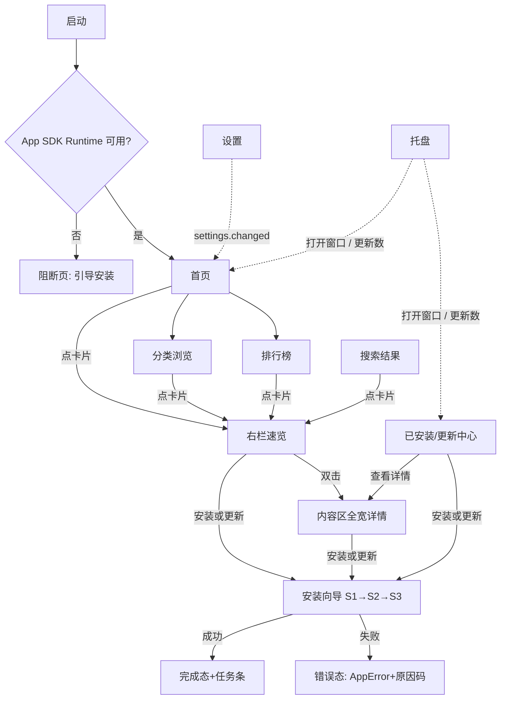
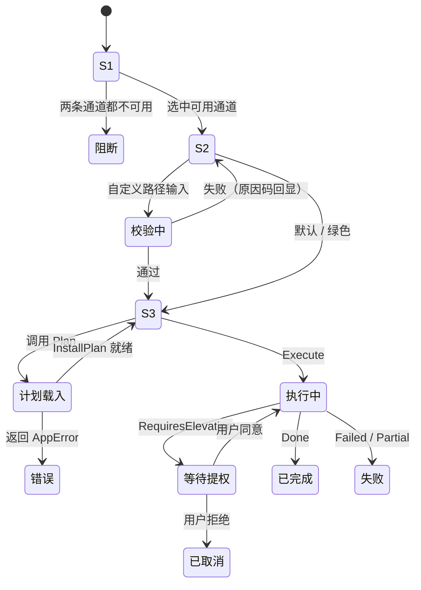

# 04 · 界面与交互设计

> 状态：草案 v0.3（设计阶段，未开发）｜**UI 栈 = WinUI 3（Windows App SDK）+ C#，单进程**
> **v0.3 变更（2026-10-18）**：架构改为**单一 C# 进程**——XAML 做界面、C# 写业务逻辑，**删除 Go 与 IPC**。§13 由「IPC 绑定契约」重写为「DI 服务接口契约」；§14 TBD 中 IPC 相关项替换为 UI 层专项；新增订阅退订与 UI 线程纪律规则。
> 上游契约：docs/00（FR/NFR）、docs/01（类型、`ReasonCode`、状态机、C# 事件）、docs/02（分层与线程模型）
> 本章编号：界面 `UI-x`、待验证 `TBD-04-x`；**不新增** FR / NFR / M 编号
> 口径：控件名按 WinUI 3 / Windows App SDK 命名；涉及版本可用性者标「待验证」，不假设本机已装 SDK

## 本章结论（TL;DR）

1. **单窗口三栏 + 底部任务条，不做多页路由**：`NavigationView` 管一级导航，`Grid` 两列承载列表与详情，避免整页重建（NFR-2.2 <100ms、NFR-1.2）。唯一的模态是安装向导，因为它对应不可撤销的系统写操作。
2. **详情分两级**：右栏「速览」支撑连续逛（不丢左侧上下文），内容区「全宽详情」用 `ScrollViewer` + 多个 `Expander` 承载 README / 资产 / 时间线；两者共用同一 `AppDetailViewModel`，只换模板。
3. **安装向导三步，能力必须前置**：通道 → 策略与路径 → 人话版计划。不可用选项**置灰并显示原因**，绝不静默忽略（FR-4.5）；文案唯一来源是本章 §9。向导用**独立 `Page` + `BreadcrumbBar`**，不用 `ContentDialog`（Step3 的计划与日志超出对话框合理高度）。
4. **已安装三态是派生状态**：`Store` / `Store 被外部升级` / `External` 由 `InstallRecord` + 注册表实测版本推导；外部安装项只有「打开目录 / 官网 / 详情」（FR-5.3）。
5. **资源约束写进 XAML 规范**：`ItemsRepeater`/`GridView` 虚拟化、`x:Load` 延迟子树、`DecodePixelWidth` 按尺寸解码、无无限 `Storyboard`、Mica 在 Win10 回退实色（NFR-1.7、NFR-2.3）。
6. **UI 与业务在同一进程，靠 DI 接口隔离**：ViewModel 通过 `IServiceProvider` 拿到服务接口（docs/01 §4），异步调用 + `IProgress<T>` 回报进度。**没有 IPC、没有序列化、没有协议版本**。新的风险是**订阅未退订导致 ViewModel 泄漏**与**UI 线程被同步等待卡死**，两者都必须在规范里写死（§13.3、§13.5）。
7. **托盘归本进程**（单进程必然结果）：关窗默认隐藏到托盘（驻留 60–110 MB），设置中可切「关窗即退出」。这是 docs/03 §3.5.2 的裁决产物。

**设计原则**：UI-1 本地优先可见（先渲染库内数据再后台刷新，绝不把「空白+转圈」当唯一状态，FR-6.3）；UI-2 能力不猜（只读 `Capability`，FR-4.5）；UI-3 代价前置（体积/占用/提权/写注册表都在「开始安装」前说清，C-6）；UI-4 一屏一主动作；UI-5 失败可执行（必带 `AppError.Actions`）；UI-6 动效只解释状态变化（NFR-2.3）。

## 1. 信息架构

### 1.1 主窗口四区（XAML 布局树）

```text
Window（AppWindow，ExtendsContentIntoTitleBar，SystemBackdrop=Mica/回退实色）
└─ NavigationView（PaneDisplayMode=Left，IsBackButtonVisible=Collapsed）
   ├─ MenuItems：NavigationViewItem 首页/排行榜/已安装（InfoBadge 显示可更新数）
   │            + Separator + NavigationViewItem「分类」→ 内嵌 TreeView（12 类，固定顺序）
   ├─ FooterMenuItems：NavigationViewItem「设置」
   └─ Content → Grid（Row0=内容，Row1=任务条）
      ├─ Row0 → Grid（2 列）
      │  ├─ Col0 → Grid：Row0 CommandBar（排序 ComboBox / 视图 ToggleButton / 筛选）
      │  │                Row1 ScrollViewer → ItemsRepeater 或 GridView（虚拟化列表）
      │  └─ Col1 → Border（宽 360，可拖 320–560）→ ScrollViewer → StackPanel（速览 + 主动作）
      └─ Row1 → Grid（高 0 或 40）→ ItemsRepeater（横向，每 Task 一行 ProgressBar）
```

**四区职责**：左导航=12 类一级分类（docs/05 §6.1）+ 首页/排行榜/已安装/设置，切换只换内容区数据源，`other` 不出现；内容区=卡片网格/列表/排行榜/已安装表/全宽详情/搜索结果，共用一个滚动容器，滚动位置按导航栈条目记忆；详情区=速览+主动作，跟随「最后一次单击的卡片」；任务条=所有长任务的统一入口，空闲 `Visibility=Collapsed`（高度 0），≥1 任务时 40px、可折叠 24px。

**断点**（按有效像素判定，故 100%–250% 缩放下断点不变）：≥1280 三栏右栏 360 / 1100–1279 三栏右栏 320 / 1024–1099 两栏 + 详情改 `SplitView` 抽屉 / <1024 不支持（最小窗口 1024×680）。

> **结论**：任务条是安装状态机（docs/01 §7）的 UI 投影，由 `task.progress` 单事件驱动；它必须常驻但空闲不占位，否则 NFR-1 的空闲内存承诺会被一个无意义面板吃掉。

### 1.2 导航流程



**读法**：只有 `WIZ` 是模态，其余全是同窗口内的区域替换。`BLOCK` 是 Windows App SDK Runtime 缺失的出口（自包含部署可规避，TBD-04-11），必须存在，否则用户看到空白窗口。

### 1.3 为什么是单窗口三栏而不是多页路由

**内存**：多页 `Frame` 导航会保留页面缓存（`NavigationCacheMode`）或反复重建可视化树，三栏只重建内容区数据源。**延迟**：分类切换只换 `ItemsSource` 与模板选择，不重新解析 XAML、不重挂事件（NFR-2.2）。**浏览习惯**：用户「逛」时连续看十几个软件，速览保留列表与滚动位置，后退成本为 0，安装按钮常驻右栏省掉往返。**代价与对策**：1024 宽拥挤 → `SplitView` 抽屉降级；无浏览器历史 → 自建 nav stack（≤20 层，每层 `{view, categoryId, sortKey, scrollOffset}`）；两套布局 → 共用同一 `AppDetailViewModel`。

> **结论**：选三栏的本质是「用一次数据绑定刷新换掉一次可视化树重建」，与 WinUI 的 `x:Bind` + `INotifyPropertyChanged` 同向；若速览在 1100px 以下不可接受，降级为抽屉，而不是改回多页路由。

## 2. 主界面（XAML 结构 + 交互）

### 2.1 首页 / 分类浏览 / 排行榜

```text
首页：ScrollViewer → StackPanel（Spacing=24）
├─ ×4 区块：Grid
│  ├─ Row0：TextBlock「编辑推荐 · 人工推荐」 + HyperlinkButton「查看全部」
│  └─ Row1：ScrollViewer（Horizontal，HorizontalScrollBarVisibility=Hidden）
│           → ItemsRepeater（StackLayout Orientation=Horizontal，Spacing=12）
│              → ItemTemplate：AppCard（144×176）
└─ 区块顺序：编辑推荐 → 热门(Star) → 新星(180 天内) → 最近更新(7 天内)

分类浏览：Grid
├─ Row0：CommandBar（ComboBox「Star 总量 ▾」SortKey 四项 / ToggleButton 网格·列表 / Button 筛选）
└─ Row1：ScrollViewer → ItemsRepeater（UniformGridLayout，MinItemWidth=168，MinItemHeight=196）
                     → ItemTemplate：AppCard

排行榜：Grid
├─ Row0：SelectorBar（Star Top 100 / 趋势 Top 50 / 新星 Top 50）
│        + InfoBar（Informational，不可关闭）「趋势为本地观测值，非 GitHub 官方数据」
├─ Row1：ListView（ItemsStackPanel，行高 64）→ ItemTemplate：Grid
│        { 名次 56 | 图标 48+名称+分类 | Star 右对齐 | 30 天增量 | 安装 Button }
└─ Row2：StackPanel（居中）：上一页 / 「1/2」 / 下一页
```

- `AppCard` = `Grid`{ 48×48 图标 + 名称（`TextTrimming=CharacterEllipsis`）+ 一句话 + `★` 数字 + 分类 + 状态 `InfoBadge` }；横滑用 `ScrollViewer` 原生惯性，不实现自定义手势。列表视图改用 `ListView`（`ItemsStackPanel`，行高 64，`VirtualizationMode=Recycling`）；并列名次显示 `1=`，同并列组共享 2px 左侧强调条。
- **交互**：单击卡片 → 更新右栏速览；双击或 `Enter` → 全宽详情；「查看全部」跳对应榜单/分类；切分类 <100ms、切排序**本地重排不联网**（FR-1.3）、滚到底增量加载（每页 50）。
- **空态**：首页单区块空 → 整块 `Collapsed` + 顶部 `InfoBar`「离线快照较旧」，全空 → 全页空态（§8 S2）；分类空 →「该分类暂无收录」+「查看相邻分类」，筛选后空 →「清除筛选」。

### 2.2 详情 / 已安装 / 设置

```text
详情：ScrollViewer → StackPanel
├─ 概览头：Grid{ 96×96 图标 | 名称+owner/repo | 指标行 ★ ⑂ License Language | 徽标 InfoBadge×≤3 }
├─ ① 安装选项：Grid{ ComboBox 通道 | RadioButtons 三策略 | Button「安装」 }
├─ ② Windows 资产：Expander（IsExpanded=True）→ ListView（文件名/类型/架构/大小/校验）
├─ ③ AI 摘要卡：Border → StackPanel（一句话 / 功能点 / 适用人群 / 注意事项 / 角标「AI 生成」）
├─ ④ README：Expander（IsExpanded=False）→ ScrollViewer（MaxHeight=600）→ RichTextBlock
└─ ⑤ Release 时间线：ItemsRepeater → 每项 = 版本号 + 日期 + 摘要 + 「查看全部」

已安装：Grid
├─ Row0：StackPanel（横向）：统计文本 + Button 检查更新 + Button 批量更新 N
├─ Row1：SelectorBar：全部 / 可更新 / 商店 / 外部 / 需处理
└─ Row2：ListView（虚拟化，行高 64）→ ItemTemplate：Grid
         { 名称 | 当前版本 | 最新版本(↑) | 来源徽标 | 安装位置 | 操作 Button + MenuFlyout }

设置：NavigationView（本页自带二级导航，IsSettingsVisible=False）
├─ MenuItems：通用 / 外观 / 网络与代理 / **软件源** / GitHub 账号 / AI 摘要 / 安装与下载 / 存储与缓存 / 隐私与日志 / 关于
└─ Content → ScrollViewer → StackPanel（每组 = Expander 或 SettingsCard 风格 Border）：
   默认安装根目录 TextBox+「更改…」 / 下载并发·限速 ComboBox×2 / 安装方式与主题 RadioButtons

软件源：ListView
├─ CommandBar：添加源 / 全部刷新
├─ 每行：名称 + 入口域名 + 信任徽标 + 软件数 + revision + 上次成功时间
└─ 每行操作：启用/禁用 / 刷新 / 查看详情 / 移除
```

- 已安装页异常行（`Partial`/`Failed`/`broken`）**置顶** + 红色左边条 + 行首 `FontIcon`；首次扫描 → `Shimmer` 骨架，无数据 →「未检测到已安装软件」+「重新扫描」。设置页无「确定」按钮：改动即时生效，需重启项就地显示 `InfoBar`。
- 详情、搜索结果、安装确认和已安装行均显示软件源徽标。`Official` 只由客户端内置信任表决定；第三方源只能显示“签名已验证”或“未签名”。同仓库多来源提供“查看其他来源”，不得静默合并。
- 添加源采用“输入 HTTPS 地址 → 预览名称/域名/软件数/密钥指纹 → 确认”的对话框。移除源前明确提示“不会卸载已安装软件，但会停止从该源更新”；刷新失败时保留旧缓存并显示错误和“重试”。

### 2.3 六界面的关键元素 / 交互 / 空态

| 界面 | 主要交互 | 空态与降级 |
|---|---|---|
| 首页 | 横滑、单击更新速览、双击进详情、查看全部 | 单区块空 → 折叠并提示；全空 → 全页空态（§8 S2） |
| 分类浏览 | 切分类、切排序（本地）、切视图、筛选 | 分类空 → 相邻分类；筛选空 → 清除筛选 |
| 排行榜 | 切榜、上一页/下一页、点行更新速览 | 无 30 天基线 →「数据积累中」；单榜空 → 回退 Star 榜 |
| 详情 | 展开 README、重新生成摘要、复制路径、切通道、安装 | 无 Windows 资产 →「仅提供源码」+官网；README 失败 →「查看 GitHub 原文」 |
| 已安装 | 检查更新、单条/批量更新、卸载、打开目录、标记已解决 | 扫描中 → `Shimmer`；空 →「未检测到已安装软件」+「重新扫描」 |
| 设置 | 即时保存、恢复默认、导出日志 | 无空态；Token 未配置 → 组内引导卡 |

> **结论**：六界面中只有「设置」不需要空态，其余五处空态都必须给「下一步动作」——空态是产品信号而非占位符（与 docs/05 §8.6 的收录缺口反馈同源）。

## 3. 分类与排名交互

**分类树**：固定入口 3 个（首页/排行榜/已安装，置顶不可折叠）→ 一级 12 类（`dev-tools` `system` `network` `media` `graphics` `office` `security` `games` `ai` `terminal` `files` `science`，右侧显示计数，**顺序固定不按热度重排**）→ 二级预留（`Category.ParentID` 非空时展开，**当前不启用**，细分由标签 chips 承担）→ `other` 不进导航（docs/05 §6.1）。

| 显示名 | 枚举 | 排序依据 | 默认 | 备注 |
|---|---|---|---|---|
| Star 总量 | `SortStars` | `stars DESC` | 是 | 分类页默认 |
| 近 30 天增速 | `SortTrending` | `stars_gained_30d DESC` | 否 | 无基线排末尾显示 `—`，`ToolTip` 说明「观测数据」（docs/05 §7.2） |
| 最近更新 | `SortUpdated` | `pushed_at DESC` | 否 | 反映「还在维护」而非「发版」 |
| 名称 | `SortName` | 本地化排序 | 否 | 中文按拼音、英文按字母、数字按数值 |

| 榜单 | 规模 | 排序键 | 翻页 | 并列处理 |
|---|---|---|---|---|
| Star 榜 `BoardStars` | Top 100 | `(stars, stars_gained_30d, full_name)` | 50/页，2 页 | 前两项相同显示 `1=`；名次按**竞争排名**（1,1,3）不跳号 |
| 趋势榜 `BoardTrending` | Top 50 | 加权分（docs/05 §7.2 因子表） | 单页 | 分数保留 4 位比较，仍相同按 `full_name` 字典序，**不显示并列** |
| 新星榜 `BoardNew` | Top 50 | `stars_gained_30d DESC` | 单页 | 同趋势榜 |

- 排序状态**全局单例**（存 `kv_meta`），切分类时保持；切换时保留**滚动位置百分比**而非绝对像素，避免列表长度变化后跳变。
- 翻页用 keyset 游标（docs/05 §7.1），**不提供跳页**——100 条规模下深翻页无价值，只会诱导错误实现 `OFFSET`；榜单头部必须标注数据来源与时间，是 docs/05 RISK-05-3 的 UI 侧缓解。

> **结论**：排行榜的「并列」不是视觉细节而是**可复现性承诺**——同一份数据两次打开必须给出完全相同的名次，否则用户会认为榜单是编的。

## 4. 详情页分区

| # | 分区 | 默认 | 数据来源 | 关键规则 |
|---|---|---|---|---|
| ① | 概览头 | 常驻吸顶 | `App` + `InstallRecord` | 图标 96、`DisplayName`、`owner/repo`、Star/Fork/License/Language/最近提交；徽标最多 3 个（已安装/可更新/Windows 可用/仅源码/已归档），超出折叠 `+n` |
| ② | 安装选项 | 常驻 | `Capability` | **能力可见化核心区**：通道 `ComboBox` + 三策略 `RadioButtons`；不可用项置灰 + `TextBlock` 原因（§9）；主按钮「安装」/「更新」/「已是最新」 |
| ③ | Windows 资产 | 展开 | `Release.Assets` | 表：文件名/类型/架构/大小/校验；默认只列推荐资产（`Arch=amd64` 且 `Kind≠SourceArchive`），其余折叠「显示全部 n 项」；无资产 →「仅提供源码」（FR-3.2） |
| ④ | AI 摘要卡 | 展开 | `ReadmeSummary` | 一句话 + 功能点（≤6）+ 适用人群 + 注意事项 + `SafetyNote`；角标「AI 生成 · 模型名」或「自动生成（未启用 AI）」；「重新生成」「展开原文对照」 |
| ⑤ | README | **折叠** | 本地缓存原文 | `Expander` 展开后才创建 `RichTextBlock`（配合 `x:Load`）；远程图片一律占位、点击加载（FR-3.3）；代码块 >500 行不做高亮 |
| ⑥ | Release 时间线 | 展开 | `AppDetail.Releases` | 最近 5 个；`Prerelease=true` 折叠进「预发布」组；`Body` 只渲染前 1200 字符 + 「查看全部」 |

- **陈旧度**：`App.Stale` 或 `FetchedAt` 超 6 小时 → 概览头右侧「缓存于 X 小时前」+ 刷新按钮（FR-3.1、FR-6.4）。

| 策略 / 通道 | 可点条件 | 不可点时的表现 |
|---|---|---|
| 默认安装 | `Capability.SupportsDefault` | 置灰 + 紧邻一行原因文本（`CustomPathReason` 查 §9） |
| 自定义路径 | `Capability.SupportsCustom` | 置灰 + 原因；原因文本绑定 `AutomationProperties.HelpText`，**键盘聚焦与读屏都能读到** |
| 绿色安装 | `Capability.SupportsGreen` | 置灰 + 原因；若为 `portable_already` 则**不禁用**而是提示「推荐绿色」 |
| 通道 `winget` / `http` | winget 探测可用 / 存在 Windows 资产 | `ComboBoxItem` 置灰 + `winget_unavailable` / `no_windows_asset` 文案 + 对应替代动作 |

> **结论**：置灰项的**唯一合法形态**是「灰控件 + 紧邻一行原因 + 至少一个替代动作」；只置灰不解释等于静默忽略，直接违反 FR-4.5。注意 WinUI 中禁用控件**默认不可聚焦**，因此原因文本必须与控件同处一个 `AutomationProperties.LabeledBy` 分组，否则读屏用户永远听不到原因。

## 5. 安装向导（三步流，核心）

入口：详情页「安装」、速览「安装」、已安装页「更新」、托盘「更新全部」。形态：**独立 `Page`**（占满内容区，非 `ContentDialog`），顶部 `BreadcrumbBar` 三步 + 底部按钮区；`Esc` 在 Step1/2 返回，**Step3 执行中不响应 `Esc`**。



### 5.1 Step1 · 选通道

| 通道 | 来源 | 需提权 | 路径可控 | 优势 | 劣势 | 默认选中 |
|---|---|---|---|---|---|---|
| HTTP 直下 | GitHub Release 资产（上游官方地址） | 视安装器（`RequiresElevation`） | 是（若 `SupportsCustom`） | 版本最新、路径与绿色可选、可校验 SHA256 | 依赖上游资产命名与安装器行为 | 有 Windows 资产时 |
| winget | winget 源 | 视 manifest（机器级需提权） | 多数不可控 | 静默安装成熟、有官方 manifest | 路径不可选、版本滞后、需 App Installer | 无可用资产时兜底 |

- 卡片式呈现（两个 `RadioButton` + 卡片内容），选中态 2px `AccentFillColorDefaultBrush` 边框；每卡底部固定一行「这条通道会：下载 X MB / 弹出 1 次 UAC / 写入 HKLM」。
- 禁用规则：`winget` 不可用 → 置灰 + `winget_unavailable` +「了解如何安装」；`http` 无资产 → 置灰 + `no_windows_asset` +「打开 Releases」；两条都不可用 → `阻断`（整页「这个应用暂时无法通过商店安装」+ 打开官网 / 打开 Releases / 收藏等待更新）。

### 5.2 Step2 · 选策略与路径

```text
StackPanel
├─ RadioButtons（三项）：默认安装 / 自定义路径 / 绿色安装
├─ Grid（仅「自定义」/「绿色」可见）：TextBox（路径）| Button「选择目录…」→ FolderPicker
│  └─ InfoBar（Warning，承载系统盘/OneDrive 等非阻断警告）
├─ TextBlock：预估占用「安装后约 320 MB（含下载 120 MB）· 可用 42.1 GB」
├─ CheckBox：静默安装（默认勾选，设置可改）
└─ 底部：Button「上一步」 + Button「下一步」（IsEnabled 受校验结果控制）
```

**路径校验（即时反馈，防抖 300ms，仅「自定义」/「绿色」下运行；规则以 docs/06 §4.3 十条为准）**：

| 规则（docs/06 §4.3） | 原因码 | 表现 | 阻断 |
|---|---|---|---|
| 非法字符/保留名/相对路径 | — | `TextBox` 红框 + 下方红字 | 是 |
| 长度超限（>240 警告，>260 且长路径未启用则拒绝） | `path_too_long` | 红字 | 是 |
| UNC / 网络盘 | `path_network_unsupported` | 红字 | 是 |
| 受保护目录 / 用户目录根 / 盘符根 / 可写性探针失败 | `path_not_writable` | 红字（或提示「需管理员权限」） | 是 |
| 目录被占用 / 含他包清单 | `path_in_use` | 红字 | 是 |
| 磁盘空间不足（`free < est×2.5+200MiB`） | `disk_insufficient` | 红字（两个数字都显示） | 是 |
| 位于系统盘 / OneDrive 同步目录 | `path_on_system_drive_warn` / `path_network_unsupported`（复用文案，见 §9 注） | 黄字 `InfoBar` | 否 |
| 仅当前用户安装却选 `Program Files` | `scope_user_only` | 黄字 + 建议 `%LOCALAPPDATA%\Programs` | 否（提交时改 Scope） |

- 绿色安装：目录默认 `%LOCALAPPDATA%\Programs\<App>`（docs/06 §4.5），显示「卸载 = 删除此目录」与「创建快捷方式」`CheckBox`（FR-4.4）。
- 预估占用 = `EstBytes`（为 0 显示「未知，安装后统计」）+ 下载体积，**两者分别显示不做加法混淆**。「下一步」禁用条件：策略不可用 / 路径校验未通过 / 校验进行中。

### 5.3 Step3 · 确认执行

```text
StackPanel
├─ TextBlock「将执行以下步骤（来源：owner/repo v1.4.0 · HTTP 直下）」
├─ ItemsRepeater → 每项 = 序号 + 人话步骤文本（见下表映射）
├─ InfoBar（Warning）「第 3 步将弹出 1 次用户账户控制（UAC）」
├─ InfoBar（Success）「校验失败会中止并删除临时文件，不会留下半装状态」
├─ CheckBox「我了解该软件来自第三方仓库，许可为 MIT，由上游提供」
├─ Expander「技术细节」（默认收起，命令与参数脱敏后展示）
└─ 底部：Button「上一步」 + Button「开始安装」（未勾选许可时 IsEnabled=false）
```

**`InstallStep.Kind` → 人话映射（唯一映射表，UI 不得自造措辞）**：

| `StepKind` | 人话模板 | 展示细节 | 失败后 |
|---|---|---|---|
| `download` | 下载 `<asset.Name>`（`<size>`） | 来源域名、是否断点续传 | 保留 `.part` 可续传（docs/01 §7 不变量 1） |
| `verify` | 校验 SHA256 与数字签名 | 期望哈希前 12 位、发布者 | 硬失败，删临时文件（FR-4.7） |
| `run` | 以静默参数运行安装器 | 安装器类型（MSI/NSIS/Inno…） | 显示退出码与日志尾部（docs/06 §2.5 码表） |
| `extract` | 解压到 `<TargetDir>` | 解压后文件数、是否含顶层目录 | 删除已解压部分 |
| `shortcut` | 创建快捷方式 | 目标位置（开始菜单 / 桌面） | 标记 `Optional`，失败不阻断 |
| `register` | 写入卸载登记 | 注册表位置（只显示 `HKCU`/`HKLM` 层级） | 回滚已执行步骤 |

- 提权提示由 `InstallPlan.Elevate` 或 `RequiresElevation` 驱动；文案固定「将弹出 1 次 UAC」（NFR-4.2、docs/07 §9 D-6），不承诺「不会再次弹」。
- 许可勾选（C-6）按 `AppId` 记忆 30 天，只存 `kv_meta` 的哈希集合，不落明文。
- 执行中：Step3 变进度视图（`ProgressBar`（`resolving` 阶段 `IsIndeterminate`）+ 阶段名 + 速度 + 剩余 + 「查看日志」`Expander` + 取消）。`Installing` 阶段按 docs/01 §7 不变量 2：按钮变「请求取消」，文案变「安装器已启动，取消将在当前步骤结束后生效」。

### 5.4 错误回显位置

| 层级 | 用于 | 位置 | 示例 |
|---|---|---|---|
| 字段级 | 路径校验、必填未选 | 控件正下方 `TextBlock`（`Foreground=SystemFillColorCriticalBrush`） | `path_not_writable` |
| 面板级 | 通道 / 策略不可用 | 选项旁一行灰字 + `HyperlinkButton` 动作 | `winget_unavailable` |
| 向导级 | `Plan` / `Probe` 失败 | Step 顶部 `InfoBar`（`Severity=Error`，`ActionButton`=`AppError.Actions[0]`） | Probe 超时 |
| 任务级 | 执行失败 | 任务条 + 详情页 `InfoBar`，保留到用户处理 | `signature_invalid` |
| 全局 | 离线 / 限流 / 数据库只读 | 主窗口顶部 `InfoBar`（`IsClosable=true`） | `gh.rate_limited` |

> **结论**：错误永远出现在「产生它的那个控件旁边」，只有跨步骤失败才上升到向导级 `InfoBar`；把路径错误弹成全局 `ContentDialog` 是本章明令禁止的模式——用户看不到它指向哪个输入框。

## 6. 已安装页：三态与按钮矩阵

| 状态 | 判定 | 视觉标识 |
|---|---|---|
| A 商店安装 | `origin=store` 且注册表实测版本 == `InstallRecord.Version` | 实心 `InfoBadge`「商店」+ 左侧 3px 主色条 |
| B 商店安装但被外部升级 | `origin=store` 且实测版本 > `InstallRecord.Version`（指纹仍匹配） | 徽标「商店·外部升级」+ 琥珀色左条 |
| C 外部安装 | `origin=external`（扫描到但无本商店指纹） | 空心徽标「外部」+ 行文字 70% 不透明度 |
| D 半装/记录异常 | `InstallRecord.State ∈ {Partial, Failed}` 或目录缺失（docs/06 §4.5 `broken`） | 红色左条 + 行首警示 `FontIcon` + 行置顶 |

| 状态 | 更新 | 卸载 | 打开目录 | 打开官网 | 查看详情 | 标记已解决 |
|---|---|---|---|---|---|---|
| A 商店安装 | **可用**（`UpdateInfo.State == UpdateState.Available`）/ 否则按 `UpToDate`、`Unknown`、`Unavailable` 显示对应状态 | 可用 | 可用 | 可用 | 可用 | 隐藏 |
| B 被外部升级 | **可用**（仅当 `LatestVersion > 实测版本`）/ 否则禁用「已由外部升级至 v2.0.0」 | 可用（提示「将移除外部升级的版本」） | 可用 | 可用 | 可用 | 隐藏 |
| C 外部安装 | **隐藏**（FR-5.3） | **隐藏**（FR-5.3） | 可用（`ExePath` 存在）/ 否则禁用 | 可用 | 可用 | 隐藏 |
| D 半装异常 | 禁用（`ToolTip`：先处理异常） | 可用（走强制卸载路径） | 可用 | 可用 | 可用 | **可用** |

- 批量操作：仅 A/B 态参与「批量更新」；C 态**不渲染 `CheckBox`**（而非禁用），避免误以为可批量。`UpdateInfo.Comparable=false`（版本方案不一致，docs/01 §3.4）→ 按钮显示「查看更新」，点击打开详情资产列表，**不显示「有更新」**（宁可漏报）。「标记已解决」= 把 D 态记录改为「已人工处理」，只写 `journal`，不碰文件系统。

> **结论**：这张矩阵是 FR-5.2 / FR-5.3 的完整落地——「隐藏」与「禁用」的区别是刻意的：**没有能力做的事直接不出现**（C 态的更新/卸载），**有能力但当前不可做的才置灰并解释**（D 态的更新）。

## 7. 搜索交互

- **位置**：`NavigationView.Header` 放 `AutoSuggestBox`，宽 `min(560, 40% 窗宽)`，`QueryIcon=Find`；`KeyboardAccelerator` `Ctrl+F` 聚焦并全选。**触发**：`TextChanged` + **200ms 防抖**（`DispatcherQueueTimer` 单例复用，停止时 `Stop()` 不销毁）；**IME 组字期间不查询**——判断 `TextChanging` 组合态，或仅响应 `Reason=UserInput` 且非组合中。
- **结果分组**（内容区替换为结果页，组间用 `TextBlock` 小标题分隔）：

| 分组 | 来源 | 头部文案 | 触发条件 |
|---|---|---|---|
| 本地命中 | 本地 FTS5 + 拼音 + trigram | 「本地结果 · 23 条 · 12ms」 | 始终 |
| 已安装 | `install_records` 关联命中 | 「你已安装 · 2 条」 | 命中已安装项时 |
| 联网补充 | GitHub Search | 「来自 GitHub · 5 条（消耗配额）」 | 仅点击「联网搜索」后 |

- **限定符**（docs/05 §8.3）：`topic:` `lang:` `stars:>N` `category:`（另支持 `installed:true`、`"短语"`）；非法语法**降级为裸词，不报错**；`AutoSuggestBox.ItemsSource` 在第 2 个字符且以 `t/l/s/c/i` 开头时给出补全候选。
- **空态**：本地无结果显示「未找到『xxx』」+ 三动作：`[联网搜索 GitHub（剩余配额 42/60）]`、`[浏览相邻分类]`、`[提交收录]`；远程失败时保留本地结果，在组头显示 `RemoteErr` 原文（「联网搜索超时」），不弹窗。
- **历史与键盘**：最近 10 条本地存储，聚焦空输入框时作为 `AutoSuggestBox` 建议项展示，单条可删、可全部清空，热门词来自内置快照（FR-2.5）；`↑/↓` 在结果间移动（`ListView` 自带），`Enter` 打开速览，`Ctrl+Enter` 进全宽详情，`Esc` 逐级：清空 → 退出搜索。

> **结论**：搜索「本地先出、远程按需」不是性能优化而是**信任设计**——断网、限流、未登录时都应得到一致的第一屏，这是 NFR-8.1 在 UI 层的唯一体现。

## 8. 状态清单（骨架 / 空态 / 错误 / 离线 / 限流 / 陈旧）

| # | 场景 | 视觉（WinUI 实现） | 文案要点 | 可执行动作 |
|---|---|---|---|---|
| S1 | 列表骨架 | `Shimmer`（Community Toolkit）或自绘灰块；`Collapsed` 时停止动画 | 无文字 | 无（≤600ms 内应消失） |
| S2 | 首次启动无数据 | 整页 `StackPanel` + `FontIcon`（不用位图） | 「正在准备内置目录」/「还没有数据」 | 「重试」「检查网络」 |
| S3 | 分类/筛选为空 | 区块内居中，保留 `CommandBar` | 「该分类暂无收录」「没有符合筛选的应用」 | 「清除筛选」「看相邻分类」 |
| S4 | 搜索无结果 | 结果区居中 | 「未找到『xxx』」 | 「联网搜索」「提交收录」（§7） |
| S5 | 局部刷新中 | 保留旧数据 + 顶部 `ProgressBar`（`IsIndeterminate`，高 2） | 不遮挡内容 | 可继续操作（不锁界面） |
| S6 | 页面级错误 | `InfoBar`（`Severity=Error`，`IsOpen=true`） | 一句人话 + `Expander` 折叠 `Detail` | `AppError.Actions` + 「复制详情」 |
| S7 | 离线 | 顶部 `InfoBar`（`Severity=Warning`） | 「当前处于离线状态，显示的是本地缓存」 | 「重试」（恢复自动消失） |
| S8 | GitHub 限流 | `InfoBar` + 倒计时文本 | 「GitHub 请求已达上限，将于 14:32 恢复」 | 「配置 Token 提高额度」「稍后提醒」 |
| S9 | 数据陈旧 | 概览头小字 `TextBlock` + `FontIcon` | 「缓存于 2 小时前」 | 「刷新」（单项） |
| S10 | Runtime 缺失 | 独立阻断页（`App.xaml` 级兜底，可退回 `MessageBox`） | 「需要 Windows App SDK 运行时」 | 「下载安装」「退出」 |
| S11 | 安装半装（`Partial`） | 已安装页行置顶 + 红条 | 「上次安装未完成」 | 「打开目录」「强制卸载」「标记已解决」 |
| S12 | AI 未配置 | 摘要卡位置替换为引导卡 | 「未启用 AI 摘要，以下为自动生成的说明」 | 「启用本地 AI」「继续看模板摘要」 |
| S13 | 摘要生成中 | 卡内流式追加 + 光标 `TextBlock` | 「正在生成…（可中断）」 | 「停止」 |

> **结论**：S5 与 S6 的分界是「有没有旧数据可显示」——有旧数据就绝不整页替换为错误页，这是本地优先产品最基本的体面。

## 9. 原因码 → 中文文案对照表（**前后端唯一文案来源**）

> 来源：docs/01 §3.6 的全部 14 个 `ReasonCode`。UI **禁止**自行拼接「因为……所以不可用」，一律查本表；未知 code 走兜底行。docs/06 §4.2 的包类型矩阵文案是本表的「矩阵级展开」，冲突时**原因码文案以本表为准**。

| `ReasonCode` | 标题（≤12 字） | 说明 | 建议动作 | 效果 |
|---|---|---|---|---|
| `installer_ignores_location` | 此安装器不支持自定义目录 | 该包用 Squirrel / MSIX / Burn 类安装器，位置由安装器决定，传入目录会被忽略 | 改用「默认安装」，或到上游反馈 | 禁用「自定义」 |
| `manifest_no_switches` | 缺少静默安装参数 | 未匹配到该安装器的静默参数规则，只能交互式安装；执行时会出现安装器窗口 | 继续（商店窗口会自动隐藏），或改用绿色安装 | 警告可继续 |
| `portable_already` | 该包本身是便携版 | 发布资产就是免安装压缩包，没有安装器；「默认安装」等同解压到默认目录 | 推荐选择「绿色安装」 | 警告（不禁用） |
| `scope_user_only` | 仅支持当前用户安装 | 安装器只支持 per-user，无法写入 `Program Files` 或为所有用户安装 | 选用户目录（如 `%LOCALAPPDATA%\Programs`）或绿色安装 | 警告 + 路径纠偏 |
| `needs_elevation` | 需要管理员权限 | 该安装器写入系统目录或 `HKLM`，执行时会弹出一次 UAC | 确认后继续；或改绿色安装避开提权 | 警告（Step3 显示提权条） |
| `path_not_writable` | 目录不可写 | 当前用户对该目录没有写权限（ACL 拒绝），或该位置属受保护目录 | 换目录，或使用安装器默认位置 | 阻断 |
| `path_on_system_drive_warn` | 安装到系统盘 | 目标位于系统盘，长期可能加速 C 盘空间耗尽 | 仍然继续，或改到其他盘 | 警告（可继续） |
| `path_network_unsupported` | 不支持网络路径 | 目标是 UNC 路径或映射网络驱动器，安装器与更新检查都不支持 | 选择本地磁盘目录 | 阻断（OneDrive 目录降级为警告） |
| `path_too_long` | 路径过长 | 完整路径超过 240 字符，部分安装器会失败或截断 | 缩短目录名，或换更短的根目录 | 阻断 |
| `path_in_use` | 目录被占用 | 目标目录已被运行中的程序或另一份安装占用 | 关闭相关程序，或换目录 | 阻断 |
| `disk_insufficient` | 磁盘空间不足 | 预计需要 <X>，可用 <Y>（两个数字都显示） | 清理空间，或换一个盘 | 阻断 |
| `signature_invalid` | 签名校验失败 | 下载文件的 Authenticode 签名无效或发布者与记录不一致，已中止并删除临时文件 | 重新下载；仍失败则放弃并反馈 | 阻断（硬失败） |
| `winget_unavailable` | winget 不可用 | 未检测到 winget（App Installer 未安装或版本过旧） | 安装/更新「应用安装程序」，或改用 HTTP 直下 | 禁用 winget 通道 |
| `no_windows_asset` | 没有 Windows 安装包 | 该 Release 只提供源码包，无法直接安装 | 打开官网或 Releases 页；收藏等待更新 | 禁用全部安装通道 |
| *(兜底)* | 该选项当前不可用 | 未识别的限制原因（已记录日志） | 查看技术细节 / 反馈 | 禁用 |

> **结论**：这张表是**文案契约**——业务层返回 `AppError` 时只填 `Reason`（`ReasonCode` 枚举），标题与说明由 UI 查表；改文案不必改业务层，改原因语义必须同时改 docs/01 §3.6 与本章。
>
> **v0.3 说明**：docs/01 把 `ReasonCode` 从字符串常量改为 C# `enum`，落库仍用 `ToWire()` 的 snake_case（与表中左列一致）。UI 侧 `switch` 该枚举，**不要**比对字符串。

## 10. 无障碍与输入

**Tab 顺序**（逻辑顺序 = 视觉顺序，用 `TabIndex` 与 `IsTabStop` 固定）：`AutoSuggestBox → CommandBar → NavigationView 菜单（↑↓ 移动，Enter 进入）→ 内容区列表 → 详情区动作按钮 → 任务条`。

| 快捷键 | 作用 | 作用域 | 实现 |
|---|---|---|---|
| `Ctrl+F` | 聚焦搜索框并全选 | 全局 | `KeyboardAccelerator`（`Window` 级） |
| `Ctrl+,` | 打开设置 | 全局 | 同上 |
| `Esc` | 关闭向导/浮层 → 退出搜索 → 清除选择（逐级） | 全局 | 各控件 `KeyDown`；向导执行中不生效 |
| `F5` | 刷新当前视图（只刷数据，不重建页面） | 内容区 | `KeyboardAccelerator` |
| `Alt+←` / `Alt+→` | 导航栈前进 / 后退 | 内容区 | `NavigationView.IsBackButtonVisible=Auto` |
| `Space` / `Enter` | `Space`=打开速览，`Enter`=打开全宽详情 | 卡片 | `ListView` 默认行为 / `ItemClick` |
| `Delete` | 已安装页卸载（需二次确认） | 已安装 | `KeyDown`，不作用于外部安装项 |

- **可聚焦性**：`IsEnabled=false` 时 WinUI 会把控件移出 Tab 序列；因此「带原因的禁用项」改为**视觉禁用样式 + 可聚焦**（`Foreground=TextFillColorDisabledBrush`）+ 点击时 `TeachingTip` 说明原因，保证键盘与读屏可达。
- **屏幕阅读器**：图标按钮必须 `AutomationProperties.Name`；装饰 `FontIcon` 设 `AccessibilityView=Raw` 或 `IsHitTestVisible=false`；列表项 `AutomationProperties.Name` 拼「名称，Star 12.3k，已安装」；`ProgressBar` 绑定 `AutomationProperties.Name` + `Value`（自动播报 `RangeValuePattern`）。`InfoBar` 与任务条用 `LiveSetting="Polite"`，进度播报**节流 ≥1s**，错误用 `Assertive`。
- **焦点与对比度**：不覆盖系统焦点视觉（`UseSystemFocusVisuals=true`），自定义模板保留 `FocusVisualPrimaryBrush` 2px 焦点框；正文 ≥4.5:1、大字与图形 ≥3:1，禁用态文字允许 3:1 但**原因文本必须 ≥4.5:1**；高对比度下全部颜色走 `ThemeResource` 自动切系统色。**动效**尊重系统「显示动画」设置（`UISettings.AnimationsEnabled`），关闭时 `Storyboard` 时长归 0、`Shimmer` 换静态。

> **结论**：WinUI 默认会把禁用控件踢出 Tab 序列，这与 FR-4.5「不可用但必须可解释」直接冲突——本章因此规定**视觉禁用 + 可聚焦**替代 `IsEnabled=false`，这是无障碍与能力可见化的交点。

## 11. DPI 与主题

**DPI**：manifest 声明 `PerMonitorV2` 后，WinUI 3 自动处理缩放与布局（DIP → 物理像素），**业务代码不需要手算 DPI**。仍需我们负责的只有三件事：① 位图资源——提供 `@1x/@1.5x/@2x/@3x` 多尺寸，或用 `BitmapImage.DecodePixelWidth` 按目标 DIP 尺寸解码（§12），GitHub 头像的 `?s=` 服务端裁剪与之**取其一**，不要双管齐下；② 自定义绘制（Composition 形状、Win2D）必须按 `XamlRoot.RasterizationScale` 换算，否则 150%/200% 下变糊；③ 最小窗口 1024×680 是**有效像素**，250% 缩放下对应物理 2560×1700，布局断点不降级。

**主题**：`ResourceDictionary.ThemeDictionaries` 三套（`Light` / `Dark` / `HighContrast`），页面内一律 `{ThemeResource ...}`，禁止硬编码颜色。

| Token | Light | Dark | HighContrast |
|---|---|---|---|
| `AppSurfaceBrush` / `AppCanvasBrush` | `#FFFFFF` / `#F7F8FA` | `#1F2023` / `#17181A` | `SystemColorWindowColor` |
| `AppSubtleBrush`（hover/骨架） | `#EEF0F4` | `#232529` | `SystemColorHighlightColor`（低透明） |
| `AppTextPrimaryBrush` / `AppTextSecondaryBrush` | `#1B1D21` / `#5A6069` | `#E8EAED` / `#A2A8B2` | `SystemColorWindowTextColor` / `SystemColorGrayTextColor` |
| `AppTextDisabledBrush` | `#9AA1AB` | `#6B7178` | `SystemColorGrayTextColor` |
| `AppBorderBrush` | `#E3E6EB` | `#2E3136` | `SystemColorWindowTextColor` |
| `AppAccentBrush` | `#2F6FEB` | `#5B9BFF` | `SystemColorHighlightColor` |
| `AppDangerBrush` / `AppWarnBrush` | `#D13438` / `#9A6700` | `#F1707B` / `#E0A83A` | `SystemColorWindowTextColor` |
| `AppSuccessBrush` / `AppBadgeExternalBrush` | `#1A7F37` / `#6B7178` | `#4FBF72` / `#8B9199` | `SystemColorHighlightColor` / `SystemColorGrayTextColor` |

- 主题跟随系统由 `ElementTheme.Default` 实现；手动选亮/暗时只设 `RootGrid.RequestedTheme`，**不重建页面**。
- **背景材质**：`MicaBackdrop` 仅 Windows 11 22000+ 可用；Win10 回退 `DesktopAcrylicBackdrop`，再回退纯色。低端机/电池模式/远程桌面一律纯色（模糊是 GPU 与合成开销，见 docs/03 RISK-3）。
- 中文字体：`FontFamily` 资源链 `Segoe UI Variable Text, Segoe UI, Microsoft YaHei UI, sans-serif`，**不内嵌字体**（TBD-04-3）。

> **结论**：WinUI 3 把 DPI 的大部分工作收进了框架，本章只需为「位图解码 + 自定义绘制 + 最小尺寸」负责；真正的风险转移到**背景材质在 Win10/低端机的回退**，必须写进首启探测，而不是让用户看到半透明糊屏。

## 12. 资源友好的 UI 手段（对应 NFR-1.x / NFR-2.x）

| 手段 | 具体做法 | 对应指标 |
|---|---|---|
| 虚拟化列表 | 卡片网格用 `ItemsRepeater` + `UniformGridLayout`；需要选择/键盘/自动化时用 `GridView`（`ItemsWrapGrid`，`VirtualizationMode=Recycling`）。两者都**必须**包在 `ScrollViewer` 内，容器数 ≈ 可视行 + 2 屏缓冲 | NFR-2.3、NFR-1.2 |
| 增量加载 | 每页 ≤50 条，`ISupportIncrementalLoading` 或 `ScrollViewer.ViewChanged` 触发；**禁止**一次拉全量（会构造过多 `App` 对象并拖长 UI 线程上的绑定更新） | 绑定耗时、NFR-1.2 |
| 延迟子树 | `x:Load` + `x:Load.Fallback` 延迟 README、资产表、技术细节；`Expander` 展开时才实例化内容 | 详情首屏 ≤1.5s |
| 分阶段渲染 | `x:Phase` 仅对 `ListViewBase` 生效（`ContainerContentChanging`）；`ItemsRepeater` **不支持** `x:Phase`，改用 `ElementPrepared` 手动补数据 | 首帧 ≤1 帧 |
| 图标解码 | `BitmapImage.DecodePixelWidth`（48/64/96 三档）+ `DecodePixelType=Logical`；失败回退首字母色块（名称哈希取色相，零网络） | 单图 ≤8 KB、NFR-1.6 |
| 图片占位 | README 图片默认不加载（FR-3.3），点击后解码；禁止自动加载任何远程图片 | NFR-5.1 + 流量 |
| 动画克制 | 过渡 ≤150ms；只用 `DoubleAnimation` 作用于 `Opacity`/`TranslateTransform`；**禁止无限循环 `Storyboard`**；窗口 `Collapsed`/非激活时 `Stop()` | NFR-1.7、NFR-2.3 |
| 慎用渲染回调 | 不用 `CompositionTarget.Rendering` 做常驻逻辑（每帧回调持续占 CPU）；需要时用 Composition 隐式动画 | NFR-1.7 |
| 减少布局开销 | 固定 `ItemHeight`（避免 `ItemsWrapGrid` 估算高度）；列表项模板扁平化（≤15 个元素）；不在 `DataTemplate` 内多层嵌套 `Grid` | NFR-2.2 |
| 无空闲定时器 | 不用 `DispatcherTimer` 轮询；相对时间由单个 60s `DispatcherTimer` 驱动且窗口隐藏时 `Stop()`；进度完全由 `task.progress` 事件驱动 | NFR-1.7（空闲 CPU ≈0%） |
| 背景材质 / 内存 | Mica/Acrylic 按 §11 三级回退；切页时清空上一页 `ItemsSource`（大 `ObservableCollection` 会持有全部视图模型）；图片缓存定容 LRU ≤32 MB | NFR-1.2 |

> **结论**：WinUI 3 的虚拟化比 Web 更强（容器回收 + 数据虚拟化是内建能力），但**「虚拟化 ≠ 免费」**——`ItemsRepeater` 不给选择模型与自动化对等物，`x:Phase` 又只在 `ListViewBase` 生效，所以「用哪个控件」必须按「是否需要键盘/读屏」来选，而不是按「哪个更快」。

## 13. 业务服务契约（C# UI ↔ C# 服务层，依赖注入）

> **v0.3 变更**：单进程架构下**没有 IPC**。服务接口（docs/01 §4）由 DI 直接注入 ViewModel，同步/异步调用，无序列化、无协议版本、无超时表（超时由 `CancellationToken` 表达）。
> 方法清单**严格来自 docs/01 §4**，本章不新增业务方法。

### 13.1 DI 装配

```csharp
// App.xaml.cs
public partial class App : Application
{
    public static IServiceProvider Services { get; private set; } = null!;

    protected override void OnLaunched(LaunchActivatedEventArgs args)
    {
        var sc = new ServiceCollection();

        // 基础设施（单例）
        sc.AddSingleton<IDbConnectionFactory, SqliteConnectionFactory>();
        sc.AddSingleton(sp => new HttpClient(new SocketsHttpHandler {
            PooledConnectionLifetime = TimeSpan.FromMinutes(10),
            MaxConnectionsPerServer = 8,
        }) { Timeout = Timeout.InfiniteTimeSpan });
        sc.AddSingleton<ISignatureVerifier, WinVerifyTrustVerifier>();
        sc.AddSingleton<IProcessRunner, ProcessRunner>();
        sc.AddSingleton<ITrayController, Win32TrayController>();

        // 业务服务（单例）
        sc.AddSingleton<ICatalogService, CatalogService>();
        sc.AddSingleton<ISearchService, SearchService>();
        sc.AddSingleton<IInstallService, InstallService>();
        sc.AddSingleton<IInventoryService, InventoryService>();
        sc.AddSingleton<ISummaryService, SummaryService>();
        sc.AddSingleton<ISettingsService, SettingsService>();

        // ViewModel（瞬态，每次导航新建）
        sc.AddTransient<HomeViewModel>();
        sc.AddTransient<DetailViewModel>();
        sc.AddTransient<InstalledViewModel>();

        Services = sc.BuildServiceProvider();
        _window = new MainWindow();
        _window.Activate();
    }
}
```

> **不用 `Host.CreateDefaultBuilder`**：Generic Host 会启动配置、日志、生命周期等多个后台组件，对桌面应用是纯浪费（与 NFR-1.6 冲突）。裸 `ServiceCollection` 足够。

### 13.2 服务方法清单

| 接口 | 方法签名 | 返回 | 取消 | 备注 |
|---|---|---|---|---|
| `ICatalogService` | `ListCategoriesAsync(ct)` | `IReadOnlyList<Category>` | `ct` | 通常 <10ms（缓存） |
| | `BrowseAsync(CatalogQuery, ct)` | `CatalogPage` | `ct` | 分页 `Limit≤60` |
| | `RankAsync(BoardKind, int, ct)` | `IReadOnlyList<App>` | `ct` | |
| | `GetAppAsync(AppId, ct)` | `AppDetail` | `ct` | 可能触发网络（`gh.*`） |
| `ISearchService` | `SearchAsync(string, SearchOptions, ct)` | `SearchResult` | `ct` | 远程失败时 `RemoteError` 内联，不抛 |
| `IInstallService` | `ProbeAsync(AppId, FetchOptions, ct)` | `Capability` | `ct` | |
| | `PlanAsync(PlanRequest, ct)` | `InstallPlan` | `ct` | **纯函数**，无副作用 |
| | `ExecuteAsync(string planId, IProgress<InstallProgress>, ct)` | `InstallRecord` | `ct` | **只传 planId**，服务层复校 |
| | `CancelAsync(string taskId)` | `Task` | — | 幂等 |
| `IInventoryService` | `ListAsync(ct)` | `IReadOnlyList<InstalledItem>` | `ct` | |
| | `RescanAsync(bool, IProgress<InstallProgress>, ct)` | `Task` | `ct` | |
| | `CheckUpdatesAsync(IReadOnlyList<AppId>, ct)` | `IReadOnlyList<UpdateInfo>` | `ct` | |
| | `UpdateAsync(installId, IProgress<InstallProgress>, ct)` | `InstallRecord` | `ct` | |
| | `UninstallAsync(installId, UninstallOptions, ct)` | `Task` | `ct` | |
| `ISummaryService` | `GetAsync(AppId, ct)` | `ReadmeSummary?` | `ct` | 缓存优先 |
| | `GenerateAsync(AppId, IProgress<SummaryChunk>, ct)` | `ReadmeSummary` | `ct` | 流式，见 §13.4 |

**错误处理**：服务层抛 `AppException`（内含 `AppError`，docs/01 §9）。ViewModel 必须 `try/catch` 并转成 `AppError` 呈现——**绝不让异常冒泡到 `async void`**。

### 13.3 事件订阅与退订（**最容易漏的规矩**）

服务是**单例**，ViewModel 是**瞬态**。如果 ViewModel 订阅了服务事件却不退订，服务会一直持有 ViewModel 引用 → **ViewModel 永不回收 → 内存持续增长**。这是 WinUI/WPF 项目最常见的泄漏源。

**三种正确的退订姿势**（按推荐度）：

```csharp
// 姿势 1（推荐）：实现 IDisposable，在导航离开时 Dispose
public sealed partial class HomeViewModel : ObservableObject, IDisposable
{
    private readonly ICatalogService _catalog;

    public HomeViewModel(ICatalogService catalog)
    {
        _catalog = catalog;
        _catalog.CatalogUpdated += OnCatalogUpdated;
    }

    private void OnCatalogUpdated(object? sender, CatalogUpdatedEventArgs e) { /* 更新集合 */ }

    public void Dispose() => _catalog.CatalogUpdated -= OnCatalogUpdated;
}

// 页面侧（MainWindow 或 NavigationService）负责调用：
viewModel?.Dispose();
```

```csharp
// 姿势 2：用 IDisposable 订阅令牌（适合一个 VM 订阅多个事件）
public static class EventExtensions
{
    public static IDisposable Subscribe<T>(this EventHandler<T> evt, Action<object?, T> handler)
        => new Subscription<T>(evt, handler);

    private sealed class Subscription<T> : IDisposable
    {
        private readonly EventHandler<T> _evt;
        private readonly Action<object?, T> _handler;
        public Subscription(EventHandler<T> evt, Action<object?, T> h)
            => (_evt, _handler) = (evt, h);
        public void Dispose() => _evt -= _handler;   // 实际需存委托，示意
    }
}
```

无法可靠获得 `OnNavigatedFrom` 的跨页面通知可用 `CommunityToolkit.Mvvm.Messaging.WeakReferenceMessenger`；普通 .NET 事件仍必须保存原委托并在 `Dispose` 中显式退订。不要引用 WPF 的 `WeakEventManager`，它不是 WinUI 3 API。

**硬规则**：
1. **每个订阅必须有对应退订**，且退订发生在 `Dispose` / `OnNavigatedFrom`。
2. 事件处理器是 `async void`（签名要求），**必须自带 try/catch**——否则异常无法被捕获并终止进程。
3. 事件可能在非 UI 线程触发。更新 `ObservableCollection` 必须 `DispatcherQueue.TryEnqueue`。

### 13.4 流式摘要：用 `IProgress` 而不是事件

```csharp
// ViewModel
var progress = new Progress<SummaryChunk>(chunk =>
{
    // Progress<T> 已自动 marshal 回 UI 线程，可直接改 UI
    SummaryText.Append(chunk.Text);
});

var summary = await _summary.GenerateAsync(appId, progress, _cts.Token);
```

**为什么不用事件**：流式是「一次调用、多个增量、一个结束」的结构，`IProgress<T>` 天然表达这个语义；用事件会引入「谁订阅、何时退订、多个订阅者同时生成怎么办」的问题（v0.2 曾用 `summary.delta` 事件，v0.3 简化）。

**节流**：服务层应把 chunk 合并到 20–50ms 一批再 `Report`，避免每个 token 都触发一次 UI 更新。

### 13.5 UI 线程纪律

1. **禁止** `.Result` / `.Wait()` / `.GetAwaiter().GetResult()`——在 UI 线程同步等待会死锁。
2. 所有 ViewModel 命令用 `CommunityToolkit.Mvvm` 的 `[RelayCommand]`（自动生成 `AsyncRelayCommand`，内置并发保护与异常处理）。
3. ViewModel 层**不要**写 `ConfigureAwait(false)`（后续代码需要回到 UI 线程操作控件）。
4. 集合更新必须在 UI 线程；后台任务的返回值不要直接在后台线程写入 `ObservableCollection`。
5. 长任务必须可取消：每个页面持有自己的 `CancellationTokenSource`，在 `OnNavigatedFrom` 时 `Cancel()` + `Dispose()`。

### 13.6 本地能力（不经服务层，由 UI 直接调用）

| 能力 | 实现 | 说明 |
|---|---|---|
| 选择文件夹 | `FolderPicker`（需 `WindowNative.GetWindowHandle` 关联） | 必须传入窗口句柄，否则 WinUI 3 抛异常 |
| 打开目录 / 打开 URL | `Process.Start(new ProcessStartInfo { FileName = path, UseShellExecute = true })` | 或 `Windows.System.Launcher.LaunchUriAsync` |
| 复制到剪贴板 | `Windows.ApplicationModel.DataTransfer.Clipboard` | |
| 窗口控制 / 单实例唤起 | `AppInstance.FindOrRegisterForKey` + `RedirectActivationTo` | 见 §2 |

> **结论**：单进程让契约层**消失了**——没有序列化、没有协议版本、没有超时表、没有「UI 与 Core 版本偏斜」。取而代之的新风险是**托管内存泄漏（订阅未退订）**与**UI 线程阻塞**。这两件事必须靠 §13.3 的规矩与 VSTHRD 分析器守住，否则单进程会把 v0.2 的「IPC 故障」换成「内存泄漏 + 卡顿」。

## 14. 待验证清单（TBD-04-x）

| 编号 | 待验证假设 | 验证方法 | 判定阈值 | 阻塞 |
|---|---|---|---|---|
| TBD-04-1 | 1000 条 `App` 加载到 `ObservableCollection` 的耗时（无序列化，纯对象+绑定） | `Stopwatch` 打点 100 次取 P95 | P95 ≤80ms（不卡帧） | P0 |
| TBD-04-2 | `ItemsRepeater` 在 1000 条 + 150%/200% DPI 下能否稳定 60fps | 连续滚动 30s，帧计数或 ETW 采样 | 掉帧 <1%（NFR-2.3） | P0 |
| TBD-04-3 | 中文字体：`Segoe UI Variable`/`Microsoft YaHei UI` 在 100%–250% 下的行高、截断与缺字 | 五档缩放渲染同批中英混排文本并截图对比 | 无截断、无缺字 | P1 |
| TBD-04-4 | 多显示器 DPI 切换（100%→200% 拖动）后 `DecodePixelWidth` 与自定义绘制是否错位/变糊 | 双屏不同缩放，拖动窗口并截图 | 无错位、无模糊（NFR-6.3） | P0 |
| TBD-04-5 | 中文 IME 候选框在 `AutoSuggestBox` 与自绘 `Flyout` 中的定位 | 微软拼音 + 搜狗，在搜索框输入 | 候选框不遮挡输入内容 | P1 |
| TBD-04-6 | 低端机（2C4G）上 200ms 防抖 + 本地搜索是否仍满足 P95 ≤50ms | 目标机跑 100 次查询 | P95 ≤50ms（NFR-2.1） | P0 |
| **TBD-04-7** | **XAML 首帧时间**（窗口可见 → 首个可交互帧） | ETW/打点 ×5 冷启动 | ≤1.5s（配合 docs/03 TBD-03-2） | P0 |
| **TBD-04-8** | **`DispatcherQueue` 队列积压在安装进度高频回报下的表现** | 模拟 100 次/秒 `IProgress` 回报，测帧率 | 无掉帧（节流后） | P0 |
| **TBD-04-9** | **ViewModel 事件订阅泄漏实测** | 反复导航进出详情页 100 次，观察 GC 后存活 VM 数 | 存活数不增长 | **P0** |
| TBD-04-7 | `ItemsRepeater` 的选择/键盘/自动化缺口能否用 `ElementPrepared` + `AutomationProperties` 补齐 | 用「讲述人」走查网格导航 | 可逐项读出名称与状态、方向键二维移动可用 | P0 |
| TBD-04-8 | `x:Phase` 仅 `ListViewBase` 生效，`ItemsRepeater` 方案下首帧是否会闪空白 | 慢速滚动 + 逐帧截图 | 首帧无空白超过 1 帧 | P1 |
| TBD-04-9 | `MicaBackdrop`/`DesktopAcrylicBackdrop` 在 Win10 与低端机上的回退与开销 | Win10 1809/22H2、远程桌面、电池模式各跑一遍 | 无异常渲染；纯色回退后 RSS 与帧率不劣化 | P0 |
| TBD-04-10 | `Shimmer`（Community Toolkit）在 200ms 内出现是否反而增加闪烁 | 慢速网络模拟，录屏对比 | 骨架不闪、消失无跳变 | P2 |
| TBD-04-11 | Windows App SDK 自包含部署（self-contained）对体积的影响，能否规避 Runtime 缺失 | 分别打框架依赖与自包含包，比体积与冷启动 | 体积增量 ≤15 MB 且启动不劣化（NFR-1.4） | P0 |
| TBD-04-12 | `AutomationProperties.LiveSetting` 节流 1s 对进度播报的可用性 | 讲述人实测下载全过程 | 播报不刷屏、关键阶段不漏 | P2 |

> **结论**：TBD-04-1 / 04-2 / 04-4 / 04-7 / 04-8 / 04-9 / 04-11 是 P0，分别决定「1000 条加载是否卡帧」「列表是否够顺」「高 DPI 是否糊」「首帧是否够快」「进度回报是否打满 UI 线程」「ViewModel 是否泄漏」「Runtime 是否必须外装」。

## 15. 与其他章节的接口

| 章节 | 本章依赖它 | 本章提供给它的契约 |
|---|---|---|
| **docs/00** | FR-1.x..FR-10 编号与验收、NFR-1.x/2.x/6.3 阈值 | 每条 FR 的界面落点（§2 六界面、§5 向导、§6 矩阵）；「能力可见化」验收口径 = §9 文案表全覆盖 |
| **docs/01** | `App`/`Capability`/`InstallPlan`/`InstallRecord`/`ReadmeSummary`/`AppError`；§3.6 全部 14 个 `ReasonCode`；§7 状态机；§8 C# 事件 | §9 原因码文案表（唯一来源）；`InstallState` → 任务条文案映射；§6 按钮矩阵；§13 服务接口的 UI 侧用法 |
| **docs/02** | 分层边界（UI/服务/基础设施）、线程模型、DI 装配、托盘方案、单实例互斥 | §13 服务接口契约与 UI 线程纪律；**已对齐**：ADR-011（单进程分层）已替代 ADR-007（双进程） |
| **docs/03** | 内存/启动预算、图片与缓存策略、VSTHRD 分析器接入 | 「详情页首屏 ≤1.5s、列表首帧 ≤100ms」；**已对齐**：ADR-001（WinUI 3 单进程）已重写，v0.2 的「Wails v2」冲突消失 |
| **docs/05** | 12 分类、三榜单与并列规则、搜索限定符与延迟预算、摘要字段与降级、限流文案 | 分类树结构与排序交互；榜单名次/并列/翻页规则；搜索三分组与空态；摘要卡字段顺序与「AI 生成」角标；限流倒计时 `InfoBar`（S8） |
| **docs/06** | `InstallPlan.Steps` 生成规则、`Capability` 探测、路径校验十条（§4.3）、安装器静默参数、退出码映射、runas 提权表现 | §5.3 的 `StepKind` → 人话映射；§5.2 路径校验的 UI 表现与阻断分级；半装态「三个出口」按钮；提权安装时「无法显示进度」的 UI 降级 |
| **docs/07 / 08** | 07：提权边界、危险操作确认、日志脱敏、三个无安装能力入口；08：性能基准方法、UI 自动化选型 | 07：提权提示文案（「将弹出 1 次 UAC」）、卸载/删目录二次确认形态、`AppError.Detail` 折叠与脱敏位置；08：UI 打点项（首帧、滚动掉帧率、订阅泄漏） |

> **结论**：本章不定义任何新的领域语义——所有类型、状态、事件、原因码都来自 docs/01；本章新增的只有**控件选型、布局、交互规则、UI 预算与服务契约的 UI 侧用法**。v0.2 遗留的两处跨章冲突（ADR-001、ADR-007）已在 v0.3 由 docs/03 与 docs/02 修复。

---

*本章为设计稿。所有置灰、禁用、隐藏行为均以 docs/01 的 `Capability` 与 `ReasonCode` 为准；`TBD-04-x` 项需在实现前完成验证并回写本章。*
