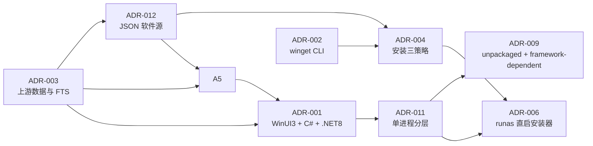
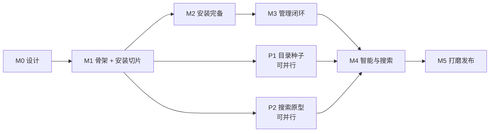

# 09 · 决策记录、路线图与开放问题

> 状态：草案 v0.3（设计阶段，未开发）
> **v0.4 补充（2026-10-19）**：新增 ADR-012（GitHub 托管 JSON 软件源与自定义订阅），并把来源身份、不可变快照、签名和回滚保护纳入 M1。
> **v0.3 变更（2026-10-18）**：架构改为**单一 C# 进程**（XAML 界面 + C# 业务逻辑，删除 Go）。ADR-007/008/010 **作废**；ADR-001/006/009 **重写**；新增 ADR-011（单进程分层）。路线图、开放问题、TBD、风险登记册、评审检查表同步更新。
> 本文是**全项目决策的索引**。各章节正文里出现的 `ADR-00x` 在这里汇总、编号去重、并标注状态；有冲突时以本文的裁决为准。

---

## 本章结论（TL;DR）

1. **9 条有效 ADR + 3 条作废**：有效的是 ADR-001（技术栈）、002（winget）、003（数据源）、004（安装策略）、005（AI）、006（提权）、009（部署形态）、011（单进程分层）、**012（JSON 软件源）**；作废的是 ADR-007、008、010（均为双进程架构的产物）。每条有效 ADR 都有「回退条件」。
2. **真正会翻车的只有三条**：ADR-004（第三方安装器不配合自定义路径）、ADR-009（体积从 20MB 涨到 40MB + 运行时依赖）、**ADR-006（提权边界削弱，`runas` 直启安装器后行为不可控）**。其余都有明确的工程解法。
3. **单进程架构的收益与代价都很清楚**：收益是「少一个运行时、无 IPC、单栈维护、调试直观」；代价是「丧失进程级崩溃隔离、丧失跨平台、托盘态内存必须驻留 60–110MB、提权可控性下降」。这些代价已在 docs/03 §3.3 与 docs/07 §2.2 逐条记录，**不粉饰**。
4. **路线图按「先证明难点，再做界面」排**：M1 就做安装引擎垂直切片 + 内存/托盘实测，而不是先堆首页——因为安装与资源是唯一可能推翻架构的部分。
5. **17 个开放问题（Q-x）** 中，**Q-6（是否接受 40MB + 运行时依赖）与 Q-17（无签名安装器不可提权）阻塞 M0 出口**；Q-2/3/4/7 已在设计过程中裁决。
6. **本文与各章节的关系**：ADR 正文在章节里，裁决与状态在本文。若冲突，以本文为准并在评审时修正章节。

---

## 1. 决策记录汇总

### 1.1 ADR 索引表

| ADR | 标题 | 归属章节 | 决策 | 状态 | 回退条件 |
|---|---|---|---|---|---|
| **ADR-001** | **UI 技术栈与部署形态** | docs/03 | **WinUI 3 + C# + .NET 8 LTS + 单进程 + unpackaged + framework-dependent**；MVVM 用 CommunityToolkit.Mvvm；数据层 `Microsoft.Data.Sqlite` + 手写 SQL | **已决策** | ① 内存 >220MB WS、② 启动 >3.0s、③ 体积 >60MB、④ WinUI 3 在某 Win10 版本失败率 >5% → **改 WPF**（同 C# 单栈） |
| ADR-002 | winget 集成方式 | docs/06 | CLI 子进程 + 结构化解析，预留 COM 适配器 | 已提议 | CLI 无法获得所需能力 → 切 COM API |
| ADR-003 | 上游数据与本地索引 | docs/05 | GitHub REST + 本地 SQLite FTS5（重叠二元组 + 拼音 + trigram）混合搜索；负责元数据刷新与检索，不定义目录分发协议 | 已提议 | FTS5 不可用 → 应用层倒排；GitHub 限流不足 → 更依赖已发布快照 |
| ADR-004 | 安装位置与绿色安装 | docs/06 | 三策略 + **能力探测前置**；`--location` 视为「请求而非保证」，以注册表 `InstallLocation` 为唯一真相 | 已提议 | 若 >40% 目标包不支持自定义路径 → 强化绿色安装与便携优先策展 |
| ADR-005 | AI 摘要提供商与隐私 | docs/05 | 提供商抽象；**默认关闭 AI**，入口始终可见；首选本地 Ollama；云端需显式开启 | 已提议 | 本地模型质量不足 → 默认云端但强制告知与脱敏 |
| **ADR-006** | **提权边界** | docs/06 + docs/07 | **主程序永不整体提权；需要时 `Verb="runas"` 直启安装器本体。硬规则：只有通过完整校验链（哈希 + 签名）的文件才允许 `runas`。** v0.2 的 `gs-elevate.exe` + 白名单动作 + HMAC plan **已移除** | **已决策** | 若「无签名安装器占比过高导致无法提权安装」成为用户主要抱怨 → 重新评估是否需要受限 helper（代价是重引入 IPC） |
| ~~ADR-007~~ | ~~核心层模块化单体 + 双进程外壳~~ | docs/02 | **作废**（单进程后无「双进程外壳」） | **Superseded by ADR-011** | — |
| ~~ADR-008~~ | ~~UI ↔ Core IPC 协议~~ | docs/02 | **作废**（无 IPC） | **Superseded by ADR-011** | — |
| ADR-009 | 部署形态 | docs/02 + docs/03 | **framework-dependent**（依赖 .NET 8 + Windows App SDK Runtime）+ unpackaged + 安装器引导运行时；NFR-1.4 修订为 **≤40MB** | **已决策** | 运行时缺失率过高 → self-contained（90–170MB，需重议 NFR-1.4） |
| ~~ADR-010~~ | ~~托盘归属 Core~~ | docs/02 | **作废**（托盘必须由本进程创建，见 docs/03 §3.5.2） | **Superseded by ADR-011** | — |
| **ADR-011** | **单进程分层架构** | docs/02 | **`App`（XAML/ViewModel）→ `Core`（业务服务）→ `Platform.Win32`（P/Invoke）三层，依赖方向单向，`Core` 不得引用 UI 与 Win32。** 取代 ADR-007/008/010 | **已决策** | 若本进程某非 UI 组件频繁导致崩溃且无法用异常边界隔离 → 考虑拆进程（代价：重引入 IPC）。**不要因为架构洁癖拆** |
| **ADR-012** | **GitHub 托管 JSON 软件源与自定义订阅** | docs/10 | **`source.json` 指向不可变完整快照；支持 HTTPS 自定义源；身份为 `SourceInstanceId + PackageId`；官方源公钥内置，第三方签名用指纹确认；禁止任意脚本和命令。** | **已决策** | 若完整快照在 20,000 条目录下超过可接受流量/导入时间 → 在保持签名、原子切换和回滚保护的前提下增加增量协议 |

> **读法**：
> - 有效 ADR 中 **001 / 004 / 006 / 009** 是「有真实代价」的决策。
> - **ADR-006 是 v0.3 唯一一条「安全上退步」的决策**——提权后的行为不再可控，只剩「谁被提权」这一道前置约束。它必须被评审者知道。
> - **ADR-011 取代了三条 ADR**（007/008/010），是本轮架构变更的核心。

### 1.2 决策之间的依赖关系

**关键依赖**：`ADR-001 → ADR-011 → {ADR-009, ADR-006}` 是主链。
- ADR-009 依赖 ADR-011：单进程只有一个产物，才有「framework-dependent + 自更新」这套方案。
- ADR-006 依赖 ADR-011：正因为单进程不再有独立的提权 helper，才必须改为直启安装器。

### 1.3 需要交叉评审的冲突点

| 编号 | 冲突 | 涉及章节 | 处理 |
|---|---|---|---|
| X-1 | 「极低内存」诉求与 WinUI 3 的资源现实冲突 | 00 / 03 | **已裁决**：接受内存不占优（浏览态 170MB WS 目标）；NFR-1.x 已按单进程口径修订 |
| X-2 | winget `--location` 限制与 FR-4.2「必须支持自定义路径」冲突 | 00 / 06 | 以 FR-4.5「能力可见化」化解：不支持则置灰，不算违约 |
| X-3 | 云端 AI 默认与 NFR-5.1「README 默认不出本机」冲突 | 05 / 07 | **已裁决**：默认关闭 AI，首选本地 Ollama，云端需显式开启 |
| X-4 | `Capability` 探测若需下载字节，与启动速度冲突 | 01 / 06 | 探测**惰性**执行：仅在详情页/安装前，不在目录刷新时 |
| X-5 | 性能基准若只测主进程，与旧「进程组」口径冲突 | 03 / 08 | **已裁决**：统一按单进程口径（docs/03 §3.5）；安装器子进程单独报告 |
| X-6 | 托盘图标需要本进程常驻，与低内存诉求冲突 | 02 / 03 / 04 | **已裁决**：默认隐藏到托盘（60–110MB），提供「关窗即退出」开关；NFR-1.1 = 110MB |
| X-7 | NFR-1.4（20MB）与 WinUI 3 的 .NET 依赖冲突 | 00 / 02 / 03 | **已裁决 ADR-009**：framework-dependent，NFR-1.4 修订为 ≤40MB；**Q-6 仍需负责人确认** |
| X-8 | 单进程丧失崩溃隔离 | 02 / 03 / 08 | **已裁决**：用「全局异常兜底 + journal 恢复 + 崩溃转储 + 崩溃率门禁」补偿；安装器仍在子进程（部分隔离保留） |
| X-9 | 提权边界削弱（`runas` 后不可控） | 06 / 07 | **已裁决 ADR-006**：用「只有校验通过才 runas」作为唯一防线；代价写入 RISK-07-3 |
| X-10 | 大量开源安装器无签名 → 无法提权安装 | 04 / 06 / 07 | **需产品注意**：这是 ADR-006 的副作用；UI 文案须前置说明（RISK-07-2） |

> **结论**：X-7 与 X-10 是两个需要**产品层面**（而非工程层面）接受的事实：前者是体积与运行时依赖，后者是「无签名软件装不到 Program Files」。它们不是 bug，是选择。

---

## 2. 路线图

### 2.1 里程碑与出口条件

| 里程碑 | 周期（估算） | 范围 | 出口条件（可验收） |
|---|---|---|---|
| **M0 设计** | 2 周 | 本文档集 | 9 条有效 ADR 有结论；**Q-6 与 Q-17 已拍板**；评审检查表 10 项全绿 |
| **M1 骨架 + 垂直切片** | 4 周 | 单进程三层骨架 + DI + 托盘（Win32 P/Invoke）+ 本地库 + **官方 JSON 源/HTTPS 自定义源完整快照同步** + 分类浏览 + **MSI/NSIS/ZIP 三类安装闭环** | 离线浏览 500 条；源刷新失败不污染活动快照；跨源同 ID 不覆盖；托盘态 ≤110MB WS；浏览态 ≤170MB WS；3 个真实包安装成功且路径选项无静默忽略；UI 全程可响应 |
| **M2 安装完备** | 3 周 | Inno/Burn/Squirrel/MSIX、winget 通道、校验链（`WinVerifyTrust`）、`runas` 提权、journal 恢复、发布者轮换白名单 | 6 类安装器全覆盖；故障注入通过（docs/08 §4）；安装成功率 ≥90%；**红线门禁 R1–R4 全绿** |
| **M3 管理闭环** | 3 周 | 已安装扫描（3 种注册表视图）、更新检查、卸载、三态区分、批量更新 | 更新/卸载闭环；外部安装项零误报；卸载残留有提示 |
| **M4 智能与搜索** | 3 周 | FTS5 + 拼音搜索、AI 摘要（默认关闭 + 本地 Ollama）、缓存与降级 | 搜索 P95 ≤50ms；摘要 Schema 校验通过率 ≥98%；离线模板可用 |
| **M5 打磨发布** | 3 周 | 自更新（独立签名 updater）、签名、性能达标、文案与无障碍、体积优化 | 全部 NFR 达标；安装包 ≤40MB；崩溃率 <0.1% |
| **M6 生态** | 持续 | 目录扩充、人工校正、云端 AI、导出导入 | 目录 ≥2000 条，Windows 可装率 ≥70% |

**总计（到 M5）**：约 18 周 ≈ 4.5 个月（1 人全职估算，含评审与缓冲）。团队 2–3 人可压缩到 11–13 周。

**与 v0.2 的差异**：M1 仍是 4 周，但内容从「双进程骨架 + IPC 握手 + Go 托盘」变为「单进程三层 + DI + Win32 托盘」。**工作量相近，风险更低**——因为 C# 单栈不需要跨语言调试。

### 2.2 为什么 M1 先做安装而不是先做首页

| 理由 | 说明 |
|---|---|
| 风险最高 | 安装引擎是唯一可能推翻架构（改架构/换框架）的部分，越早暴露越好 |
| 可独立验证 | 不需要漂亮的 UI 就能证明「能装、能装对地方、装错能回滚」 |
| 决定数据模型 | `Capability`/`InstallPlan`/`InstallRecord` 的形状由安装引擎倒推，先做界面会返工 |
| **验证资源承诺** | 「省资源」是产品卖点，必须在 M1 就实测，而不是 M5 才发现超预算 |
| 用户价值密度高 | 即使界面粗糙，能装软件就已经有用；反之漂亮但装不上则毫无价值 |

### 2.3 关键路径与并行

> **结论**：目录种子与搜索原型可以从 M1 起并行，因为它们不依赖安装引擎；但 **AI 摘要要等到 M4**，因为它依赖稳定的详情页与缓存层，过早做会返工。

---

## 3. 开放问题（需拍板）

| 编号 | 问题 | 选项 | 建议 | 状态 / 阻塞 |
|---|---|---|---|---|
| **Q-6** | **是否接受 WinUI 3 的代价：安装包 ≤40MB + 需装 .NET / Windows App SDK 运行时** | 接受 / 重新评估技术栈 | **必须负责人明确拍板**；这是 WinUI 3 的必然代价（ADR-009） | **未决 · 阻塞 M0 出口** |
| Q-1 | 首版是否包含 winget 通道 | 只 HTTP / 两条都做 | 两条都做，winget 作为「无资产兜底」 | 未决 · M2 |
| Q-2 | AI 摘要默认行为 | 默认关闭 / 默认本地 / 默认云端 | **已裁决**：默认关闭 + 入口始终可见 + 首选本地 Ollama | 已裁决 |
| Q-3 | 是否内置种子目录 | 内置 SQLite / 内置 JSON / 纯联网 | **已裁决**：随包内置官方源已审核快照的 gzip 子集（≤1.5MB，500 条），首启导入 SQLite；联网后按 ADR-012 完整快照升级 | 已裁决 |
| Q-4 | 托盘常驻 vs 关窗即退 | 常驻 / 关窗即退 | **已裁决**：默认隐藏到托盘，设置可切「关窗即退出」 | 已裁决 |
| Q-5 | 是否上架 winget 分发自身 | 是 / 否 | 是（我们分发自己，与被安装的第三方包无关） | 未决 · 不阻塞 |
| Q-7 | 是否允许「签名缺失继续安装」 | 允许+标红 / 完全禁止 | **已裁决**：允许 + 强制二次确认 + 标红；**但不可提权**；哈希不符或签名无效 → 硬失败，无开关 | 已裁决 |
| Q-8 | 默认安装根目录 | `%LOCALAPPDATA%\Programs` / `C:\Program Files` | `%LOCALAPPDATA%\Programs`（免 UAC） | 未决 · M1 |
| Q-9 | 摘要是否落库共享 | 落库 / 仅内存 | 落库（省重复计费），可清空 | 未决 · 不阻塞 |
| Q-10 | 是否支持多用户共享安装 | 是 / 否 | 否（v1 单用户） | 未决 · 不阻塞 |
| Q-11 | 目录是否允许用户提交 | 是 / 否 | v1 否（避免审核负担），v2 再议 | 未决 · 不阻塞 |
| Q-12 | 更新检查频率 | 每次启动 / 每日 / 手动 | 每日 + 手动，启动时只读缓存 | 未决 · 不阻塞 |
| Q-13 | 是否提供 CLI | 是 / 否 | v1 否（**且范围外清单已明确禁止无 UI 静默安装入口**） | 未决 · 不阻塞 |
| Q-14 | 绿色安装默认根 | `%LOCALAPPDATA%\GitHubStore\installs` / 用户选 | 前者（可在设置改） | 未决 · 不阻塞 |
| Q-15 | 遥测 | 零遥测 / 可选匿名 | 零遥测默认 + 可选匿名（逐项开关） | 未决 · 不阻塞 |
| Q-16 | 是否支持预发布版本安装 | 是 / 否 | 是，但默认折叠且标红 | 未决 · 不阻塞 |
| **Q-17** | **无签名开源安装器无法提权安装（无法装到 Program Files）是否可接受** | 接受 / 放宽规则 | **建议接受**——这是 ADR-006 的必然结果；放宽会摧毁 §2.5 的唯一防线。但**必须在产品文案与 FAQ 中前置说明** | **未决 · 建议 M0 一并拍板** |

> **结论**：**Q-6 与 Q-17 建议在 M0 出口一并拍板**——它们都是「接受代价」型问题，且都是 WinUI 3 + 单进程架构的必然结果。其余可延后到对应里程碑。

---

## 4. 待验证清单汇总（TBD）

> 各章节的 TBD 在此汇总去重。**验证方法**列写清「怎么验、验到什么程度算过」，避免「已关注」式空转。

| TBD | 内容 | 章节 | 验证方法 | 判定阈值 | 阻塞里程碑 |
|---|---|---|---|---|---|
| TBD-01-1 | `Microsoft.Data.Sqlite` 是否内置 FTS5 + trigram | 01/05 | 建虚拟表 + 中文查询 | 能建表并命中 | **M4** |
| TBD-01-2 | trigram 对 2 字中文查询的命中率 | 01/05 | 构造 100 条中文名，查询「截图/下载/压缩」 | 召回 ≥90% | M4 |
| TBD-01-3 | 仓库改名后 API 的重定向行为 | 01/05 | 取已知改名仓库，观察 `full_name` 与 301 | 能识别并更新本地 ID | M3 |
| TBD-01-5 | 枚举落库为 `INTEGER` 后插入新成员的兼容性 | 01 | 断言显式数值与文档一致 | 无顺序依赖 | M1 |
| **TBD-02-1** | **WinUI 3 单进程三态 WS/PM 实测** | 02/03 | 建空项目逐步加功能，每步 5 min 稳态 P95 | 浏览态 ≤170MB WS | **M1** |
| TBD-02-2 | 托盘隐藏后视觉树是否真正释放 | 02/03 | `Hide()` vs 导航空页 vs 清空 ItemsSource | 隐藏后 ≤110MB WS | **M1** |
| **TBD-02-3** | **`WaitForExitAsync` 在子进程挂起、stdio 未消费时的行为** | 02/03 | 构造挂起安装器实测 | 超时能被识别并终止 | **M1** |
| TBD-02-4 | framework-dependent vs self-contained 真实体积 | 03 | `dotnet publish` 两种模式 | framework-dependent ≤40MB | M5 |
| TBD-02-5 | Windows App SDK Runtime 在 Win10 1809+ 的可用性 | 02 | 兼容矩阵测试 | 失败率 <5% | M1 |
| TBD-02-6 | `PublishSingleFile` 对首启的影响 | 03 | 对比发布 | 差异 <300ms | P2 |
| TBD-03-8 | `ThreadPool.SetMinThreads(16)` 的实际效果 | 03 | 并发基准对比默认值 | 无饥饿 | M1 |
| TBD-03-12 | 安装器等待取消、宿主崩溃与重启对账正确性；Job Object 仅回收自有辅助进程 | 03/06 | 故障注入后核对 journal、注册表与任务状态 | 不强杀真实安装器且可收敛到确定状态 | M1 |
| TBD-05-1 | GraphQL 批量 `nodes(ids:)` 的实际点数成本 | 05 | 实测 `rateLimit.cost` | 50 个一组是否最优 | M3 |
| TBD-05-6 | Ollama 3B 在目标机器的耗时与内存 | 05 | 基准测试 | 决定默认模型规模 | M4 |
| TBD-05-7 | 拼音库选型（`TinyPinyin.Net`/`NPinyin`/`ToolGood.Words`） | 05 | 评估维护状态、体积、多音字 | 体积 <100KB 且首字母命中 | M4 |
| TBD-05-11 | 500 条快照 gzip 后能否 ≤1.5MB | 05 | 真实数据实测 | ≤1.5MB | M1 |
| TBD-05-12 | 首启导入 500 条的耗时 | 05 | 冷机 + 机械盘各测 10 次 | 100–300ms | M1 |
| TBD-06-1 | winget `--location` 在各包上的真实行为 | 06 | 对 10 个不同类型包实测 | 记录支持/忽略/报错三类 | **M2 开工** |
| TBD-06-2 | winget COM API 可用性与部署要求 | 06 | 原型验证 | 能在无 CLI 环境调用 | M2（若 CLI 不足） |
| TBD-06-6 | 各安装器静默参数在真实包上的表现 | 06 | 每类 3 个包实测 | 静默成功率 ≥90% | **M2 开工** |
| TBD-06-4 | winget 退出码全集 | 06 | 收集实际错误样本 | 覆盖 Top 20 | M2 |
| TBD-06-5 | MSIX 自定义路径是否完全不可能 | 06 | 实测 `Add-AppxPackage -ExternalLocation` | 记录可用条件 | M2 |
| TBD-06-13 | 发布者轮换白名单的下发签名方案 | 06/07 | 构造篡改/缺失/过期三用例 | 均 fail-closed | M2 |
| **TBD-07-7** | **`Verb="runas"` 时能否可靠拿到 `Process.ExitCode`** | 06/07 | 写测试 exe，runas 启动后读取 | 能读到正确码 | **M2 开工** |
| **TBD-07-8** | **`UseShellExecute=true` 时 `ArgumentList` 对含空格/引号参数的转义** | 06/07 | MSI `TARGETDIR="C:\a b\c"` 实测 | 路径正确 | **M2 开工** |
| TBD-07-1 | `WinVerifyTrust` 在各类签名状态下的返回值 | 07 | 构造 5 类样本文件 | 与 §4.3 矩阵一致 | M2 |
| TBD-07-2 | GitHub asset `digest` 的实际覆盖率 | 07 | 抽样 200 个 Release | 记录覆盖率 | M2 |
| TBD-07-3 | `ProtectedData` 在 .NET 8 + 裁剪下的可用性 | 07 | 发布裁剪版跑 DPAPI 往返 | 可用 | M2 |
| TBD-07-11 | 同用户进程读本进程内存的可行性（用于措辞） | 07 | Sysinternals PoC（仅测试用） | 确认 §6.3 措辞准确 | M2 |
| TBD-08-3 | FlaUI / WinUI 3 UIA 对 WinUI 3 的控件支持度 | 08 | PoC 测 5 个关键控件 | 可自动化 | **M2 开工** |
| TBD-08-8 | UI 响应性断言（B-13）的实现方式 | 08 | `DispatcherQueue` 队列深度或输入延迟 | 可测且稳定 | **M1** |
| TBD-08-10 | 三方策略比对（docs/01/07/fixture）的自动化 | 08 | 写文档解析 + 比对脚本 | 不一致即失败 | M2 |
| TBD-08-13 | Roslyn 分析器（R3）自身测试框架可用性 | 08 | PoC | 能注入违规代码并报错 | M2 |

> **结论**：**M1 的三条（TBD-02-1/02-2/02-3）是「架构成立性」验证，必须最先做**；**M2 开工前的两条（TBD-07-7/07-8）是「runas 方案成立性」验证**，如果 `runas` 拿不到可靠退出码或参数转义错误，ADR-006 需要回退。

---

## 5. 风险登记册

| 编号 | 风险 | 概率 | 影响 | 等级 | 应对 |
|---|---|---|---|---|---|
| RISK-001 | **第三方安装器不支持自定义路径** | 高 | 高 | **红** | 能力探测前置 + 明确文案 + 绿色安装兜底（ADR-004） |
| RISK-002 | **误判 origin 导致卸载用户自装软件** | 中 | **极高** | **红** | 证据链判定 + 单向保守 + 卸载前指纹复核（docs/06 §7.5） |
| RISK-003 | 提示注入导致错误说明 | 中 | 中 | 黄 | docs/07 §7 十项控制 |
| RISK-004 | **红线被「合理化」绕过** | 中 | **极高** | **红** | docs/08 §9 四道门禁 + docs/07 §11.2 治理条款 |
| RISK-005 | 杀软误报（下载+执行安装器） | 高 | 中 | 黄 | 代码签名 EV；提交白名单；行为可解释 |
| RISK-006 | winget 输出本地化/版本差异导致解析失败 | 中 | 中 | 黄 | 固定 locale；版本探测；降级到 COM |
| RISK-007 | 安装中崩溃导致半装状态 | 中 | 中 | 黄 | SQLite journal + `Partial` 状态 + 用户可介入 |
| RISK-008 | 目录质量差（收录了装不了的仓库） | 高 | 中 | 黄 | 收录规则 + `WindowsReady` 标记 + 人工抽查 |
| RISK-009 | 维护者停止维护后目录腐化 | 中 | 中 | 绿 | 归档检测 + 自动下架 |
| RISK-010 | 仓库改名/转移导致 ID 断裂 | 中 | 低 | 绿 | `app_id_redirects` 表 |
| RISK-011 | 团队人力不足导致文档与实现脱节 | 中 | 中 | 绿 | ADR 驱动 + 每里程碑更新文档 |
| **RISK-012** | **UI 线程被同步等待卡死** | 中 | **极高** | **红** | VSTHRD 分析器（编译期）+ B-13 响应性探针 + code review |
| **RISK-013** | **单进程崩溃率高于双进程** | 中 | 高 | 黄 | 三层全局异常兜底 + 崩溃转储 + 崩溃率门禁 <0.1% |
| **RISK-014** | **`runas` 提权后行为不可控** | 中 | 高 | 黄 | 仅「校验通过才 runas」一道防线；**接受为已知风险**（ADR-006 代价） |
| **RISK-015** | **无签名安装器无法提权安装**（大量开源软件受影响） | **高** | 中 | 黄 | 产品文案前置说明；引导绿色/用户目录安装；**不放宽规则**（Q-17） |
| **RISK-016** | **托盘态内存驻留 60–110MB 被用户抱怨** | 中 | 中 | 黄 | 提供「关窗即退出」开关；文档说明代价 |
| **RISK-017** | **ViewModel 事件订阅泄漏导致内存持续增长** | 中 | 中 | 黄 | §13.3 退订规范 + TBD-04-9 泄漏实测 + code review |
| **RISK-018** | **安装器子进程挂起/僵尸** | 中 | 中 | 黄 | 心跳超时 + Job Object + 用户可放弃等待 |

**红色风险（4 条）**：RISK-001、RISK-002、RISK-004、RISK-012。每条必须有 owner 与验证计划。

---

## 6. 设计评审检查表

> 用于 M0 出口评审。任一项不通过则 M0 不通过。

| # | 检查项 | 通过标准 |
|---|---|---|
| 1 | 需求可追溯 | 每条 FR 至少被一个模块覆盖，无孤儿需求 |
| 2 | 非功能可验收 | 每条 NFR 有明确测量方法与阈值（**含 WS/PM 双口径、单进程口径**） |
| 3 | ADR 完备 | **9 条有效 ADR** 均有决策、理由、后果、回退条件；3 条作废的已标注 `Superseded` |
| 4 | 契约一致 | `docs/01` 的 C# 类型名在各章节无冲突；`VerifyPolicy` 枚举拼写全项目一致（`Proceed`/`WarnConfirm`/`HardFail`） |
| 5 | 风险有主 | **4 条**红色风险各有 owner 与验证计划 |
| 6 | 开放问题收敛 | **Q-6 与 Q-17 已拍板**（两者均为「接受代价」型）；其余有明确期限 |
| 7 | 可行性 | 至少完成一次「3 个真实包安装」的技术预演（可手工，不需代码） |
| 8 | 范围清晰 | 范围外清单被认可（含「无静默安装入口」「无忽略校验开关」） |
| 9 | **架构成立性** | **TBD-02-1 / 02-2 / 02-3 已排期且方法明确**（WinUI 3 基线内存、托盘隐藏释放、子进程挂起） |
| 10 | **安全红线冻结** | **docs/07 §4.3 判定矩阵 + §11.1 三个入口 + §11.2 治理条款已在 docs/06/08 落地为可执行检查** |

---

## 7. 文档维护约定

| 约定 | 说明 |
|---|---|
| 编号不复用 | 删除的需求保留编号并标注「已废弃」，新需求往后排 |
| ADR 不可改，只可增 | 推翻旧决策 = 新增一条 ADR 并标旧条 `Superseded by ADR-xxx`（本轮 ADR-007/008/010 即按此处理） |
| 每次里程碑更新 | 更新路线图状态、TBD 结论、风险等级 |
| 单一真源 | 类型与接口只在 docs/01 定义；其它章节引用不复制 |
| 文档即验收 | M0 出口 = 本文 §6 检查表全绿 |
| **架构变更必须全链更新** | 本轮「Go 双进程 → C# 单进程」变更触及 8 个文档，任何类似变更必须同步更新：ADR、类型、NFR、风险、TBD、评审表 |

---

## 8. 与其它章节的接口

- 本文**裁决**其它章节的 ADR 冲突（§1.3）。
- 本文 §4 的 TBD 编号由各章节提出，汇总后统一追踪。
- 本文 §5 的风险与各章节 `RISK-xx` 一一对应；章节内编号形如 `RISK-02-1`，本文用全局 `RISK-0xx`，映射关系在评审时登记。
- 路线图（§2）与 `docs/00` §6 的里程碑映射一致，冲突以本文为准。
- **v0.3 特别说明**：本轮架构变更的完整影响面见 §1.1 的 ADR 状态表（3 条作废 + 3 条重写 + 1 条新增），以及各章节的 `v0.3 变更` 说明。
